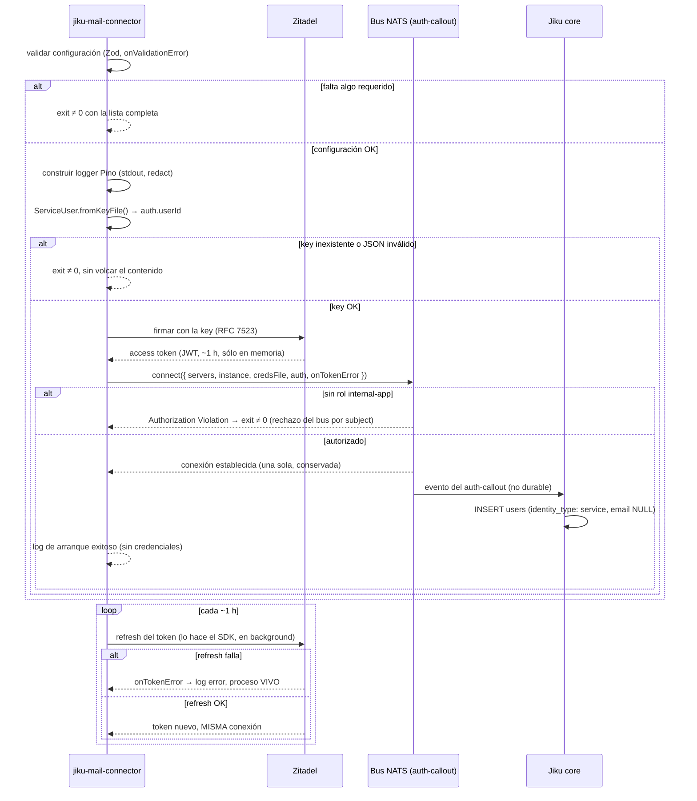

# Arranque y Conexión al Bus

**Tipo:** Evento
**Status:** Draft
**Creado:** 2026-08-27
**Última actualización:** 2026-08-27 (S-002: Paso 1 implementado)
**Stories:** S-002, S-003, S-004

## Descripción

Flujo completo del arranque del `jiku-mail-connector`, desde la validación de su configuración hasta
la conexión establecida con el bus NATS de Jiku. Se dispara al iniciar el proceso (`npm run start` o
el `CMD` del contenedor). Cubre la validación fail-fast de la configuración, la construcción del
logger, la construcción de la identidad desde la key del machine user, el único `connect()` del
proceso, y el **efecto lateral no provocado** de que Jiku cree la fila del conector en `users`.

Este flujo **no publica ningún comando**: deja el proceso vivo con un cliente conectado. La
publicación es del flujo [publicacion-requirements-new](publicacion-requirements-new.md).

## Servicios Involucrados

| Servicio | Rol | Tipo de Participación |
|----------|-----|-----------------------|
| jiku-mail-connector | Valida su configuración, construye identidad y conexión | Iniciador |
| Zitadel | Emite el access token (JWT con claim de roles) a partir de la key firmada | Procesador |
| Bus NATS + auth-callout | Evalúa el token al conectar y autoriza los subjects de la identidad | Procesador |
| Jiku (`core`) | Consume el evento del auth-callout y crea la fila del conector en `users` | Consumidor |

## Pasos del Flujo

### Paso 1: Validar la configuración

**Origen:** jiku-mail-connector
**Destino:** (interno)
**Tipo:** Interno

**Acción:** `src/config/env.ts` — el **único** módulo que toca `process.env` — valida con
`createEnv({ ..., onValidationError })` de `@t3-oss/env-core` + Zod. El handler recibe **todos** los
issues en una sola invocación y lanza `ConfigValidationError` una sola vez con la lista completa.

> **Corregido en S-002.** La opción `emitErrors: true` que este paso documentaba no existe en
> `@t3-oss/env-core@0.13.11`; la API real es `onValidationError`. La agregación de issues que el paso
> describe se mantiene igual — se verificó que con varias variables inválidas el handler se invoca una
> vez con todas. Lo que no sirve es el handler *por defecto*: parte el reporte en un `console.error`
> con el array crudo de issues y un `Error` genérico sin ningún nombre adentro, así que el conector
> aporta el suyo (`src/config/errors.ts`), que nombra las variables y nunca interpola valores.

**Variable del `projectId` de prueba:** se llama `JIKU_VERIFY_PROJECT_ID` (fijado en S-002). Es el
proyecto de **Jiku** (entero) del modo de verificación, y no debe confundirse con `JIKU_PROJECT_ID`,
que es el project de **Zitadel** (UUID).

**Composición con el SDK:** la configuración del bus se lee con `loadConfig()` del SDK, invocado
dentro de `src/config/index.ts`, y su resultado se compone con el `env` validado en un único
`AppConfig`. El `env` se valida **antes** de llamar a `loadConfig()`, porque este último lee el
filesystem y CA-2 exige fallar sin intentar nada antes.

**Variables del alcance:**

| Variable | Requerida | Default |
|---|---|---|
| `JIKU_CREDS` | Sí | — |
| `JIKU_KEY_FILE` | Sí | — |
| `JIKU_PROJECT_ID` | Sí | — |
| `JIKU_VERIFY_PROJECT_ID` | Sí | — |
| `JIKU_INSTANCE` | No | `dev` |
| `JIKU_SERVERS` | No | `nats://localhost:4222` |
| `JIKU_ISSUER` | No | `https://id.grava.io` |
| `JIKU_TIMEOUT` | No | `15000` (**piso**, no baja) |
| `LOG_LEVEL` | No | `info` |

Las variables de **IMAP y del Mapa de Tickets no se declaran todavía** (FG-2 y FG-3).

La configuración del bus se lee con `loadConfig()` del SDK, invocado **dentro de `src/config/`** para
no duplicar sus defaults ni romper el punto de lectura único.

**Ref:** S-002; ADR-002; convención `env-config`

---

### Paso 2: Construir el logger

**Origen:** jiku-mail-connector
**Destino:** (interno)
**Tipo:** Interno

**Acción:** `src/shared/logger.ts` construye **una** instancia de Pino con destino **stdout**, nivel
tomado de `LOG_LEVEL`, `pino-pretty` sólo con `NODE_ENV === 'development'` y JSON en producción, y
`redact` con `censor: '[REDACTED]'` sobre credenciales, tokens y contenido de key/creds.

**Por qué antes de conectar:** el arranque y **cada fallo de conexión** ya tienen que salir por un
logger que redacta. Un logger agregado después dejaría sin cubrir el tramo más sensible.

**Ref:** S-003; convención `logging`; NFR-O01, NFR-S06

---

### Paso 3: Construir la identidad desde la key

**Origen:** jiku-mail-connector
**Destino:** (interno — lee un archivo montado read-only)
**Tipo:** Interno

**Acción:** `ServiceUser.fromKeyFile(keyFile, { issuer, projectId })`. El `user-id` que irá en el
subject sale de `auth.userId`, **derivado de la key y nunca del entorno** (invariante 17).

**Ref:** S-004; ADR-005; NFR-S03

---

### Paso 4: Obtener el access token

**Origen:** jiku-mail-connector
**Destino:** Zitadel
**Tipo:** REST (HTTPS, RFC 7523)

**Acción:** el SDK firma con la key y obtiene el access token — un JWT con claim de roles, ~1 h de
vida. El conector **no implementa nada** del intercambio.

**Response (éxito):** access token, **sólo en memoria**. Nunca a disco, nunca al log. El SDK lo expone
como **getter, no como string**.

**Ref:** S-004; ADR-005; NFR-S02

---

### Paso 5: Conectar al bus

**Origen:** jiku-mail-connector
**Destino:** Bus NATS + auth-callout
**Tipo:** Interno (conexión NATS vía SDK)

**Acción:** `connect({ servers, instance, credsFile, auth, onTokenError })` — **exactamente una vez**.
El cliente resultante se conserva por toda la vida del proceso. El callout evalúa el token **al
conectar** y NATS **no revalida** después. `onTokenError` queda registrado.

**Response (éxito):** cliente conectado. Una línea de log de arranque exitoso, **sin ninguna
credencial**.

**Ref:** S-004; ADR-002; C-14, NFR-P05

---

### Paso 6: Jiku crea la fila del conector en `users` (efecto lateral)

**Origen:** Bus NATS (auth-callout)
**Destino:** Jiku (`core`)
**Tipo:** Evento

**Evento consumido:** el evento del auth-callout de la primera autenticación de esta identidad.

**Operación de BD:**
- **Tabla:** `users` (base de Jiku)
- **Operación:** INSERT
- **Campos:** `identity_type: service`, `email` en `NULL`

**El conector no la crea ni la pide** (G-03, ADR-005). La **verifica**, no la provoca. La entrega de
este evento **no es durable** (NATS sin JetStream): si se pierde, el conector queda sin fila hasta su
próxima autenticación, y reconectar lo resuelve.

**Ref:** S-004 CA-9, CA-16 de S-005; ADR-005

---

### Paso 7: Refresh del token en background

**Origen:** jiku-mail-connector (SDK)
**Destino:** Zitadel
**Tipo:** REST (HTTPS), recurrente

**Acción:** el SDK renueva el token al acercarse su expiración y actualiza el valor que el getter
devuelve. **La misma conexión sigue en uso** — no se abre una segunda.

**Si falla:** el callback `onTokenError` loguea `error` y **el proceso sigue vivo**. El token vigente
sigue sirviendo; lo que se rompe es el próximo reconnect.

**Ref:** S-004; C-15, NFR-R04

## Manejo de Errores

| Paso | Error | Código | Response | Comportamiento |
|------|-------|--------|----------|---------------|
| 1 | Faltan variables requeridas | — | Lista **completa** en un solo mensaje | **No arranca**, exit ≠ 0. No conecta a nada |
| 1 | Valor con forma inválida | — | Entra en la lista agregada, **sin volcar el valor** | **No arranca**, exit ≠ 0 |
| 2 | Falla el transporte de desarrollo | — | — | Se degrada a JSON en stdout: un worker sin logs es indiagnosticable |
| 3 | Key inexistente o JSON mal formado | — | "la key no se pudo cargar", **sin volcar su contenido** | **No arranca**, exit ≠ 0 |
| 4 | Zitadel rechaza la firma o es inalcanzable | — | Clase del SDK + `hint()` | **No arranca**, exit ≠ 0 |
| 5 | Machine user **sin** rol `internal-app` | `Authorization Violation` / `JikuPermissionDenied` | Log: **rechazo del bus por subject** — problema de **Zitadel**, no del payload | **No arranca**, exit ≠ 0 |
| 5 | Bus inalcanzable (red) | — | Clase del SDK + `hint()` | **No arranca**: el proceso no queda vivo en un estado inútil |
| 6 | Se pierde el evento del auth-callout | — | — | El conector queda sin fila en `users` hasta su próxima autenticación. Reconectar lo resuelve. **Dependencia declarada del producto, no un bug del conector** |
| 7 | Falla el refresh del token | — | Log `error` con clase y `hint()` | **El proceso NO muere** (NFR-R04). El token vigente sigue sirviendo |

**Regla que gobierna la tabla:** un fallo **al arrancar** es fatal; un fallo del refresh **en
background** no lo es. Son dos momentos distintos y las dos reglas conviven.

## Resultado

**Éxito:** un proceso vivo con **exactamente una** conexión al bus, y una línea de log de arranque
exitoso en stdout **sin ninguna credencial**.

**Estado final:**
- Proceso: vivo, con una conexión conservada por toda su vida
- Access token: en memoria, refrescándose en background
- Fila del conector en `users` de Jiku: creada por Jiku sola, `identity_type: service`, `email` en
  `NULL`
- Logs: estructurados en stdout (JSON en producción). **Ningún archivo escrito**

## Notas

- **Exactamente una conexión por proceso, no una por operación** (NFR-P05): conectar cuesta un
  round-trip a Zitadel más el handshake que corre el auth-callout.
- El token se entrega **como getter, no como string** (patrón 5 del PRD): es lo que permite que el
  refresh en background no requiera reconectar.
- **Las cinco precondiciones de este flujo son manuales y no verificables por código** (machine user,
  rol `internal-app`, key JSON, creds, red al bus). Son de U-02, no del software. Lo que el conector
  aporta es que **cada fallo diga cuál de los sistemas lo produjo**.
- **Los tests no cubren este flujo de punta a punta:** `Client.fromConnection()` **saltea el handshake
  de auth**, así que no prueba nada sobre Zitadel, el rol ni el prefijo de inbox. La verificación real
  sólo ocurre contra un despliegue.
- El rol `internal-app` concede **los dos planos completos** para un conector que usa 1 comando y
  ninguna consulta. Acotarlo modificaría el producto (G-03): fuera de alcance v1, **no descartado**.
