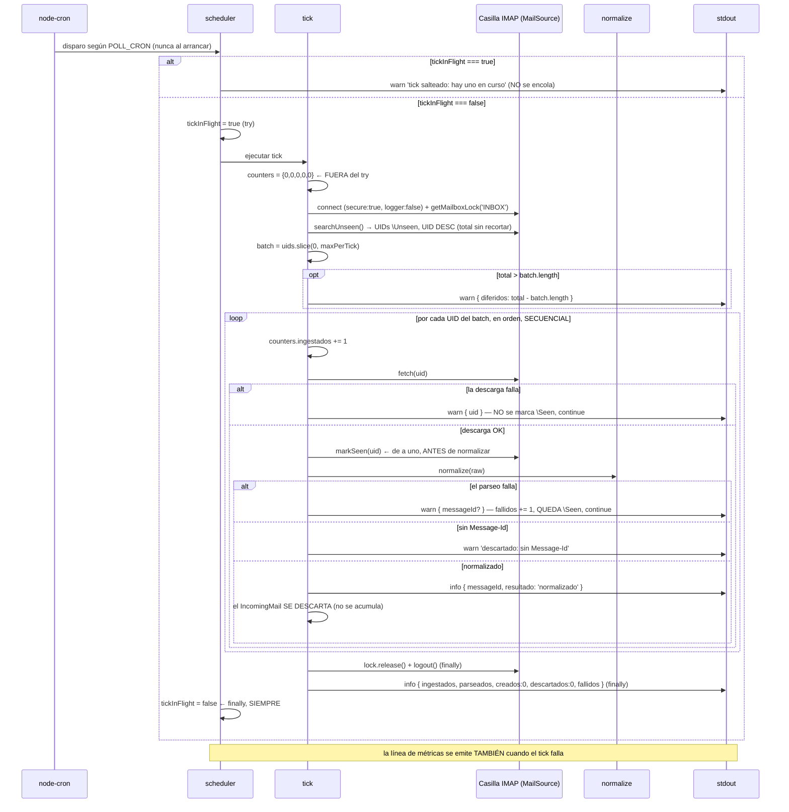

# Ingesta y Normalización del Mail

**Tipo:** Evento (scheduled)
**Status:** Draft
**Creado:** 2026-08-27
**Última actualización:** 2026-08-27 (creado desde REQ-002, antes de la implementación)
**Stories:** S-007, S-008, S-009, S-010, S-011

## Descripción

El tick completo del `jiku-mail-connector`, de punta a punta. Se dispara por `node-cron` según
`POLL_CRON` — **nunca al arrancar**: el primer tick espera al primer disparo del cron.

El tick conecta a la casilla sobre TLS, toma el lock de `INBOX`, busca los mensajes `\Unseen`, los
ordena de más nuevo a más viejo y toma los primeros N según `POLL_MAX_PER_TICK`. Por cada mensaje
tomado: descarga los bytes crudos, **marca `\Seen` de inmediato si la descarga fue exitosa**,
normaliza el mail a la forma de trabajo, loguea el resultado y **descarta el objeto**.

**El log es el único resultado observable.** Nada se persiste, nada se publica al bus y `core` no se
entera de que este flujo existe. En este alcance el pipeline **termina en el mail normalizado**: el
ruteo, la extracción del slug y la publicación son de FG-3.

**La casilla IMAP es el único actor externo.** Ni Jiku, ni el bus NATS, ni Zitadel participan de este
flujo — se puede verificar de punta a punta **sin una instancia de Jiku corriendo**.

## Servicios Involucrados

| Servicio | Rol | Tipo de Participación |
|----------|-----|-----------------------|
| jiku-mail-connector (`scheduler`) | Guarda el no solapamiento y libera el indicador siempre | Iniciador |
| jiku-mail-connector (`tick`) | Aplica el cap, el orden, el marcado, el aislamiento de fallos y los contadores | Procesador |
| jiku-mail-connector (`src/infra/imap`) | Adaptador del puerto `MailSource` sobre `imapflow` | Procesador |
| jiku-mail-connector (`normalize`) | Funciones puras: headers, cuerpo y adjuntos a `IncomingMail` | Procesador |
| Casilla IMAP | Entrega los mensajes `\Unseen` y persiste el flag `\Seen` | Fuente externa (única) |
| stdout | Recibe la línea por mail y la línea de métricas del tick | Consumidor |

## Pasos del Flujo

### Paso 1: Guard de no solapamiento

**Origen:** node-cron
**Destino:** `src/domain/ingesta/scheduler.ts`
**Tipo:** Interno

**Trigger:** disparo del cron según `POLL_CRON`. **No hay tick inmediato al arrancar** (S-011 CA-2).

- Si `tickInFlight === true` → `logger.warn({}, 'tick salteado: hay uno en curso')` y **retorna**. El
  disparo salteado **no se encola**.
- Si `tickInFlight === false` → lo pone en `true` y entra al `try`.
- El `finally` lo devuelve a `false` **siempre**, incluso si el tick lanzó.

**Por qué el `finally` no es opcional:** un indicador que no se libera detiene la ingesta **para
siempre** sin que el proceso muera, y en un worker sin healthcheck (ADR-006) **no tiene síntoma**. Es
el fallo más caro del alcance.

**Ref:** S-011 CA-5, CA-6, CA-7; REQ-002 RF-8 y RF-9, Riesgo 1

---

### Paso 2: Conexión TLS y lock de `INBOX`

**Origen:** `tick`
**Destino:** Casilla IMAP (vía `src/infra/imap`)
**Tipo:** Interno (adaptador del puerto `MailSource`)

**Antes de nada:** `TickCounters` se inicializa **fuera del `try`**, para que el `finally` pueda
emitir la línea de métricas aunque el tick falle acá mismo.

- `new ImapFlow({ host, port, secure: true, auth: { user, pass }, logger: false })`
  - `secure: true` **incondicional**: no hay opción de texto plano.
  - `logger: false` **incondicional**: el default de `imapflow` emite el tráfico crudo, que incluye el
    `LOGIN`. NFR-S06 no puede depender del default de una dependencia.
- `await client.connect()` → `await client.getMailboxLock('INBOX')`
- `INBOX` es **constante del módulo**, no variable de entorno.

**Ref:** S-009 CA-4, CA-5, CA-6; REQ-002 RF-4, RF-12, RF-38

---

### Paso 3: Buscar, ordenar y aplicar el cap

**Origen:** `tick`
**Destino:** Casilla IMAP
**Tipo:** Interno

- `searchUnseen()` → `client.search({ seen: false })`: **únicamente** los `\Unseen`.
- Ordena **UID descendente** — por **UID**, no por el header `Date`, que es dato del cliente y puede
  venir mal.
- `const total = uids.length; const batch = uids.slice(0, maxPerTick);`
- Si `total > batch.length` → `logger.warn({ diferidos: total - batch.length }, ...)` **con el
  número**. Los diferidos siguen `\Unseen` y los toma el próximo tick.

**El recorte vive en el tick, no en el adaptador:** `searchUnseen()` devuelve el **total sin
recortar** justamente para que el contador de diferidos sea observable.

**Ref:** S-009 CA-7, S-010 CA-2 y CA-3; REQ-002 RF-13, RF-14, RF-15; ADR-006

---

### Paso 4: Por cada mensaje — descargar, marcar, normalizar, descartar

**Origen:** `tick`
**Destino:** Casilla IMAP + `normalize`
**Tipo:** Interno

Los mensajes se recorren **en el orden del `batch`** (más nuevo primero) y **secuencialmente**, un
mail a la vez, sin paralelismo (Arq-14).

1. `counters.ingestados += 1`
2. `fetch(uid)` → si **lanza**: `logger.warn({ uid }, ...)`, **no se marca `\Seen`**, `continue`. El
   próximo tick lo reintenta.
3. `markSeen(uid)` **inmediatamente después de la descarga exitosa**, de a uno — **nunca en lote al
   final del tick**.
4. `normalize(raw)` → produce un `IncomingMail`:
   - `messageId` — **el único campo obligatorio**. Sin él, el mail se **descarta con warn** que dice
     que fue por eso.
   - `referenceIds` — unión deduplicada de `In-Reply-To` y `References`, en orden de aparición. **El
     tick no decide nada con ese dato.**
   - `recipient` — primer `Delivered-To`, con `To` como fallback. **Crudo**, sin extraer slug. Vacío
     es válido.
   - `senderEmail` — aislado de `Nombre <mail@dominio>`. Nadie lo lee en v1 y **no se loguea**.
   - `subject` — sin `Re:`/`Fwd:`/`RV:`, quitados iterativamente y sin distinguir mayúsculas. Vacío
     es válido.
   - `body` — texto plano con el texto citado recortado (heurística best-effort). El texto plano gana
     sobre el HTML; el HTML se convierte **sólo** si no hay parte de texto. Vacío es válido.
   - `attachments[]` — `filename`, `mimeType` (**declarado, no verificado**), `size`, `content`,
     `contentDisposition`, `contentId`. **Todas** las partes con contenido de archivo, sin filtrar por
     disposición: una imagen inline es un adjunto normal. **Sin checksum** (es de FG-4).
   - Si el parseo **lanza**: `counters.fallidos += 1`, se loguea con su `Message-Id` si se alcanzó a
     extraer, `continue`. **Queda `\Seen` y se pierde** — no se reintenta y no hay compensación.
5. `counters.parseados += 1`, `logger.info({ messageId, resultado: 'normalizado' }, ...)`
6. **El objeto se descarta.** No se acumula en ningún array del tick: no hay consumidor.

**Operación de BD:** ninguna. **Evento publicado:** ninguno.

**Ref:** S-008 completa, S-010 CA-5 a CA-8 y CA-16; REQ-002 RF-16 a RF-33

---

### Paso 5: Cerrar y emitir las métricas

**Origen:** `tick`
**Destino:** stdout
**Tipo:** Interno — **en el `finally`**

- `lock.release()` y `client.logout()`.
- `logger.info({ ingestados, parseados, creados: 0, descartados: 0, fallidos }, 'tick completado')` —
  **los cinco contadores**. `creados` y `descartados` son `0` **literales** hasta FG-3.

**Por qué en el `finally`:** la línea de métricas se emite **también cuando el tick falla**, con los
contadores de lo que alcanzó a procesar. Escrito de la forma natural —contadores dentro del `try`,
emisión al final del camino feliz— este requisito **falla en silencio**.

**Ref:** S-010 CA-11 y CA-14; REQ-002 RF-35 y RF-36, ADR-006, Riesgo 4

## Manejo de Errores

| Fallo | Nivel | Comportamiento | Estado del mensaje | Ref. |
|---|---|---|---|---|
| Un mensaje no se descarga | `warn` | Se saltea, el tick sigue | **`\Unseen`** — el próximo tick lo reintenta | RF-17 |
| Un mensaje no se parsea | `warn` | `fallidos += 1`, el tick sigue | **`\Seen`** — se perdió, el log es su único rastro | RF-18 |
| Un mail sin `Message-Id` | `warn` | Se descarta. El warn **dice que fue por eso** | `\Seen` | RF-21 |
| Credenciales incorrectas | `error` | Tick completo falla. **Worker vivo**, reintenta en el próximo disparo. **Sin credenciales en el log** | Ninguno tocado | RF-10 |
| Host inalcanzable | `error` | Tick falla, worker vivo | **Ningún mensaje quedó `\Seen`** | RF-10 |
| Red cortada a mitad | `error` | Tick termina por el fallo | Los ya `\Seen` no se reprocesan; los `\Unseen` sí | REQ-002 CA-13 |

**En los seis casos la línea de métricas se emite igual.**

**No hay compensación de ningún tipo:** ni desmarcado, ni reintento, ni carpeta de fallidos. El
marcado `\Seen` **no se revierte nunca**. La idempotencia de este flujo **no es una tabla: es el flag
`\Seen` de IMAP** (ADR-001).

## Resultado

**Ningún efecto persistente.** No hay base de datos, ni volumen, ni archivo temporal. El
`IncomingMail` y sus `Buffer` de adjuntos se liberan apenas se descarta el mail, así que el pico de
memoria del proceso es de **un mail a la vez**, no del lote entero — una propiedad que **FG-4 tiene
que preservar deliberadamente**.

**El log es el único resultado observable:**

- **Una línea por mail** con su `Message-Id` y su resultado: normalizado, descartado con motivo, o
  fallido con su causa. **Ningún mail termina sin rastro** — el único que puede aparecer sin
  `Message-Id` es el que se descarta justamente por no tenerlo.
- **Una línea por tick** con los cinco contadores, emitida también en el camino de fallo.
- **Un `warn` por diferidos** cuando el cap recortó, con cuántos quedaron.
- **Un `warn` por tick salteado** cuando el guard rechazó un disparo.

Esa línea de métricas **es el instrumento de medición de NFR-P06**: es la primera visibilidad real de
qué llega a la casilla, con qué volumen y con qué forma.

## Notas

**Lo que nunca aparece en stdout** (RF-37): credenciales IMAP, tráfico IMAP crudo, `body`, `subject`,
`senderEmail`, `recipient` completo, contenido de adjunto. Del adjunto **sí** pueden ir `filename`,
`mimeType` y `size`.

**`subject` y `recipient` no están en `REDACT_PATHS`, y agregarlos sería un error:** ADR-006 exige que
`messageId`, `projectId` y `slug` **sí** se logueen, y FG-3 necesita loguear el slug, que sale del
`recipient`. Su protección es **por omisión deliberada en cada punto de log**, no por redacción, y se
verifica escaneando la salida de un tick completo.

**Este flujo no toca el bus.** El módulo `publicacion` ya tiene `requirements.new` implementado
(S-005), pero este flujo **no lo invoca**. FG-3 es el que reemplaza el descarte del Paso 4 por el
ruteo y la publicación, y llena los contadores `creados` y `descartados` que acá son `0` literales.

**Deuda de convención declarada:** el poll IMAP y el scheduling por cron no tienen convención en el
catálogo. Este flujo y las stories S-009/S-010/S-011 producen ese patrón; formalizarlo es candidato a
`/product-change-technical-definition` cuando se estabilice.

**Relación con el arranque:** el scheduling de este flujo ocurre en el Paso 8 de
[arranque-y-conexion-al-bus](arranque-y-conexion-al-bus.md), que también documenta la rama de
`POLL_ENABLED=false` y el apagado ordenado por `SIGTERM`/`SIGINT`.
