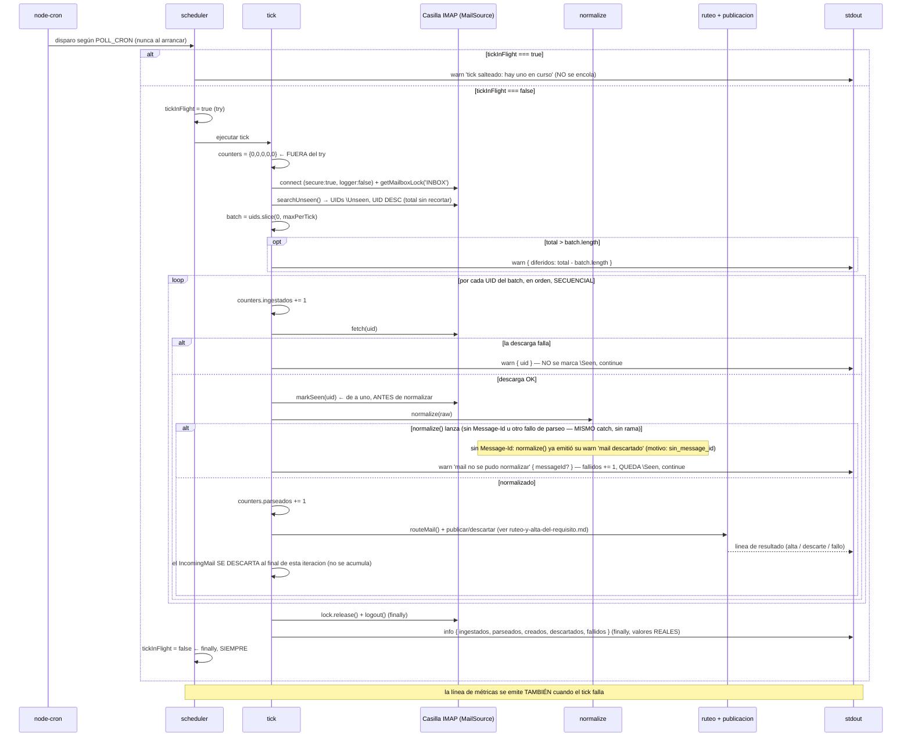

# Ingesta y Normalización del Mail

**Tipo:** Evento (scheduled)
**Status:** Active
**Creado:** 2026-08-27
**Última actualización:** 2026-09-01 (S-022 implementada: la nota sobre el log de metadatos de
adjunto deja de ser alcance futuro de FG-4 — describe el log real del módulo de adjuntos)
**Stories:** S-007, S-008, S-009, S-010, S-011, S-012, S-013, S-014, S-015, S-016, S-022

## Descripción

El tick completo del `jiku-mail-connector`, de punta a punta. Se dispara por `node-cron` según
`POLL_CRON` — **nunca al arrancar**: el primer tick espera al primer disparo del cron.

El tick conecta a la casilla sobre TLS, toma el lock de `INBOX`, busca los mensajes `\Unseen`, los
ordena de más nuevo a más viejo y toma los primeros N según `POLL_MAX_PER_TICK`. Por cada mensaje
tomado: descarga los bytes crudos, **marca `\Seen` de inmediato si la descarga fue exitosa**,
normaliza el mail a la forma de trabajo, lo rutea y publica (o descarta), y **descarta el objeto** al
final de su misma iteración.

**El log es el único resultado observable persistido por este servicio** — pero ahora sí hay
consumidor: un alta exitosa persiste en Jiku (la escritura la hace `core`) y `core` se entera vía el
comando `requirements.new`. Ver [ruteo-y-alta-del-requisito](ruteo-y-alta-del-requisito.md) para el
árbol de decisión y la publicación completos.

**La casilla IMAP sigue siendo el único actor externo de ESTE flujo**, pero ya no alcanza para
verificarlo de punta a punta: la **verificación automatizada** (test) sigue sin necesitar una
instancia real de Jiku — el responder de `test/bus/responder.ts` hace de `core` sobre el bus real de
Testcontainers — pero el flujo **en producción** sí necesita una instancia de Jiku alcanzable para que
el alta tenga efecto.

## Servicios Involucrados

| Servicio | Rol | Tipo de Participación |
|----------|-----|-----------------------|
| jiku-mail-connector (`scheduler`) | Guarda el no solapamiento y libera el indicador siempre | Iniciador |
| jiku-mail-connector (`tick`) | Aplica el cap, el orden, el marcado, el aislamiento de fallos y los contadores | Procesador |
| jiku-mail-connector (`src/infra/imap`) | Adaptador del puerto `MailSource` sobre `imapflow` | Procesador |
| jiku-mail-connector (`normalize`) | Funciones puras: headers, cuerpo y adjuntos a `IncomingMail` | Procesador |
| jiku-mail-connector (`ruteo`) | Resuelve el proyecto del mail o el motivo de descarte | Procesador |
| jiku-mail-connector (`publicacion`) | Arma, valida y publica el requisito derivado del mail | Procesador |
| Bus NATS | Entrega el comando `requirements.new` a `core` y devuelve la reply | Procesador |
| Jiku (`core`) | Autoriza, valida la forma y crea el requisito | Procesador |
| Casilla IMAP | Entrega los mensajes `\Unseen` y persiste el flag `\Seen` | Fuente externa |
| stdout | Recibe la línea por mail y la línea de métricas del tick | Consumidor |

## Pasos del Flujo

### Paso 1: Guard de no solapamiento

**Origen:** node-cron
**Destino:** `src/domain/ingesta/scheduler.ts`
**Tipo:** Interno

**Trigger:** disparo del cron según `POLL_CRON`. **No hay tick inmediato al arrancar** (S-011 CA-2).

- Si `tickInFlight === true` → `logger.warn({}, 'tick salteado: hay uno en curso')` y **retorna**. El
  disparo salteado **no se encola**.
- Si `tickInFlight === false` → lo pone en `true` y entra al `try`.
- El `finally` lo devuelve a `false` **siempre**, incluso si el tick lanzó.

**Por qué el `finally` no es opcional:** un indicador que no se libera detiene la ingesta **para
siempre** sin que el proceso muera, y en un worker sin healthcheck (ADR-006) **no tiene síntoma**. Es
el fallo más caro del alcance.

**Ref:** S-011 CA-5, CA-6, CA-7; REQ-002 RF-8 y RF-9, Riesgo 1

---

### Paso 2: Conexión TLS y lock de `INBOX`

**Origen:** `tick`
**Destino:** Casilla IMAP (vía `src/infra/imap`)
**Tipo:** Interno (adaptador del puerto `MailSource`)

**Antes de nada:** `TickCounters` se inicializa **fuera del `try`**, para que el `finally` pueda
emitir la línea de métricas aunque el tick falle acá mismo.

- `new ImapFlow({ host, port, secure: true, auth: { user, pass }, logger: false })`
  - `secure: true` **incondicional**: no hay opción de texto plano.
  - `logger: false` **incondicional**: el default de `imapflow` emite el tráfico crudo, que incluye el
    `LOGIN`. NFR-S06 no puede depender del default de una dependencia.
- `await client.connect()` → `await client.getMailboxLock('INBOX')`
- `INBOX` es **constante del módulo**, no variable de entorno.

**Ref:** S-009 CA-4, CA-5, CA-6; REQ-002 RF-4, RF-12, RF-38

---

### Paso 3: Buscar, ordenar y aplicar el cap

**Origen:** `tick`
**Destino:** Casilla IMAP
**Tipo:** Interno

- `searchUnseen()` → `client.search({ seen: false }, { uid: true })`: **únicamente** los `\Unseen`.
  El segundo argumento **no es opcional en la práctica**: sin `{ uid: true }`, `imapflow` devuelve
  números de secuencia (posición en la casilla), no UIDs, y esos números no sirven para `fetch()` ni
  `markSeen()` de otra invocación (verificado contra `imapflow@1.7.6` en la Tarea 1 de S-009).
- Ordena **UID descendente** — por **UID**, no por el header `Date`, que es dato del cliente y puede
  venir mal.
- `const total = uids.length; const batch = uids.slice(0, maxPerTick);`
- Si `total > batch.length` → `logger.warn({ diferidos: total - batch.length }, ...)` **con el
  número**. Los diferidos siguen `\Unseen` y los toma el próximo tick.

**El recorte vive en el tick, no en el adaptador:** `searchUnseen()` devuelve el **total sin
recortar** justamente para que el contador de diferidos sea observable.

**Ref:** S-009 CA-7, S-010 CA-2 y CA-3; REQ-002 RF-13, RF-14, RF-15; ADR-006

---

### Paso 4: Por cada mensaje — descargar, marcar, normalizar, rutear y publicar (o descartar)

**Origen:** `tick`
**Destino:** Casilla IMAP + `normalize` + `ruteo` + `publicacion`
**Tipo:** Interno

Los mensajes se recorren **en el orden del `batch`** (más nuevo primero) y **secuencialmente**, un
mail a la vez, sin paralelismo (ADR-001).

1. `counters.ingestados += 1`
2. `fetch(uid)` → si **lanza**: `logger.warn({ uid }, ...)`, **no se marca `\Seen`**, `continue`. El
   próximo tick lo reintenta.
3. `markSeen(uid)` **inmediatamente después de la descarga exitosa**, de a uno — **nunca en lote al
   final del tick**.
4. `normalize(raw)` → produce un `IncomingMail`, o **lanza**:
   - `messageId` — **el único campo obligatorio**. Sin él, `normalize()` ya emitió su propio `warn`
     (`'mail descartado'`, `motivo: 'sin_message_id'`) y lanza `MissingMessageIdError`.
   - `referenceIds` — unión deduplicada de `In-Reply-To` y `References`, en orden de aparición. Es lo
     que `routeMail()` consulta primero (Paso 1 de
     [ruteo-y-alta-del-requisito](ruteo-y-alta-del-requisito.md)).
   - `recipient` — primer `Delivered-To`, con `To` como fallback. **Crudo**; el slug se extrae recién
     en el ruteo. Vacío es válido.
   - `senderEmail` — aislado de `Nombre <mail@dominio>`. Nadie lo lee en v1 y **no se loguea**.
   - `subject` — sin `Re:`/`Fwd:`/`RV:`, quitados iterativamente y sin distinguir mayúsculas. Vacío
     es válido; se usa como base del `title` del requisito.
   - `body` — texto plano con el texto citado recortado (heurística best-effort). El texto plano gana
     sobre el HTML; el HTML se convierte **sólo** si no hay parte de texto. Vacío es válido; se usa
     como base de la `description` del requisito.
   - `attachments[]` — `filename`, `mimeType` (**declarado, no verificado**), `size`, `content`,
     `contentDisposition`, `contentId`. **Todas** las partes con contenido de archivo, sin filtrar por
     disposición: una imagen inline es un adjunto normal. **Sin checksum** (es de FG-4). No se lee en
     ningún punto de este flujo — `fileIds` es de FG-4.
   - **Cualquier fallo de `normalize()` cae en el MISMO `catch`** — incluido `MissingMessageIdError`:
     el catch **distingue por CLASE del error, nunca por texto** (ADR-002). `MissingMessageIdError` es
     un **descarte** (`counters.descartados += 1`; `normalize()` ya emitió su propio `warn` con
     `motivo: 'sin_message_id'`, no se re-loguea) — un mail sin `Message-Id` no es "algo salió mal en
     el parseo", es un mail que la ingesta decide no procesar. Cualquier otro fallo de parseo es
     `no_parseable` (`counters.fallidos += 1`, se loguea `'mail no se pudo normalizar'` con su
     `Message-Id` si se alcanzó a extraer, que nunca es el caso de `MissingMessageIdError`). En ambos
     casos `continue`, **queda `\Seen`** — no se reintenta y no hay compensación.
   - **Esta distinción no es un cambio de código de esta story**: `tick.ts` ya la implementaba así
     desde que compuso `ingesta` con `ruteo`/`publicacion` (S-014). Lo que corrige esta story es que
     la versión anterior de este documento decía que el `catch` contaba `MissingMessageIdError` junto
     con cualquier otro fallo como `fallidos` — esa frase nunca reflejó el código real.
5. `counters.parseados += 1`. El mail normalizado se pasa a `routeMail()` — el árbol de decisión
   completo, el armado del payload y la publicación están documentados en
   [ruteo-y-alta-del-requisito](ruteo-y-alta-del-requisito.md), en la **misma iteración** de este
   `for`:
   - **Descartado** por `routeMail()` (`es_respuesta`, `sin_slug`, `slug_no_mapeado`) →
     `counters.descartados += 1`, una línea `warn` `'mail descartado'` con el motivo.
   - **Publicado con éxito** → `counters.creados += 1`; la línea `'requisito creado en Jiku'` la
     emite `publishRequirementFromMail()`, no el tick.
   - **Publicación fallida** (`PublishError`) → `counters.fallidos += 1`; la línea de error la emite
     `publishRequirementFromMail()`, no el tick.
6. **El objeto se descarta al final de la misma iteración.** No se acumula en ningún array del tick —
   ni el `IncomingMail` ni el `RouteResult` sobreviven a la iteración en la que se procesaron. Es la
   propiedad del pico de memoria de **un mail a la vez** que FG-4 tiene que preservar cuando agregue
   los `Buffer` de los adjuntos.

**Operación de BD:** ninguna (el conector no alcanza PostgreSQL; la escritura la hace `core`, tres
saltos más allá). **Evento publicado:** `requirements.new`, cuando `routeMail()` resuelve el proyecto.

**Ref:** S-008 completa, S-010 CA-5 a CA-8 y CA-16, S-012 a S-016; REQ-002 RF-16 a RF-33; REQ-003

---

### Paso 5: Cerrar y emitir las métricas

**Origen:** `tick`
**Destino:** stdout
**Tipo:** Interno — **en el `finally`**

- `lock.release()` y `client.logout()`.
- `logger.info({ ingestados, parseados, creados, descartados, fallidos }, 'tick completado')` — **los
  cinco contadores, todos con valores reales** desde S-014/S-015: `creados` cuenta las altas que
  `publishRequirementFromMail()` confirma, `descartados` cuenta los cinco motivos reales
  (`es_respuesta`, `sin_slug`, `slug_no_mapeado`, `sin_message_id`, y — para completar el catálogo —
  el `no_parseable` cuenta como `fallidos`, no como descarte).

**Por qué en el `finally`:** la línea de métricas se emite **también cuando el tick falla**, con los
contadores de lo que alcanzó a procesar. Escrito de la forma natural —contadores dentro del `try`,
emisión al final del camino feliz— este requisito **falla en silencio**.

**Ref:** S-010 CA-11 y CA-14; REQ-002 RF-35 y RF-36, ADR-006, Riesgo 4

## Manejo de Errores

| Fallo | Nivel | Comportamiento | Estado del mensaje | Ref. |
|---|---|---|---|---|
| Un mensaje no se descarga | `warn` | Se saltea, el tick sigue | **`\Unseen`** — el próximo tick lo reintenta | RF-17 |
| Un mensaje no se parsea (`no_parseable`) | `warn` | `fallidos += 1`, el tick sigue | **`\Seen`** — se perdió, el log es su único rastro | RF-18 |
| Un mail sin `Message-Id` (`sin_message_id`) | `warn` | `descartados += 1`. El warn **dice que fue por eso** | `\Seen` | RF-21 |
| El mail es una respuesta (`es_respuesta`) | `warn` | `descartados += 1`, vía `routeMail()` | `\Seen` | S-013, S-016 CA-19 |
| El recipient no tiene subaddress (`sin_slug`) | `warn` | `descartados += 1`, vía `routeMail()` | `\Seen` | S-013 |
| El slug no está en el Mapa de Tickets (`slug_no_mapeado`) | `warn` | `descartados += 1`, con el `slug` en la línea | `\Seen` | S-013 |
| La publicación falla (bus o `core` rechazan) | `error` | `fallidos += 1`, sin reintento, el tick sigue con el próximo UID | `\Seen` — ver [ruteo-y-alta-del-requisito](ruteo-y-alta-del-requisito.md) | S-005, S-015 |
| Credenciales incorrectas | `error` | Tick completo falla. **Worker vivo**, reintenta en el próximo disparo. **Sin credenciales en el log** | Ninguno tocado | RF-10 |
| Host inalcanzable | `error` | Tick falla, worker vivo | **Ningún mensaje quedó `\Seen`** | RF-10 |
| Red cortada a mitad | `error` | Tick termina por el fallo | Los ya `\Seen` no se reprocesan; los `\Unseen` sí | REQ-002 CA-13 |

**En los seis casos la línea de métricas se emite igual.**

**Cómo se garantiza esto en el código (dos funciones, dos `finally`):** `runTick()` corre el batch y
emite la línea de métricas en su propio `finally` — corre siempre que el batch haya empezado, con
éxito o con fallo a mitad de camino. Pero si la conexión nunca llega a abrirse (falla `connect()` o
`getMailboxLock()`), `runTick()` nunca arranca y ese `finally` nunca corre. Por eso `runIngestaTick()`
(el punto de entrada del módulo) tiene su **propio** `catch`, que emite la línea con los cinco
contadores en `0` **sólo si el batch nunca llegó a empezar** — nunca duplica la línea si `runTick()` sí
corrió. La distinción entre "el batch empezó" y "nunca empezó" se decide con una bandera que se marca
justo antes de invocar `runTick()`, **no** inspeccionando el tipo de excepción: un `getMailboxLock()`
que falla no lanza la misma clase que un `connect()` fallido, y basarse en el tipo de error dejaría ese
camino sin línea de métricas.

**No hay compensación de ningún tipo:** ni desmarcado, ni reintento, ni carpeta de fallidos. El
marcado `\Seen` **no se revierte nunca**. La idempotencia de este flujo **no es una tabla: es el flag
`\Seen` de IMAP** (ADR-001).

## Resultado

**Sin persistencia propia.** No hay base de datos del conector, ni volumen, ni archivo temporal. El
`IncomingMail` y sus `Buffer` de adjuntos se liberan apenas se procesa el mail, así que el pico de
memoria del proceso es de **un mail a la vez**, no del lote entero — una propiedad que **FG-4 tiene
que preservar deliberadamente**. Jiku sí persiste: un alta exitosa escribe un requisito nuevo (ver
[ruteo-y-alta-del-requisito](ruteo-y-alta-del-requisito.md)).

**El log es el único resultado observable directamente de este flujo:**

- **Una línea por mail** con su `Message-Id` y su resultado: creado con su `id`, descartado con
  motivo, o fallido con su causa. **Ningún mail termina sin rastro** — el único que puede aparecer sin
  `Message-Id` es el que se descarta justamente por no tenerlo (`no_parseable` deja la línea del
  `uid`).
- **Una línea por tick** con los cinco contadores reales, emitida también en el camino de fallo.
- **Un `warn` por diferidos** cuando el cap recortó, con cuántos quedaron.
- **Un `warn` por tick salteado** cuando el guard rechazó un disparo.

Esa línea de métricas **es el instrumento de medición de NFR-P06**: es la primera visibilidad real de
qué llega a la casilla, con qué volumen y con qué forma.

## Notas

**Lo que nunca aparece en stdout** (RF-37, ADR-006): credenciales IMAP, tráfico IMAP crudo, `body`,
`subject`, `senderEmail`, `recipient` completo, contenido de adjunto, la `uploadUrl` prefirmada ni el
payload de `requirements.new`. Del adjunto **sí** aparecen `nombre` y `mime` (nunca `content`, nunca
`checksum`, nunca `uploadUrl`) — el log real que produce el módulo de adjuntos de este request
(S-017 a S-022, FG-4), en tres puntos distintos: `avisarRechazoLocal()` con nivel `info` para un
rechazo de la política local (particionar/deduplicar/aplicarTope), `requestFileUpload()` con nivel
`warn` (más el `code`) para un rechazo de negocio de `core`, y `uploadFileContent()` con nivel `warn`
para un fallo de `PUT`. Ver
`docs/reusable-code/jiku-mail-connector/services.md` para el detalle de cada función.

**`subject` y `recipient` no están en `REDACT_PATHS`, y agregarlos sería un error:** ADR-006 exige que
`messageId`, `projectId` y `slug` **sí** se logueen. Su protección es **por omisión deliberada en cada
punto de log**, no por redacción, y se verifica escaneando la salida de un tick completo (S-016 CA-7).

**Este flujo ya toca el bus, a través del ruteo y la publicación.** Lo que antes decía *"nada se
persiste, nada se publica al bus y `core` no se entera de que este flujo existe"* dejó de ser cierto
desde que S-014 cableó `routeMail()` en el tick y S-015 armó el payload derivado del mail: un alta
exitosa **sí** persiste (la hace `core`) y `core` **sí** se entera, vía el comando `requirements.new`.
**FG-3 es el que reemplazó el descarte incondicional del Paso 4** por el ruteo y la publicación, tal
como esta misma nota anticipaba — y S-016 cierra el feature group confirmando que ya ocurrió.

**Deuda de convención declarada:** el poll IMAP y el scheduling por cron no tienen convención en el
catálogo. Este flujo y las stories S-009/S-010/S-011 producen ese patrón; formalizarlo es candidato a
`/product-change-technical-definition` cuando se estabilice.

**Relación con el arranque:** el scheduling de este flujo ocurre en el Paso 8 de
[arranque-y-conexion-al-bus](arranque-y-conexion-al-bus.md), que también documenta la rama de
`POLL_ENABLED=false` y el apagado ordenado por `SIGTERM`/`SIGINT`.
