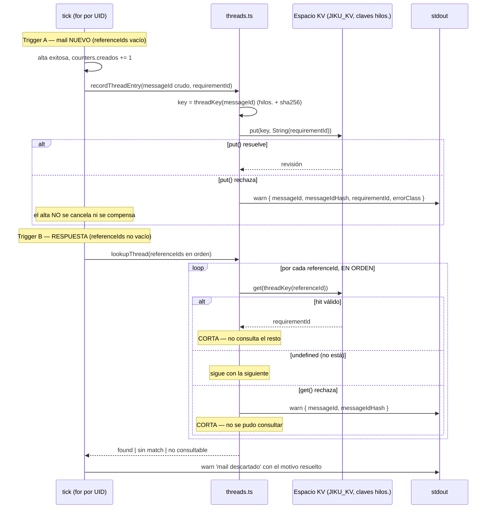

# El Mapa de Hilos en el KV

**Tipo:** Evento
**Status:** Active
**Creado:** 2026-09-08
**Última actualización:** 2026-09-09 (S-028: el flujo queda **completo y verificado E2E** contra un
NATS real. Antes: S-026 implementó las dos operaciones sobre el bucket que S-024 abre y verifica —el
write después del alta y el lookup ordenado de la respuesta—, y S-027 le dio consumidor al lookup).
2026-10-08 (S-032 implementada y documentada en S-034 / REQ-008: el Mapa de Hilos deja el bucket
propio con TTL de 90 días y pasa a las claves `hilos.<sha256>` del **Espacio KV** del conector en
`JIKU_KV`, **sin TTL**: los hilos no expiran. La lógica —clave sin normalizar, write no cancelante,
lookup ordenado con corte— no cambia)
**Stories:** S-026, S-027, S-028, S-032, S-034

## Descripción

Las **operaciones** del conector sobre el Mapa de Hilos, que vive en el Espacio KV del conector
(claves `hilos.`; hasta S-032, un bucket propio): cómo se construye su clave y por qué, cómo
se escribe una entrada después de crear un Requisito, y cómo se consulta desde una respuesta para
saber a qué Requisito pertenece su hilo.

Es la **primera entidad que el conector escribe y que sobrevive al tick** — hasta S-025 todas sus
entidades eran efímeras o de configuración administrada por un humano.

**Estado COMPLETO.** El flujo tiene **dos triggers**, y desde S-027 los **dos** existen:

| Trigger | Story | Estado |
|---|---|---|
| El alta de un Requisito desde un mail nuevo | S-026 | **Implementado.** El write ocurre tras el `success` del alta, después de `creados += 1` |
| El comentario exitoso desde una respuesta con match | S-027 | **Implementado.** El write ocurre tras el `success` del comentario, después de `comentados += 1` — ver [publicacion-requirements-comment](publicacion-requirements-comment.md) |

**Registro histórico (S-026):** hasta S-027 este flujo estaba *"incompleto a propósito"* — el lookup
funcionaba y estaba afirmado por tests, pero su resultado **no tenía consumidor**: una respuesta con
match **se descartaba igual**, porque no había salida por comentario. Ese estado intermedio era
coherente y desplegable —el bucket se poblaba desde ya— y S-027 encontró el estado listo antes de
necesitarlo. Se deja anotado y no se borra: es lo que explica por qué el bucket puede tener entradas
anteriores a que existiera la salida por comentario.

**Verificación (S-028).** El flujo está verificado E2E contra un NATS real con JetStream, no sólo
contra los módulos:

| Propiedad | Suite |
|---|---|
| El ciclo completo encadenado: alta → write → respuesta → comentario → write → respuesta a la respuesta | `test/infra/kv/e2e-kv.test.ts` (TS-31 a TS-33) |
| Los **dos** casos de `hilo_desconocido` —reenvío interno e hilo anterior al despliegue— no crean nada, no escriben nada, y son **indistinguibles** entre sí *(S-034 / REQ-008: antes eran tres, con "entrada expirada por el TTL")* | `test/ingesta/tick-propiedades-kv.test.ts` (TS-16 a TS-20), `test/ingesta/tick-propiedades-espacio.test.ts` (S-033, TS-25) |
| Una entrada de **cualquier antigüedad** matchea: los hilos no expiran (invariante 32) *(S-034 / REQ-008: reemplaza el caso de la entrada expirada)* | `test/ingesta/tick-propiedades-espacio.test.ts` (S-033, TS-15/TS-16: un hilo de 91 días comenta) |
| El write que falla **no cancela el alta**, y el del comentario está condicionado al `success` | `test/ingesta/tick-propiedades-kv.test.ts` (TS-21 a TS-26) |
| El Espacio KV **no participa de la idempotencia**: el `\Seen` sigue siendo la única marca | `test/ingesta/tick-propiedades-kv.test.ts` (TS-51 a TS-53) |
| **No hay dedup de adjuntos contra el hilo**, y es deliberado | `test/ingesta/tick-propiedades-kv.test.ts` (TS-54 a TS-56) |
| Los pasos manuales de inspección del espacio (las claves son 64 chars de hex) | [verificacion-e2e-manual.md](../architectures/jiku-email-tickets/verificacion-e2e-manual.md), Parte 2 |

## Servicios Involucrados

| Servicio | Rol | Tipo de Participación |
|----------|-----|-----------------------|
| jiku-email-tickets (`infra/kv`, `threads.ts` y `keys.ts`) | Construye la clave hasheada (`threadKey()`), escribe la entrada y resuelve el lookup. Ninguna de sus dos operaciones lanza | Procesador |
| jiku-email-tickets (`ingesta`, el tick) | Invoca el write después del alta y el lookup en la rama de la respuesta; decide el motivo del descarte con el resultado | Procesador |
| Bus NATS / JetStream (Espacio KV del conector en `JIKU_KV`, claves `hilos.<sha256>`) | Almacena las entradas del Mapa de Hilos, **sin TTL**: no expiran *(S-034 / REQ-008: antes un bucket propio con TTL de 90 días)* | Almacén |
| stdout | Recibe el `warn` de cada fallo del write, del lookup y de cada entrada mal formada | Consumidor |

**`core` no participa.** El `put()` y el `get()` son operaciones del **bus** (JetStream KV), no
comandos de Jiku: no pasan por `client.command()` y no consumen ningún contrato nuevo.

## Pasos del Flujo



---

### Paso 1: La clave — `hilos.` + `sha256hex(Message-Id crudo)`

**Origen:** `threads.ts` (vía `threadKey()` de `src/infra/kv/keys.ts`)
**Destino:** interno
**Tipo:** Interno

`threadKey(messageId)` = `hilos.` + `sha256hex(messageId)`, donde `sha256hex()` es
`createHash('sha256').update(messageId, 'utf8').digest('hex')` — 64 chars de `[0-9a-f]`, sobre el
`Message-Id` **crudo, con sus brackets**, tal como lo entrega `mailparser` a través de `normalize()`.
El conector maneja sólo esa parte derecha de la clave; el prefijo `{instance}.{userId}.` lo agrega el
SDK (invariante 31). *(S-034 / REQ-008: antes la clave era el hash solo, en un bucket propio)*

**Sin `trim()`, sin `toLowerCase()`, sin normalización de ninguna clase.**

**Por qué el hash y no el `Message-Id`.** Las reglas de clave del SDK (`assertValidKVKey()`), que
son las de NATS (`[A-Za-z0-9\-/_=.]`, sin comodines), **rechazan `<`, `>` y `@`** — los tres
presentes en un `Message-Id` real. Una clave inválida no se puede escribir ni consultar, así que la
defensa es no producirla nunca. *(S-034 / REQ-008: antes citaba `validKeyRe` de la librería KV cruda
y su `Error` plano; la librería ya no está en el árbol y las reglas son las del SDK)*

**Por qué NO se normaliza el `Message-Id` como alternativa.** Escapar o normalizar para que entre en el
regex permitiría que **dos `Message-Id` distintos colapsen a la misma clave**, y eso **rutearía un
comentario al requisito equivocado** — viola G-04. El riesgo asumido a cambio es que la clave **no se
lee a simple vista** con `nats kv get`: son 64 chars de hex. *(S-034 / REQ-008: antes "no es legible
con `nats kv ls`"; el conector no lista el espacio)* Aceptado explícitamente; la legibilidad no vale un
comentario en el ticket de otro cliente.

**Ref:** S-026 CA-1, CA-2; REQ-005 RF-9, riesgo 5

---

### Paso 2: El write, después del alta y fuera de su camino crítico

**Origen:** `tick` → `recordThreadEntry()`
**Destino:** el Espacio KV del conector (`JIKU_KV`, clave `hilos.<sha256>`)
**Tipo:** Evento (escritura en el KV)

Dentro de la rama `found` de la intención de alta del `for` de `tick.ts` *(S-034 / REQ-008: antes "la
rama `route.ok === true`")*, **dentro del mismo `try` de la publicación**, **después** de
`counters.creados += 1` y **sólo** si el alta tuvo éxito:

```
space.put(threadKey(mail.messageId), String(requirementId))
```

- El valor va como el **entero en texto**, con el mismo criterio que el Mapa de Tickets, para que
  `nats kv get` muestre algo legible y el parseo compartido (`parsePositiveId()`) lo lea igual. **No
  JSON**: `entry.json<T>()` **lanza** si el payload no es parseable, y una excepción por un dato malo
  de una sola clave no puede ser un modo de falla acá.
- **El `put()` va sin objeto de opciones** —ni timeout ni TTL—: el Espacio KV no expone TTL y **los
  hilos no expiran** (invariante 32). *(S-034 / REQ-008: antes el TTL era del bucket propio y lo
  fijaba el operador al crearlo)*
- **Si el alta falló**, el `catch` cuenta `fallidos` y **no se escribe nada** — el espacio no debe
  apuntar a un requisito que no existe.
- **Un mail sin `Message-Id` no llega hasta acá**: `normalize()` ya lo descartó como
  `sin_message_id`. No se escribe nada.

**La falla NO cancela el alta.** Si el `put()` rechaza, `recordThreadEntry()` **no propaga**: emite un
`warn` con `{ messageId, messageIdHash, requirementId, errorClass }` y resuelve normalmente.
`errorClass` distingue un `JikuBucketFull` (el bucket es compartido entre todas las identidades y no
tiene cuota por identidad) de un timeout o un permiso. `counters.creados`
**no se revierte**, no hay compensación (un requisito creado no se modifica ni se borra nunca —
invariante 9), y el `for` continúa con el siguiente UID. **La consecuencia asumida es que ese hilo no
va a rutear después**: una respuesta a ese mail se descartará como `hilo_desconocido`, que es la falla
segura.

**Ref:** S-026 CA-1, CA-3, CA-4, CA-5; REQ-005 RF-10, RF-19, CA-22, invariante 27; ADR-001

---

### Paso 3: El lookup, ordenado y con corte en el primer hit

**Origen:** `tick` → `lookupThread()`
**Destino:** el Espacio KV del conector (`JIKU_KV`, claves `hilos.<sha256>`)
**Tipo:** Evento (lectura puntual del KV)

En la rama de la intención de comentario (S-027; hasta S-026, `route.motivo === 'es_respuesta'`), **antes** de
emitir la línea del descarte. Los descartes del slug (`sin_slug`, `slug_no_mapeado`,
`slug_no_consultable`) no tienen referencias que consultar y **no pagan el round-trip**; un mail
nuevo tampoco: nunca entra en esta rama.

Itera `mail.referenceIds` **en el orden recibido**, secuencialmente, y por cada uno hace
`space.get(threadKey(refId))`:

- **`undefined`** es "no está" — un resultado normal, no un fallo — y se sigue con la siguiente
  referencia. *(S-034 / REQ-008: el `get()` del SDK devuelve `undefined`, no `null`)*
- **Hit válido** → devuelve el `requirementId` y **CORTA**: las referencias posteriores no se consultan.
  Ese `requirementId` tiene **dos consumidores** desde S-029: es el `{id}` del comando
  `requirements.{id}.comment`, y es el `entityId` de la consulta de reuso de adjuntos contra el hilo
  (ver [publicacion-requirements-comment](publicacion-requirements-comment.md), Paso 3). El
  comportamiento de **este** flujo no cambia por eso: se devuelve el mismo valor, sin paso, rama ni
  fallo nuevos.
- **Valor mal formado** (no un entero seguro estrictamente positivo, o que no se re-serialice
  idéntico) → **no es un hit**: se saltea con un `warn` que nombra el `messageIdHash`, y la iteración
  **continúa** con la siguiente. El dato malo de una clave no puede tapar el hilo real que está en la
  siguiente.
- **`get()` que rechaza** → **CORTA** con el estado "no se pudo consultar": un espacio inaccesible no
  se vuelve accesible en la referencia siguiente.
- **`referenceIds` vacío** → devuelve "sin match" **sin invocar `get()` ni una vez**.

**El orden no se recalcula acá.** `normalize()` (vía `mergeReferenceIds()`) ya entrega la unión
deduplicada de `In-Reply-To` y `References`, en orden de aparición, **con el de `In-Reply-To`
primero**. `lookupThread()` itera el array tal como lo recibe: no ordena, no deduplica, no filtra.

**REGLA DURA: nada de `Promise.all` sobre las referencias.** Borraría las dos cosas que el diseño
compra: el **corte** en el primer hit (se pagarían N round-trips donde el diseño paga 1) y el
**orden**, que es lo que hace que la referencia de `In-Reply-To` gane.

**Por qué `get()` puntual.** Es estado de **alto cardinal** que cambia en cada mail: una copia en
memoria sería un mapa creciendo sin techo y desactualizado. Desde REQ-008 **los dos mapas** se
resuelven con un `get` puntual —el de Tickets también, con `lookupTicket()`—, así que ya no hay un
contraste que justificar. *(Historia: hasta S-032 el Mapa de Tickets se seguía con `watch()` sobre
una copia en memoria, en `ticket-map.ts`, y este párrafo explicaba por qué el de Hilos era distinto a
propósito.)*

**Ref:** S-026 CA-6, CA-10, CA-12; REQ-005 RF-11, CA-12, riesgo 6

---

### Paso 4: El resultado decide el motivo del descarte

**Origen:** `tick`
**Destino:** stdout
**Tipo:** Interno

Los tres estados de `ThreadLookupResult` son valores de retorno tipados —ninguno es una excepción— y
cada uno resuelve un motivo distinto. El motivo se resuelve en una variable **antes** del
`logger.warn`, para que siga habiendo **una sola** línea de log por descarte.

| Resultado del lookup | Motivo emitido | Por qué |
|---|---|---|
| **Sin match, consultable** | `hilo_desconocido` | Se pudo preguntar y ninguna referencia matcheó: *"esta respuesta apunta a un hilo que no conozco"* |
| **No consultable** (el espacio inaccesible) | `es_respuesta` | *"No pude averiguar a qué hilo apunta"*. El arreglo está en la infraestructura, no en el hilo |
| **Con match** | `es_respuesta` | El hilo **sí** se conoce, así que `hilo_desconocido` sería falso; y todavía no hay salida por comentario. **Éste es el punto exacto donde S-027 reemplaza el descarte por la publicación del comentario** |

En los tres casos: `counters.descartados += 1`, una línea `warn` con el literal `'mail descartado'` y
contexto `{ messageId, motivo }`, y **ningún Requisito creado**.

**`hilo_desconocido` cubre dos situaciones indistinguibles a propósito**, porque el conector no puede
separarlas y las dos tienen la misma respuesta correcta (descartar sin crear nada):

1. Un cliente reenvía a `tickets+alfa@grava.io` un hilo interno con `References` poblado y slug
   mapeado, y el lookup no matchea.
2. Un hilo anterior al despliegue de esta funcionalidad.

> **Una entrada de cualquier antigüedad matchea** (invariante 32): los hilos viven en el Espacio KV y
> no expiran. *(S-034 / REQ-008: hasta REQ-008 la expiración por el TTL de 90 días del bucket propio
> era un tercer origen de `hilo_desconocido`.)*

**Ref:** S-026 CA-8, CA-9, CA-10, CA-13; REQ-005 RF-14, CA-15, CA-17, CA-18, CA-23

---

### Paso 5: Lo que el Mapa de Hilos NO hace — la idempotencia

**Origen:** —
**Destino:** —
**Tipo:** Interno (invariante)

**El Mapa de Hilos NO participa de la idempotencia, y eso es explícito.**

El **flag `\Seen` de IMAP sigue siendo la ÚNICA marca** (ADR-001). El Espacio KV **no se usa para
deduplicar mails**: un mail cuyo hash ya está en el espacio se procesa **igual** que uno que no, sin
saltearse — hay un test de comportamiento que lo afirma, más un escaneo estructural de `tick.ts` que
verifica que ninguna rama saltea un mail en función de una consulta al KV.

La consecuencia, que ya estaba aceptada y no cambia: si el proceso muere después de marcar `\Seen` y
antes de escribir la entrada del hilo, el próximo tick **no reprocesa** ese mail y ese hilo queda sin
ruteo.

Aprovechar el KV para idempotencia **sería otra decisión, con su propio análisis, y REQ-005 no la
tomó.**

**Ref:** S-026 CA-14; REQ-005 RF-20, CA-28; ADR-001

## Manejo de Errores

| Situación | Motivo / Log | Nivel | Comportamiento |
|---|---|---|---|
| El `put()` falla (espacio inaccesible, `JikuBucketFull`, timeout) | `warn` con `{ messageId, messageIdHash, requirementId, errorClass }` | `warn` | **El tick continúa.** El alta **no se cancela ni se compensa**; `counters.creados` **no se revierte**. Consecuencia asumida: ese hilo no rutea después |
| Ninguna referencia matchea | `hilo_desconocido` | `warn` | `counters.descartados += 1`. **No se crea nada.** Cubre también el reenvío de hilo interno con slug mapeado |
| Una entrada de **cualquier antigüedad** | — (es un hit) | — | **Matchea**: los hilos no expiran (invariante 32). *(S-034 / REQ-008: reemplaza la fila "Entrada expirada por el TTL de 90 días → `hilo_desconocido`")* |
| El Espacio KV inaccesible en caliente (`get()` rechaza) | `es_respuesta` | `warn` | `counters.descartados += 1`. El motivo viejo cubre *"no pude preguntar"*, distinto de *"no conozco el hilo"* |
| Una entrada con valor mal formado | `warn` que nombra el `messageIdHash` | `warn` | **No es un hit.** Se saltea y la iteración **continúa** con la referencia siguiente |
| `JIKU_KV` no usable al arrancar (no existe, sin `allow_direct`, sin grants) | `KvSpaceUnavailableError` con `diagnosis` y `bucket: JIKU_KV` | `fatal` | **El conector no arranca** (fail-fast del Paso 5.5 de [arranque-y-conexion-al-bus](arranque-y-conexion-al-bus.md), S-032) |

**Ningún reintento, ni en el write ni en el lookup** (ADR-001). Un solo intento, y los dos caminos de
falla se absorben con un `warn`. Ninguna de las dos operaciones lanza hacia arriba: lanzar obligaría
al tick a envolver cada llamada en un `try/catch` que reintroduciría la decisión en el lugar
equivocado.

## Resultado

**Trigger A (mail nuevo, camino feliz):** un Requisito creado en Jiku (idéntico a antes de S-026) más
una entrada nueva en el Mapa de Hilos: `hilos.<sha256(Message-Id)> → requirementId`, en el Espacio
KV y sin expiración. *(S-034 / REQ-008: antes "con el TTL de 90 días del bucket")*

**Trigger A (write fallido):** el Requisito creado igual, `counters.creados` intacto, y un `warn`. El
hilo queda sin poblar.

**Trigger B (respuesta):** en S-026, **siempre** un descarte. Con match el motivo es `es_respuesta`,
sin match `hilo_desconocido`, con el KV caído `es_respuesta`. **Ningún efecto en Jiku, ningún
comando publicado, `comentados` en 0.**

**En todos los casos:** el mail queda `\Seen`, el pico de memoria sigue siendo de **un mail a la vez**
—esta operación no introduce ningún array que acumule entre iteraciones— y `creados` sigue contando
**sólo** altas de Requisito.

## Notas

**Por qué un flujo propio y no una sección de `ruteo-y-alta-del-requisito`:** el Mapa de Hilos tiene
**dos triggers** que viven en dos ramas distintas del tick —el alta de un mail nuevo y (desde S-027)
el comentario de una respuesta— y ninguna de las dos ramas es su dueño. Además, sus decisiones (el
hash, el `get()` puntual, la falla no cancelante) son del **almacén**, no del ruteo, y describirlas
dentro del flujo de ruteo las escondería en la mitad de otra cosa.

**Por qué el estado se implementó antes que su consumidor:** deja el Mapa de Hilos **poblado y
consultable antes de que exista quien lo use** (S-027). Sin eso, el día que S-027 empezara a comentar
no habría ni una sola entrada en el KV: cada hilo abierto antes de ese despliegue habría sido
`hilo_desconocido`. *(S-034 / REQ-008: antes "durante los primeros 90 días", por el TTL que ya no
existe)* Separarlo también hace que la story del comentario
llegue con el estado ya afirmado por tests.

**El parseo del entero es compartido, no duplicado:** `parsePositiveId()` (`src/infra/kv/parse.ts`) es
la misma función que valida el `projectId` del Mapa de Tickets — entero seguro, estrictamente
positivo, que se re-serialice idéntico (rechaza `'4.5'`, `'42abc'`, `'0x2a'`). Dos copias de la misma
regla divergirían en el primer cambio, y la que divergiría en silencio sería la del mapa que se lee
menos.

**Relación con los otros flujos:**
[ruteo-y-alta-del-requisito](ruteo-y-alta-del-requisito.md) es donde este flujo se dispara — su Paso 6
gana el write, y su rama de descarte gana el lookup;
[ingesta-y-normalizacion-del-mail](ingesta-y-normalizacion-del-mail.md) **no se modificó**: ya produce
`messageId` crudo y `referenceIds` con la forma exacta que hace falta;
[arranque-y-conexion-al-bus](arranque-y-conexion-al-bus.md) es donde el Espacio KV se abre y se
verifica (Paso 5.5, S-032; hasta S-032, el bucket propio de S-024) y donde el handle (`space`) empieza
el viaje que lo lleva hasta el tick.
