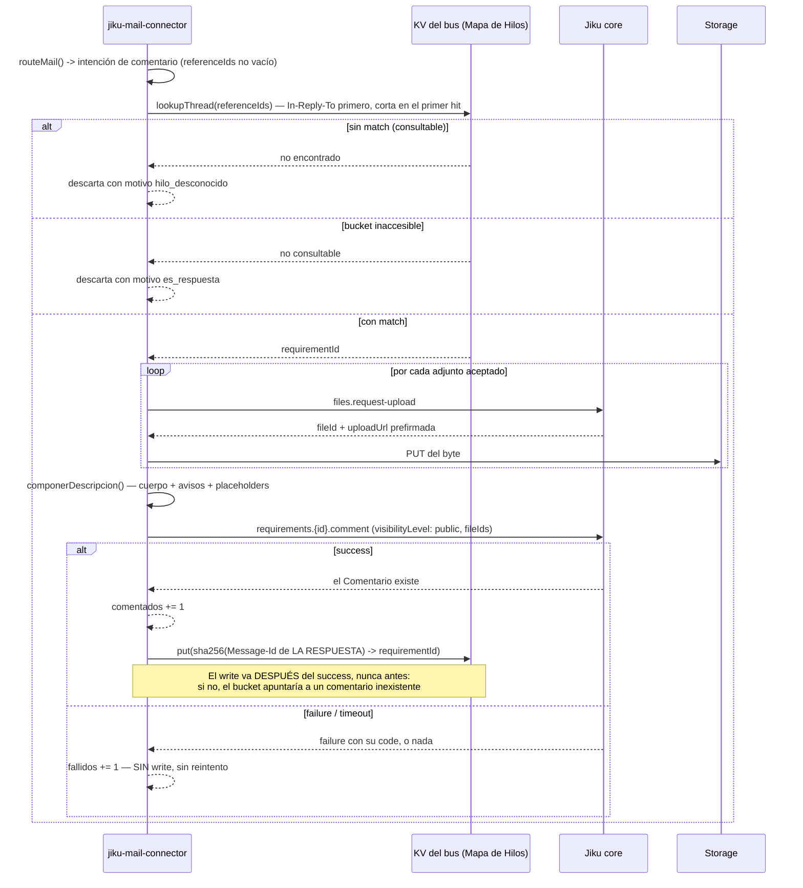

# Publicación de `requirements.{id}.comment`

**Tipo:** Feature
**Status:** Implemented
**Creado:** 2026-09-09
**Última actualización:** 2026-09-09 (S-027 implementada: la respuesta de un cliente al hilo de su
ticket deja de descartarse y se publica como un Comentario **público** del Requisito, con sus
adjuntos vinculados)
**Stories:** S-027

## Descripción

El **tercer** y último comando de escritura que el conector publica, hermano de
[`publicacion-requirements-new`](publicacion-requirements-new.md) y del `files.request-upload` que
aquel documenta.

Cuando un cliente **responde por mail** al hilo de su ticket, esa respuesta ya no se pierde: el tick
la reconoce como respuesta, busca su hilo en el
[Mapa de Hilos](mapa-de-hilos-en-kv.md), y —si lo encuentra— publica su contenido como un
**Comentario del Requisito**, con la misma política de adjuntos que un alta.

**Lo que cierra:** hasta S-026 el conector descartaba activamente toda respuesta. El servicio
predecesor (`grava-gestion/mail-integration` v1.0.0) sí las procesaba, con una tabla propia
`inbound_mail_threads`; el bloqueo para replicarlo era dónde guardar el mapa `Message-Id →
requirementId`, porque el conector no tiene base propia (ADR-001) y no puede escribir la de Jiku
(`core` es el único escritor, ADR-003). El KV del bus resolvió exactamente eso.

**Lo que NO hace, y es deliberado:** no modifica el Requisito (el Comentario es una entidad aparte),
no consulta el Requisito antes de comentar, y no deduplica adjuntos contra el resto del hilo. Ver
**Notas**.

## Servicios Involucrados

| Servicio | Rol |
|---|---|
| `jiku-mail-connector` | Publica el comando. Compone el texto, procesa los adjuntos y escribe la entrada del hilo |
| Bus NATS | Transporte del comando y del KV donde vive el Mapa de Hilos |
| `core` (Jiku) | **Único escritor.** Crea el Comentario y lo vincula al Requisito |
| Storage S3-compatible | Recibe el byte de cada adjunto por `PUT` a la `uploadUrl` prefirmada |

## Pasos del Flujo



---

### Paso 1: El tick reconoce la intención de comentar

**Origen:** `jiku-mail-connector` (`domain/ruteo`)
**Tipo:** Decisión pura, sincrónica

`routeMail()` evalúa `referenceIds` **antes** que el slug y devuelve
`{ ok: false, intencion: 'comentario' }`. **No** es un descarte, y por eso esa variante no lleva
`motivo`.

**Ref:** S-027; ADR-004

> **La consecuencia observable del orden:** el slug **no se evalúa nunca** para una respuesta, así
> que una respuesta a un hilo conocido se comenta **aunque su `recipient` no resuelva ningún slug
> válido**. Es correcto: el hilo ya dice a qué Requisito pertenece, y el slug sólo sirve para
> elegir proyecto cuando hay que crear algo nuevo.
>
> **El lookup no vive en `routeMail()`, ni debe:** esa función es pura, sincrónica y sin logging, y
> el lookup es asincrónico y toca `#infra/kv`. Meterlo ahí sería la "simplificación" más tentadora
> y la que rompe la dirección de dependencias.

---

### Paso 2: El lookup en el Mapa de Hilos

**Origen:** `jiku-mail-connector`
**Destino:** Bus NATS (KV)

`lookupThread()` recorre los `referenceIds` **en orden** —la unión deduplicada de `In-Reply-To` +
`References` que `normalize()` ya arma, con `In-Reply-To` primero por ser el mensaje inmediatamente
anterior— y **corta en el primer match**.

**Ref:** S-026, S-027 · Detalle completo en [mapa-de-hilos-en-kv](mapa-de-hilos-en-kv.md)

Sus tres resultados y qué hace el tick con cada uno:

| Resultado | Qué significa | Efecto |
|---|---|---|
| **Con match** | El hilo se conoce | Sigue al Paso 3: se comenta |
| **Sin match, consultable** | Se pudo preguntar y ninguna referencia matcheó | Descarta con `hilo_desconocido` |
| **No consultable** | El bucket no se pudo leer | Descarta con `es_respuesta` |

> **Los dos motivos son distintos a propósito**, y el log tiene que sostener la distinción: uno se
> arregla **cargando el hilo** (o esperando: puede ser un hilo anterior al despliegue, o una entrada
> expirada por el TTL de 90 días), el otro **arreglando el bucket**. Un solo motivo para los dos
> perdería el diagnóstico.

---

### Paso 3: Los adjuntos de la respuesta

**Origen:** `jiku-mail-connector`
**Destino:** `core` + Storage

`procesarAdjuntosDelMail()`, **la misma función y la misma política** que el alta: doble lista
blanca, tope de tamaño, tope de 10, dedup **intra-mail** por checksum, placeholders al final,
continue-on-failure.

**Ref:** S-017 a S-021, reusadas sin cambios por S-027

> **El caso observado en la prueba local, y aceptado:** Gmail arrastra los adjuntos del mail
> original en la respuesta. El dedup intra-mail colapsa las repeticiones **dentro de esa respuesta**,
> pero el archivo **se sube de nuevo** porque ya estaba vinculado al Requisito por el mail original.
> Es una fila más en `files` y un objeto más en S3, y Jiku ya declara el archivo con 0..N vínculos
> como estado válido.
>
> **No se deduplica contra el hilo**, y la razón es la forma del contrato de consultas:
> `attachments.list` **no** devuelve `checksum` y `files` no tiene `list`. Deduplicar contra el hilo
> serían **N+1 consultas por respuesta** para evitar un placeholder repetido — y obligaría a tocar el
> plano de consultas, que ADR-003 prohíbe. Si en la práctica molesta, la solución correcta es pedirle
> a Jiku que `attachments.list` exponga `checksum` como incluible, y entonces el dedup es **una** consulta.

---

### Paso 4: La publicación del Comentario

**Origen:** `jiku-mail-connector`
**Destino:** `core` (Jiku)

**Comando:** `requirements.{id}.comment`

```jsonc
{
  "comment": "<cuerpo compuesto: texto + avisos + placeholders>",
  "visibilityLevel": "public",
  "fileIds": [12, 13]        // ausente si no hay ninguno — nunca []
}
```

**Ref:** S-027; ADR-003 (regla de comandos permitidos, **reescrita** por esta story)

> **`visibilityLevel: 'public'` explícito, y es la decisión más cara si se omite.** El contrato lo
> declara **opcional con default `internal`**, que es **el opuesto** del que hace falta: un
> comentario `internal` **no lo vería el cliente en Opus**, y `core` respondería `success` igual —
> falla en silencio, con el peor síntoma posible (el cliente cree que nadie leyó su respuesta). Por
> eso el schema del conector lo declara **requerido**: olvidarlo tiene que ser un error de
> compilación, no un comentario invisible. Es consistente con el Requisito, que el conector ya crea
> público.
>
> **El `{id}` va en el `method`, no en un subject armado a mano.** No contradice ADR-002: el SDK
> deriva el subject completo a partir del `method`, y el contrato se titula literalmente
> `requirements.{id}.comment`. El conector **nunca** concatena subjects.
>
> **La traducción de errores se REUSA**, no se reimplementa: `diagnosePublishFailure()` con sus nueve
> ramas, sin agregar ninguna. `requirement_not_found` y `file_not_owned` caen en
> `core_rechazo_desconocido`, **y eso es correcto** — agregarles ramas propias sería duplicar el
> catálogo de códigos de `core`, que crece, en un segundo lugar que quedaría viejo.

---

### Paso 5: El write que cierra el ciclo del hilo

**Origen:** `jiku-mail-connector`
**Destino:** Bus NATS (KV)

Tras el `success`, se escribe `sha256(Message-Id de la respuesta) → requirementId`.

**Ref:** S-027; CA-9, CA-10

> **El orden es la única cosa de este flujo que corrompe estado si se hace mal.** El write va
> **estrictamente después** del `success`, dentro del mismo `try`, después de `comentados += 1`. Un
> write anticipado —o en paralelo— dejaría el bucket apuntando a un Comentario **que no existe**, y
> la próxima respuesta rutearía a un hilo cuyo último eslabón se perdió. Con cualquier fallo del
> comentario, el write **no corre**.
>
> **Se escribe el `Message-Id` de LA RESPUESTA**, no el de la referencia que matcheó. Es lo que hace
> que **una respuesta a la respuesta** rutee aunque el cliente recorte la cadena de `References` —
> el predecesor agregaba una fila por cada mail del hilo, por la misma razón. Escribir el de la
> referencia reescribiría una entrada que ya existe: inútil y silencioso.
>
> **Si el write falla, el Comentario NO se compensa.** Ya existe en Jiku y está bien que exista. La
> consecuencia asumida es que ese eslabón del hilo no ruteará: una respuesta a esta respuesta caerá
> en `hilo_desconocido`, que es la falla **segura**.

## Manejo de Errores

| Paso | Error | Código | Comportamiento |
|---|---|---|---|
| 2 | El bucket de hilos no se puede leer | — | Descarta con `es_respuesta`. **No** se comenta: sin saber el Requisito no hay dónde |
| 2 | Ninguna referencia matchea | — | Descarta con `hilo_desconocido`. Log `warn`, **una sola línea** |
| 3 | Un adjunto lo rechaza la política local | — | **El comentario se publica igual**, con el aviso en su texto |
| 3 | Falla el `PUT` del byte | — | Ídem: aviso de fallo en el texto, el comentario **no** se cancela |
| 4 | `core` rechaza el comando (`requirement_not_found`, `file_not_owned`, cualquier otro) | `PUBLISH_ERROR` | `fallidos += 1`, **sin write**, sin reintento. El `for` **continúa** con el siguiente UID |
| 4 | Timeout / nada respondió | `PUBLISH_ERROR` | Ídem |
| 5 | Falla el write del hilo | — | Log `warn`. **El comentario NO se compensa** y `comentados` no se revierte |

**La regla que gobierna la tabla:** ningún fallo de esta rama aborta el lote ni reintenta. El mail
ya está `\Seen` —se marcó antes de normalizar— y el KV **no participa** de la idempotencia (ADR-001).

## Resultado

Un Comentario **público** en el Requisito del hilo, con los adjuntos de la respuesta vinculados, y
una entrada nueva en el Mapa de Hilos que permite que la conversación siga.

| Contador | Efecto |
|---|---|
| `comentados` | **+1** por respuesta comentada con éxito |
| `creados` | **Sin cambios.** Un comentario no es un alta, y sumarlos borraría la distinción |
| `descartados` | +1 por respuesta sin match o con el bucket inaccesible |
| `fallidos` | +1 por fallo de la publicación |

## Notas

**El Requisito no se modifica** (CA-17). El Comentario es una entidad aparte de Jiku; el conector
sigue sin publicar ningún comando de edición, y hay un test de propiedad que escanea `src/` para
afirmar que ningún sufijo de comando dinámico sea `.update`, `.delete` o `.close`.

**No se consulta el Requisito antes de comentar.** Si se borró, `core` contesta
`requirement_not_found` y **ese es el diagnóstico**. Consultar antes sería usar el plano de lectura
que ADR-003 prohíbe, para adelantar un error que el comando ya da con más precisión.

**El texto del comentario es contenido del cliente** y nunca se loguea. La defensa es doble: ningún
punto de log lo incluye (estructural, con un test que lo afirma) y `REDACT_PATHS` cubre `comment` y
`*.comment` por si alguien agrega un log en el futuro sin acordarse de la regla.

**La decisión 9 del análisis funcional queda derogada.** Decía que los comentarios estaban fuera de
alcance; REQ-005 los puso adentro. El documento de discovery es histórico y conserva la decisión con
su nota de derogación, en vez de reescribirse.
