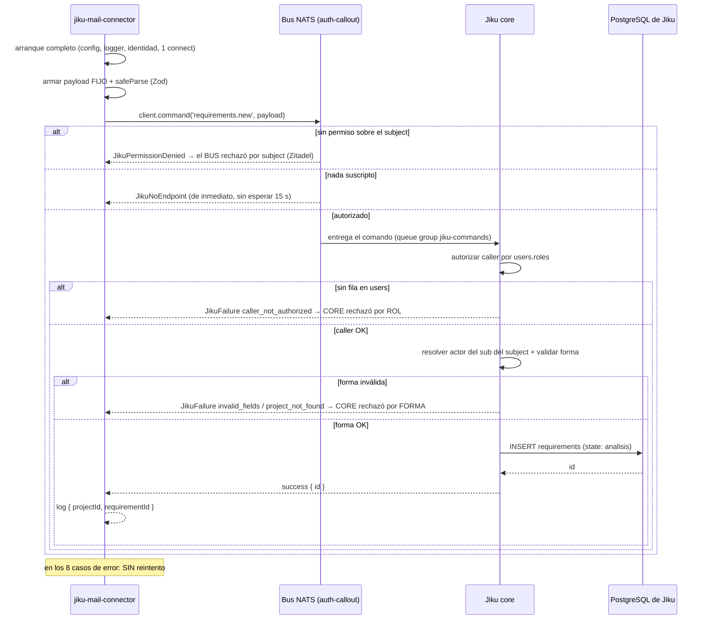

# Publicación de `requirements.new`

**Tipo:** Feature
**Status:** Implemented
**Creado:** 2026-08-27
**Última actualización:** 2026-08-27
**Stories:** S-005

## Descripción

Flujo de publicación del comando `requirements.new` al bus de Jiku y traducción de su respuesta. En
este alcance (FG-1) lo dispara el **modo de verificación** —un script explícito del repositorio,
separado del arranque normal— con un payload **fijo**. Cubre el armado y la validación del payload, la
publicación vía `client.command()`, la reply por `_INBOX`, y **la traducción de las 7 clases de error
del SDK a un diagnóstico que dice cuál de los tres sistemas rechazó**.

Reusa completo el flujo [arranque-y-conexion-al-bus](arranque-y-conexion-al-bus.md): misma
configuración, mismo logger, misma identidad, **una sola conexión**.

> **Nota para FG-3:** este flujo se **extiende, no se reescribe**. Cambia el origen del payload (fijo
> → derivado de un mail real, C-16) y se agrega el registro del alta con `messageId` (C-18). La
> traducción de errores queda igual.

## Servicios Involucrados

| Servicio | Rol | Tipo de Participación |
|----------|-----|-----------------------|
| jiku-mail-connector | Arma el payload fijo, publica el comando y traduce la respuesta | Iniciador |
| Bus NATS + auth-callout | Autoriza el subject y entrega el comando a `core`; devuelve la reply por `_INBOX` | Procesador |
| Jiku (`core`) | Autoriza el caller por rol, resuelve el actor del subject, valida la forma y crea el requisito | Procesador |
| PostgreSQL de Jiku | Persiste el requisito (escrito por `core`, no por el conector) | Consumidor |

## Pasos del Flujo



### Paso 1: Arranque y conexión

**Origen:** jiku-mail-connector
**Destino:** (interno)
**Tipo:** Interno

**Acción:** el modo de verificación reusa los pasos 1-5 del flujo
[arranque-y-conexion-al-bus](arranque-y-conexion-al-bus.md): misma configuración, mismo logger, misma
identidad, **una sola conexión**.

**Trigger del flujo:** ejecución **explícita** de un script del repositorio (p. ej. `npm run verify`),
**nunca un efecto secundario de `start`** ni del `CMD` del contenedor.

> **Por qué separado:** invariante 9 — un requisito creado no se modifica ni se borra nunca. Si la
> publicación ocurriera en cada arranque, **cada reinicio dejaría basura permanente** en el proyecto
> de Jiku.

**Ref:** S-005 CA-2; S-006 CA-7; RF-13

---

### Paso 2: Armar y validar el payload fijo

**Origen:** jiku-mail-connector
**Destino:** (interno)
**Tipo:** Interno

**Acción:** `src/domain/publicacion/` arma el payload **fijo** y lo valida con el schema Zod del
comando usando `safeParse`. Los tipos están inferidos del schema (`z.infer`), no escritos a mano.

**Payload:**
```json
{
  "title": "string — req, max 255. Literal del código",
  "description": "text — req. Literal del código",
  "projectId": "int — req. De la configuración (proyecto de prueba)",
  "type": "enum funcionalidad|mejora|incidencia|otro — 'incidencia'",
  "priority": "enum sin_prioridad|baja|media|alta|urgente — 'sin_prioridad'",
  "visibilityLevel": "enum public|internal — 'public'"
}
```

**Lo que el payload NO lleva, con su fuente:**

| Campo excluido | Por qué |
|---|---|
| `state` | El requisito nace en `analisis`, default de Jiku (invariante 6, ADR-003) |
| `actor` | **La única clave de identidad que el plano de escritura rechaza de plano** (invariante 18) |
| `fileIds` | Se envía **sólo si hay al menos uno** (ADR-003); no hay adjuntos acá. Es de FG-4 |
| `creator` | `core` resuelve el actor **del subject** e ignora lo que el cuerpo declare (ADR-005) |

La lógica de C-16 —payload derivado del mail, truncado a 255, placeholders por asunto/cuerpo vacío,
composición de la descripción— **queda fuera de este alcance** y pertenece a FG-3.

**Ref:** S-005 CA-3, CA-4; ADR-003; convención `validation`

---

### Paso 3: Publicar el comando

**Origen:** jiku-mail-connector
**Destino:** Bus NATS + auth-callout
**Tipo:** Evento (comando con reply)

**Acción:** `client.command('requirements.new', payload)`.

- **Subject:** `{instance}.{sub}.jiku-commands.v1.requirements.new` — **lo arma el SDK**. El conector
  **no arma subjects ni parsea envelopes**.
- **Reply:** por `_INBOX.{hash(sub)}.>`. El prefijo **lo fija el SDK siempre**; el conector **no fija
  `inboxPrefix`**.
- **Timeout:** **15000 ms**, el default del SDK. **No se baja** — el servidor corta a los 10 s y
  PostgreSQL a los 8 s; un timeout más corto convierte el error explicado en un timeout mudo.

**Ref:** S-005 CA-5, CA-6; ADR-002; NFR-P03, ADR-006

---

### Paso 4: `core` autoriza, valida y crea el requisito

**Origen:** Bus NATS
**Destino:** Jiku (`core`) — queue group `jiku-commands`
**Tipo:** Evento (consumidor)

**Acción de `core`:**
1. Autoriza el caller leyendo `users.roles`.
2. Resuelve el actor **del `sub` del subject** (ignora lo que el cuerpo declare).
3. Valida la forma del payload.
4. Crea el requisito en una transacción.

**Operación de BD:**
- **Tabla:** `requirements` (base de Jiku)
- **Operación:** INSERT
- **Campos:** `title`, `description`, `projectId`, `type: incidencia`,
  `priority: sin_prioridad`, `visibilityLevel: public`, `state: analisis` (default, el conector no lo
  manda)

**Response (éxito):** `success` con el `id` del requisito creado.

**El conector no alcanza PostgreSQL:** está tres saltos más allá — publica un comando, `core` lo
ejecuta, `core` escribe (ADR-001).

**Ref:** S-005 CA-1; ADR-003; ADR-001

---

### Paso 5: Traducir la respuesta

**Origen:** jiku-mail-connector
**Destino:** stdout
**Tipo:** Interno

**Acción (éxito):** loguea el `id` del requisito **junto con el `projectId`**, en la misma línea:
`{ projectId, requirementId }`.

**Acción (error):** traduce la clase del SDK al diagnóstico de **quién rechazó** (ver Manejo de
Errores). **No reintenta nada.**

**Ref:** S-005 CA-1, CA-7..CA-14; ADR-006

## Manejo de Errores

**Esta tabla es el entregable central del flujo** (copiada de ADR-006 y del PRD de arquitectura):

| Paso | Clase del SDK | `errorCode` | Quién rechazó | Qué dice el log | CA |
|------|---------------|-------------|---------------|-----------------|-----|
| 3 | `JikuPermissionDenied` | — | **El bus**, por subject, antes de que `core` viera nada | Problema del **rol en Zitadel**. **No implica nada sobre `core`** | S-005 CA-7 |
| 3 | `JikuNoEndpoint` | — | El bus dice **de inmediato** que nada está suscripto | Se loguea sin esperar el timeout | S-005 CA-12 |
| 3 | `JikuInvalidRequest` | — | Rechazado **localmente**: nada llegó a la red | **Error de armado del conector** | S-005 CA-12 |
| 4 | `JikuFailure` | `caller_not_authorized` | El bus dejó pasar; **`core` rechazó por rol** | Típicamente **sin fila en `users`**. **Reconectar lo corrige solo**, y una corrida posterior tiene éxito | S-005 CA-8 |
| 4 | `JikuFailure` | `invalid_fields` | `core` aceptó el caller y rechazó **la forma** | El payload. **Es prueba de que el plano de escritura está abierto** | S-005 CA-10 |
| 4 | `JikuFailure` | `project_not_found` | `core`: el proyecto no existe | Se loguea **con el `projectId` usado**. También prueba que el plano está abierto | S-005 CA-9 |
| 3-4 | `JikuTimeout` | — | Nada respondió: `core` caído o lento | A los **15 s**, con la clase. **Sin `hint()`: la clase no lo declara** (ver Nota sobre `hint()`) | S-005 CA-11 |
| 4 | cualquiera | **desconocido** | — | Se loguea con su `code` y su `errorMessage` **y no se mapea a nada**. Su `hint()` es `undefined` (ver Nota sobre `hint()`) | S-005 CA-13 |

**En los ocho casos: no hay reintento** (C-19, NFR-R03). El resultado del modo de verificación es
informar el fallo con la clase del SDK, el `code` y —cuando existe— el `hint()`.

**El eje del diagnóstico:** las tres primeras filas son **el bus**; las tres siguientes son **`core`**,
y entre ellas se distingue **por rol** (`caller_not_authorized`) de **por forma** (`invalid_fields`,
`project_not_found`). Esa distinción es la que le dice a U-02 si el arreglo está en Zitadel, en la fila
de `users`, o en el payload.

## Resultado

**Éxito:** un Requisito visible en Jiku, en el proyecto de prueba, con `type: incidencia`,
`priority: sin_prioridad`, `visibilityLevel: public` y `state: analisis`; y una línea de log con
`{ projectId, requirementId }`.

**Estado final:**
- `requirements` (base de Jiku): un requisito nuevo, escrito por `core`. **Nunca se modifica ni se
  borra**
- Conector: sin estado persistido de ninguna clase — no hay base, ni volumen, ni registro del alta en
  este alcance (el registro con `messageId` es de FG-3)
- Logs: una línea con el `id` y el `projectId`

## Notas

- **Repetible y sin idempotencia:** cada corrida del modo de verificación **crea un requisito nuevo**.
  Dos corridas dejan dos requisitos y **ninguno se borra ni se modifica** — no hay comando de
  compensación (invariante 9). *Mitigación operativa:* correrlo **contra un proyecto de prueba**.
- **La primera corrida de un despliegue nuevo falla con `caller_not_authorized`, y eso es correcto.**
  La fila del conector en `users` la crea Jiku sola en su primera autenticación; hasta que exista,
  todo comando se rechaza. El conector **no intenta crear la fila** (G-03). Una corrida posterior tiene
  éxito.
- **`invalid_fields` y `project_not_found` son buenas noticias en un despliegue nuevo:** prueban que el
  plano de escritura está **abierto** para esta identidad. Distinguirlos de `caller_not_authorized` es
  lo que evita diagnosticar un problema de payload cuando el problema es de rol, y al revés.
- **Riesgo:** alguien "optimiza" el timeout a 5 s y convierte los errores explicados de PostgreSQL
  —que corta a los 8 s— en timeouts mudos. Es el tipo de cambio que parece una mejora y empeora
  exactamente lo que se está protegiendo. El piso de 15000 ms está en la configuración (S-002 CA-5).
- **Los tests cubren la traducción, no el plano real:** el responder de `core` se implementa en el
  propio test y `Client.fromConnection()` **saltea el handshake de auth**. Cada clase de error tiene su
  test, pero nada de eso prueba Zitadel, el rol ni el prefijo de inbox.
- **Convención candidata:** el patrón de uso del SDK (conexión única, token como getter, mapeo de
  clases de error) no tiene convención escrita en el catálogo. Este flujo **lo produce**; formalizarlo
  es candidato a `/product-change-technical-definition` cuando FG-2/FG-3 confirmen que se estabilizó.

- **Nota sobre `hint()` — desviación documentada entre la story y el SDK instalado.** Los criterios
  CA-9, CA-11, CA-12 y CA-13 de S-005 piden loguear la clase del error "con su `hint()`". **Eso no se
  puede hacer literalmente**, y verificarlo ejecutando el SDK lo dejó firme:

  1. **`hint()` está declarado sólo en `JikuFailure`.** `JikuTimeout`, `JikuNoEndpoint`,
     `JikuPermissionDenied` y `JikuInvalidRequest` extienden `JikuError`, que no lo declara:
     invocarlo sobre cualquiera de ellas es un **`TypeError`** — y ocurriría justo cuando el conector
     ya está fallando y el log es lo único que queda. Por eso el acceso vive en **una sola** función
     guardada (`hintOf()`), y hay un test de propiedad que afirma que hay un único punto de llamada.
  2. **`hint()` devuelve `undefined` para `project_not_found` y para todo código desconocido.** El
     catálogo de `hintFor()` no los cubre y su `default` devuelve `undefined`. Son exactamente los dos
     casos que CA-9 y CA-13 piden loguear "con su `hint()`".

  **Lo que se implementó en su lugar:** el campo `hint` se **omite** del contexto cuando no existe (no
  se loguea `hint: null`, que sugeriría que el SDK contestó algo cuando no contestó nada), y lo que
  viaja siempre es la **clase del error**, el **`code`** y el **`errorMessage` que mandó `core`,
  verbatim**. Para esos dos casos ése es el dato de diagnóstico real. **No inventar texto para tapar
  la ausencia de `hint()`.**

- **Nota para FG-3:** este flujo se **extiende**, no se reescribe. Lo que cambia es el **origen del
  payload** (fijo → derivado del mail, con truncado y placeholders) y se agrega el registro del alta
  con `messageId`. **La traducción de errores queda igual**, y el punto de log también: la línea vive
  dentro de `publishVerificationRequirement()` y no en el entry point, precisamente para que siga
  existiendo cuando el llamador pase a ser el tick en vez del script.
