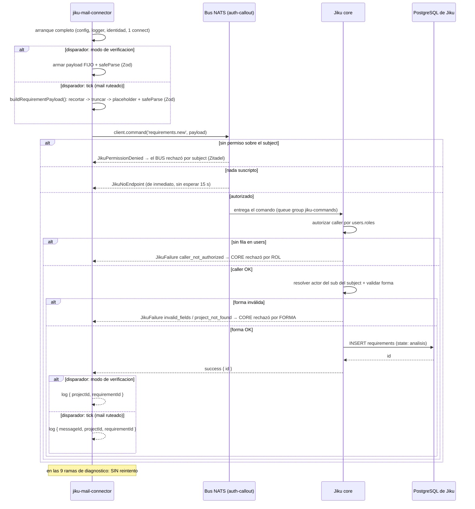

# Publicación de `requirements.new`

**Tipo:** Feature
**Status:** Implemented
**Creado:** 2026-08-27
**Última actualización:** 2026-09-01 (S-022 implementada: el disparador del tick ahora puede llevar
`fileIds` condicional, y se documenta el segundo comando que ADR-003 permite —
`files.request-upload` —, reusando la traducción de errores ya documentada. El modo de verificación
no cambia)
**Stories:** S-005, S-012, S-013, S-014, S-015, S-016, S-022

## Descripción

> **Hermano (S-027):** el conector publica un tercer comando,
> [`requirements.{id}.comment`](publicacion-requirements-comment.md), cuando un cliente responde por
> mail al hilo de su ticket. Este flujo **no cambia**: el alta de un Requisito sigue siendo
> exactamente lo que era.

Flujo de publicación del comando `requirements.new` al bus de Jiku y traducción de su respuesta.
**Dos disparadores, desde S-015:** el **modo de verificación** —un script explícito del repositorio,
separado del arranque normal— con un payload **fijo**; y el **tick** (FG-3), con un payload
**derivado del mail** vía `publishRequirementFromMail()`. Cubre el armado y la validación del payload,
la publicación vía `client.command()`, la reply por `_INBOX`, y **la traducción de las 9 ramas de
diagnóstico del SDK a cuál de los tres sistemas rechazó**.

Reusa completo el flujo [arranque-y-conexion-al-bus](arranque-y-conexion-al-bus.md): misma
configuración, mismo logger, misma identidad, **una sola conexión**. El árbol de decisión que resuelve
el proyecto y arma el payload del camino del mail está documentado en
[ruteo-y-alta-del-requisito](ruteo-y-alta-del-requisito.md).

**El flujo se extiende, no se reescribe** — como ya anticipaba su propia nota de FG-3. Lo que cambió
es el **origen del payload** en el segundo disparador (derivado del mail, con el orden
recortar → truncar → placeholder) y que la línea de éxito del camino del mail suma el `messageId`. **La
traducción de errores queda igual**, y el punto de log también: la línea vive dentro de
`publishVerificationRequirement()` / `publishRequirementFromMail()`, nunca en el entry point.

## Servicios Involucrados

| Servicio | Rol | Tipo de Participación |
|----------|-----|-----------------------|
| jiku-mail-connector | Arma el payload (fijo o derivado del mail), publica el comando y traduce la respuesta | Iniciador |
| Bus NATS + auth-callout | Autoriza el subject y entrega el comando a `core`; devuelve la reply por `_INBOX` | Procesador |
| Jiku (`core`) | Autoriza el caller por rol, resuelve el actor del subject, valida la forma y crea el requisito | Procesador |
| PostgreSQL de Jiku | Persiste el requisito (escrito por `core`, no por el conector) | Consumidor |

## Pasos del Flujo



### Paso 1: Arranque y conexión, con dos disparadores

**Origen:** jiku-mail-connector
**Destino:** (interno)
**Tipo:** Interno

**Acción:** los dos disparadores reusan los pasos 1-5 del flujo
[arranque-y-conexion-al-bus](arranque-y-conexion-al-bus.md): misma configuración, mismo logger, misma
identidad, **una sola conexión**.

**Dos disparadores, ambos sobre la misma publicación de fondo** (`client.command('requirements.new',
...)`, una sola constante `COMMAND`, un único punto de invocación en todo el código —verificado por
`test/publicacion/source-properties.test.ts`, *"invokes client.command in exactly one file"*):

1. **El script de verificación** (`npm run verify`) — **sin cambios desde S-005**: ejecución
   **explícita** de un script del repositorio, **nunca un efecto secundario de `start`** ni del `CMD`
   del contenedor, con un payload **fijo**.
2. **El tick** (FG-3, desde S-015) — dentro del `for` de `runTick()`, cuando `routeMail()` resuelve un
   proyecto para el mail (ver [ruteo-y-alta-del-requisito](ruteo-y-alta-del-requisito.md)), con un
   payload **derivado del mail**.

> **Por qué el script de verificación sigue separado del arranque:** invariante 9 — un requisito
> creado no se modifica ni se borra nunca. Si la publicación ocurriera en cada arranque, **cada
> reinicio dejaría basura permanente** en el proyecto de Jiku. El tick, en cambio, sí publica como
> parte de su ciclo normal — pero cada publicación corresponde a un mail nuevo `\Unseen`, nunca a un
> reinicio del proceso: el test de S-011 que afirma que `scheduleTick()` no dispara ningún tick antes
> del primer cron es la defensa de que esta propiedad se mantiene ahora que existe un camino de código
> de `index.ts` a `publicacion` vía el tick (S-016 CA-8).

**Ref:** S-005 CA-2; S-006 CA-7; S-015; RF-13

---

### Paso 2: Armar y validar el payload

**Origen:** jiku-mail-connector
**Destino:** (interno)
**Tipo:** Interno

**Acción:** `src/domain/publicacion/` arma el payload y lo valida con el schema Zod del comando usando
`safeParse`. Los tipos están inferidos del schema (`z.infer`), no escritos a mano. **La forma del
payload es idéntica en los dos disparadores** — sólo cambia de dónde salen `title`, `description` y
`projectId`.

**Payload del modo de verificación (fijo, `buildVerificationPayload()`):**
```json
{
  "title": "string — req, max 255. Literal del código",
  "description": "text — req. Literal del código",
  "projectId": "int — req. De la configuración (proyecto de prueba)",
  "type": "enum funcionalidad|mejora|incidencia|otro — 'incidencia'",
  "priority": "enum sin_prioridad|baja|media|alta|urgente — 'sin_prioridad'",
  "visibilityLevel": "enum public|internal — 'public'"
}
```

**Payload del tick (derivado del mail, `buildRequirementPayload()`, en alcance desde S-015):**

| Campo | Valor |
|---|---|
| `title` | `mail.subject.trim()` → `.slice(0, 255)` → si queda `''`, `config.ruteo.placeholderTitle` |
| `description` | `mail.body.trim()` → si queda `''`, `config.ruteo.placeholderBody` |
| `projectId` | El resuelto por `routeMail()` |
| `type` | `'incidencia'` — fijo, misma política que el modo de verificación |
| `priority` | `'sin_prioridad'` — fijo |
| `visibilityLevel` | `'public'` — fijo |
| `creator` | `client.userId` — el único campo que el payload fijo NO lleva (ver tabla de exclusiones) |
| `fileIds` | El resultado de `procesarAdjuntosDelMail()` (S-022, FG-4) — **condicional**, sólo si tiene al menos un elemento |

**Orden exacto en `title`/`description`, no intercambiable:** recortar (`.trim()`) → truncar
(`.slice(0, TITLE_MAX_LENGTH)`, sólo para `title`) → placeholder (si el resultado quedó `''`).
Invertirlo produciría, para un asunto de 400 espacios, un `title` vacío que el schema rechaza con
`min(1)` — el mail se perdería por un error de armado en vez de crear el requisito con el placeholder.
Detalle completo en [ruteo-y-alta-del-requisito](ruteo-y-alta-del-requisito.md).

**Lo que el payload NO lleva, con su fuente:**

| Campo excluido | Por qué |
|---|---|
| `state` | El requisito nace en `analisis`, default de Jiku (invariante 6, ADR-003) |
| `actor` | **La única clave de identidad que el plano de escritura rechaza de plano** (invariante 18) |
| `creator` | **Cambia según el disparador** — ver abajo |

**`fileIds` ya no es una fila de exclusión fija: depende del disparador.** Se envía **sólo si hay al
menos uno** (ADR-003). **El disparador del tick SÍ puede llevarlo**, condicional según lo que
`procesarAdjuntosDelMail()` resolvió (S-022, FG-4) — nunca `fileIds: []`. **El modo de verificación
(`npm run verify`) sigue sin cambios en este alcance:** su payload sigue siendo el fijo documentado
arriba, sin adjuntos, sin `fileIds`.

**La única fila que cambia respecto de la versión anterior de este documento es `creator`:**

| Disparador | `creator` | Efecto en `core` |
|---|---|---|
| Modo de verificación (sin cambios) | No va | Actor resuelto sólo del `sub` del subject |
| Tick (desde S-015) | **Va** — `client.userId` | `core` lo **ignora**: resuelve el actor del `sub` del subject igual (ADR-005). El campo es informativo, no una fuente de verdad |

Las filas de `state` y `actor` **no cambian**: siguen excluidas en los dos disparadores por las mismas
razones. `fileIds` es la excepción desde S-022: condicional en el disparador del tick, siempre ausente
en el modo de verificación. La lógica de payload derivado del mail —truncado a 255, placeholders por
asunto/cuerpo vacío— que la versión anterior de este documento marcaba como *"fuera de este
alcance"* **ya está en alcance**, implementada desde S-015.

**Ref:** S-005 CA-3, CA-4; S-015; ADR-003, ADR-005; convención `validation`

---

### Paso 2b: El segundo comando — `files.request-upload`

**Origen:** `procesarAdjuntosDelMail()` (`src/domain/publicacion/procesar-adjuntos-mail.ts`, vía
`requestFileUpload()`)
**Destino:** Bus NATS + auth-callout → Jiku (`core`)
**Tipo:** Evento (comando con reply)

El **segundo comando** que ADR-003 permite, distinto de `requirements.new`: pide permiso de subida
para UN adjunto y, si `core` lo concede, devuelve la `uploadUrl` prefirmada para el `PUT` directo (el
byte nunca viaja por el bus). Publicado **sólo desde el disparador del tick**, dentro de
`procesarAdjuntosDelMail()` — nunca desde el modo de verificación, que no procesa adjuntos.

**Payload:**

| Campo | Valor |
|---|---|
| `fileName` | `adjunto.filename` |
| `mimeType` | `adjunto.mimeType` (declarado, no verificado por el conector) |
| `fileSize` | `adjunto.content.length` |
| `checksum` | sha256 del `content`, calculado con `node:crypto` |

**Publicación:** `client.command('files.request-upload', payload)` — mismo `client`, mismo timeout
(15000 ms, ADR-002), mismo mecanismo de subject/reply que `requirements.new` (Paso 3 de este mismo
documento).

**Traducción de la respuesta — reutiliza `diagnosePublishFailure()` y `logContext()`** (la misma
función que traduce las nueve ramas de `requirements.new`, tabla de "Manejo de Errores" de este
documento): las clases del SDK (`JikuPermissionDenied`, `JikuNoEndpoint`, `JikuTimeout`, etc.) se
traducen igual. **La única rama nueva, ANTES de esa función,** es el `failure` de **negocio** propio
de este comando — no una clase del SDK, sino el `status: 'failure'` que `core` responde cuando el
archivo no pasa su propia política:

| `errorCode` | Quién rechazó | Log |
|---|---|---|
| `file_type_not_allowed` | `core`, política de tipo de archivo | `warn` con `{ code, nombre, mime }`, `'permiso de subida rechazado'` |
| `file_too_large` | `core`, política de tamaño | `warn` con `{ code, nombre, mime }`, `'permiso de subida rechazado'` |

Ninguna de las dos ramas es un error del SDK ni del bus: es un rechazo de **negocio**, tratado como
caso esperado (el filtro local del conector es conveniencia, no autoridad — ADR-003) y anotado como
aviso en la `description` del requisito, nunca como `fallidos` del tick.

**Éxito:** `success { fileId, uploadUrl }` — el `fileId` se acumula para el `fileIds` del payload de
`requirements.new` (Paso 2), y la `uploadUrl` se usa **una sola vez**, para el `PUT` inmediato del
byte, y **nunca se loguea**.

**Ref:** S-018, S-019, S-022 CA-2; ADR-003, ADR-006

---

### Paso 3: Publicar el comando

**Origen:** jiku-mail-connector
**Destino:** Bus NATS + auth-callout
**Tipo:** Evento (comando con reply)

**Acción:** `client.command('requirements.new', payload)`.

- **Subject:** `{instance}.{sub}.jiku-commands.v1.requirements.new` — **lo arma el SDK**. El conector
  **no arma subjects ni parsea envelopes**.
- **Reply:** por `_INBOX.{hash(sub)}.>`. El prefijo **lo fija el SDK siempre**; el conector **no fija
  `inboxPrefix`**.
- **Timeout:** **15000 ms**, el default del SDK. **No se baja** — el servidor corta a los 10 s y
  PostgreSQL a los 8 s; un timeout más corto convierte el error explicado en un timeout mudo.

**Ref:** S-005 CA-5, CA-6; ADR-002; NFR-P03, ADR-006

---

### Paso 4: `core` autoriza, valida y crea el requisito

**Origen:** Bus NATS
**Destino:** Jiku (`core`) — queue group `jiku-commands`
**Tipo:** Evento (consumidor)

**Acción de `core`:**
1. Autoriza el caller leyendo `users.roles`.
2. Resuelve el actor **del `sub` del subject** (ignora lo que el cuerpo declare).
3. Valida la forma del payload.
4. Crea el requisito en una transacción.

**Operación de BD:**
- **Tabla:** `requirements` (base de Jiku)
- **Operación:** INSERT
- **Campos:** `title`, `description`, `projectId`, `type: incidencia`,
  `priority: sin_prioridad`, `visibilityLevel: public`, `state: analisis` (default, el conector no lo
  manda)

**Response (éxito):** `success` con el `id` del requisito creado.

**El conector no alcanza PostgreSQL:** está tres saltos más allá — publica un comando, `core` lo
ejecuta, `core` escribe (ADR-001).

**Ref:** S-005 CA-1; ADR-003; ADR-001

---

### Paso 5: Traducir la respuesta

**Origen:** jiku-mail-connector
**Destino:** stdout
**Tipo:** Interno

**Acción (éxito, modo de verificación):** loguea el `id` del requisito **junto con el `projectId`**,
en la misma línea: `{ projectId, requirementId }`.

**Acción (éxito, tick):** loguea los tres identificadores más los dos conteos de archivos, en la misma
línea: `{ messageId, projectId, requirementId, archivosVinculados, archivosConAviso }` (los dos
conteos suman desde S-021/S-022) — el `messageId` es lo que sumó el disparador del tick, cerrando la
nota que la versión anterior de este documento ya anticipaba (*"el registro con `messageId` es de
FG-3"*).

**Acción (error, en cualquiera de los dos disparadores):** traduce la clase del SDK al diagnóstico de
**quién rechazó** (ver Manejo de Errores). En el camino del mail, la línea de error también suma el
`messageId` — `logContext()` en sí **no cambia**, el `messageId` se agrega al objeto de log por fuera.
**No reintenta nada, en ningún disparador.**

**Ref:** S-005 CA-1, CA-7..CA-14; S-015; ADR-006

## Manejo de Errores

**Esta tabla es el entregable central del flujo** (copiada de ADR-006 y del PRD de arquitectura). **Su
contenido no cambia respecto de S-005** — las nueve ramas de diagnóstico son las mismas para los dos
disparadores. Lo que cambia es que, en el camino del mail, cada línea lleva además el `messageId`:

| Paso | Clase del SDK | `errorCode` | Quién rechazó | Qué dice el log | CA |
|------|---------------|-------------|---------------|-----------------|-----|
| 3 | `JikuPermissionDenied` | — | **El bus**, por subject, antes de que `core` viera nada | Problema del **rol en Zitadel**. **No implica nada sobre `core`** | S-005 CA-7 |
| 3 | `JikuNoEndpoint` | — | El bus dice **de inmediato** que nada está suscripto | Se loguea sin esperar el timeout | S-005 CA-12 |
| 3 | `JikuInvalidRequest` | — | Rechazado **localmente**: nada llegó a la red | **Error de armado del conector** | S-005 CA-12 |
| 4 | `JikuFailure` | `caller_not_authorized` | El bus dejó pasar; **`core` rechazó por rol** | Típicamente **sin fila en `users`**. **Reconectar lo corrige solo**, y una corrida posterior tiene éxito | S-005 CA-8 |
| 4 | `JikuFailure` | `unknown_caller` | El bus dejó pasar; **`core` rechazó por rol** | Mismo diagnóstico que `caller_not_authorized`: mismo arreglo (reconectar) | S-016 |
| 4 | `JikuFailure` | `invalid_fields` | `core` aceptó el caller y rechazó **la forma** | El payload. **Es prueba de que el plano de escritura está abierto** | S-005 CA-10 |
| 4 | `JikuFailure` | `project_not_found` | `core`: el proyecto no existe | Se loguea **con el `projectId` usado**. También prueba que el plano está abierto | S-005 CA-9 |
| 3-4 | `JikuTimeout` | — | Nada respondió: `core` caído o lento | A los **15 s**, con la clase. **Sin `hint()`: la clase no lo declara** (ver Nota sobre `hint()`) | S-005 CA-11 |
| 4 | cualquiera | **desconocido** | — | Se loguea con su `code` y su `errorMessage` **y no se mapea a nada**. Su `hint()` es `undefined` (ver Nota sobre `hint()`) | S-005 CA-13 |
| — | (respuesta sin `id` usable) | — | `core` contestó éxito pero sin dato usable (`respuesta_ilegible`) | Prueba igual que el plano está abierto: `core` contestó | S-005 |

**En todos los casos: no hay reintento** (C-19, NFR-R03). El resultado es informar el fallo con la
clase del SDK, el `code` y —cuando existe— el `hint()`, más el `messageId` cuando el disparador es el
tick.

**El eje del diagnóstico:** las tres primeras filas son **el bus**; las cuatro siguientes son
**`core`**, y entre ellas se distingue **por rol** (`caller_not_authorized`, `unknown_caller`) de
**por forma** (`invalid_fields`, `project_not_found`). Esa distinción es la que le dice a U-02 si el
arreglo está en Zitadel, en la fila de `users`, o en el payload.

## Resultado

**Éxito (modo de verificación):** un Requisito visible en Jiku, en el proyecto de prueba, con
`type: incidencia`, `priority: sin_prioridad`, `visibilityLevel: public` y `state: analisis`; y una
línea de log con `{ projectId, requirementId }`.

**Éxito (tick):** un Requisito visible en Jiku, en el proyecto que `routeMail()` resolvió del slug del
mail, con los mismos cuatro campos fijos más `creator` (informativo); y una línea de log con
`{ messageId, projectId, requirementId }`.

**Estado final:**
- `requirements` (base de Jiku): un requisito nuevo, escrito por `core`. **Nunca se modifica ni se
  borra**
- Conector: sin estado persistido de ninguna clase — no hay base, ni volumen
- Logs: una línea con el `id`, el `projectId`, y —en el camino del mail— el `messageId`

## Notas

- **Repetible y sin idempotencia:** cada corrida del modo de verificación **crea un requisito nuevo**.
  Dos corridas dejan dos requisitos y **ninguno se borra ni se modifica** — no hay comando de
  compensación (invariante 9). *Mitigación operativa:* correrlo **contra un proyecto de prueba**.
- **La primera corrida de un despliegue nuevo falla con `caller_not_authorized`, y eso es correcto.**
  La fila del conector en `users` la crea Jiku sola en su primera autenticación; hasta que exista,
  todo comando se rechaza. El conector **no intenta crear la fila** (G-03). Una corrida posterior tiene
  éxito.
- **`invalid_fields` y `project_not_found` son buenas noticias en un despliegue nuevo:** prueban que el
  plano de escritura está **abierto** para esta identidad. Distinguirlos de `caller_not_authorized` es
  lo que evita diagnosticar un problema de payload cuando el problema es de rol, y al revés.
- **Riesgo:** alguien "optimiza" el timeout a 5 s y convierte los errores explicados de PostgreSQL
  —que corta a los 8 s— en timeouts mudos. Es el tipo de cambio que parece una mejora y empeora
  exactamente lo que se está protegiendo. El piso de 15000 ms está en la configuración (S-002 CA-5).
- **Los tests cubren la traducción, no el plano real:** el responder de `core` se implementa en el
  propio test y `Client.fromConnection()` **saltea el handshake de auth**. Cada clase de error tiene su
  test, pero nada de eso prueba Zitadel, el rol ni el prefijo de inbox.
- **Convención candidata:** el patrón de uso del SDK (conexión única, token como getter, mapeo de
  clases de error) no tiene convención escrita en el catálogo. Este flujo **lo produce**; formalizarlo
  es candidato a `/product-change-technical-definition` cuando FG-2/FG-3 confirmen que se estabilizó.

- **Nota sobre `hint()` — desviación documentada entre la story y el SDK instalado.** Los criterios
  CA-9, CA-11, CA-12 y CA-13 de S-005 piden loguear la clase del error "con su `hint()`". **Eso no se
  puede hacer literalmente**, y verificarlo ejecutando el SDK lo dejó firme:

  1. **`hint()` está declarado sólo en `JikuFailure`.** `JikuTimeout`, `JikuNoEndpoint`,
     `JikuPermissionDenied` y `JikuInvalidRequest` extienden `JikuError`, que no lo declara:
     invocarlo sobre cualquiera de ellas es un **`TypeError`** — y ocurriría justo cuando el conector
     ya está fallando y el log es lo único que queda. Por eso el acceso vive en **una sola** función
     guardada (`hintOf()`), y hay un test de propiedad que afirma que hay un único punto de llamada.
  2. **`hint()` devuelve `undefined` para `project_not_found` y para todo código desconocido.** El
     catálogo de `hintFor()` no los cubre y su `default` devuelve `undefined`. Son exactamente los dos
     casos que CA-9 y CA-13 piden loguear "con su `hint()`".

  **Lo que se implementó en su lugar:** el campo `hint` se **omite** del contexto cuando no existe (no
  se loguea `hint: null`, que sugeriría que el SDK contestó algo cuando no contestó nada), y lo que
  viaja siempre es la **clase del error**, el **`code`** y el **`errorMessage` que mandó `core`,
  verbatim**. Para esos dos casos ése es el dato de diagnóstico real. **No inventar texto para tapar
  la ausencia de `hint()`.**

- **La nota original para FG-3 se cumplió, sin sorpresas.** Decía que este flujo se extendería sin
  reescribirse, cambiando sólo el origen del payload y sumando el registro del alta con `messageId`.
  S-015 lo implementó exactamente así: `publishRequirementFromMail()` es hermana de
  `publishVerificationRequirement()`, comparte el mismo `try/catch/log/relanza` y el mismo
  `client.command()`, y la única diferencia observable es de dónde sale el payload y que el
  `messageId` viaja en ambos objetos de log. La traducción de errores (`diagnosePublishFailure()`,
  `logContext()`) **no se tocó**.
