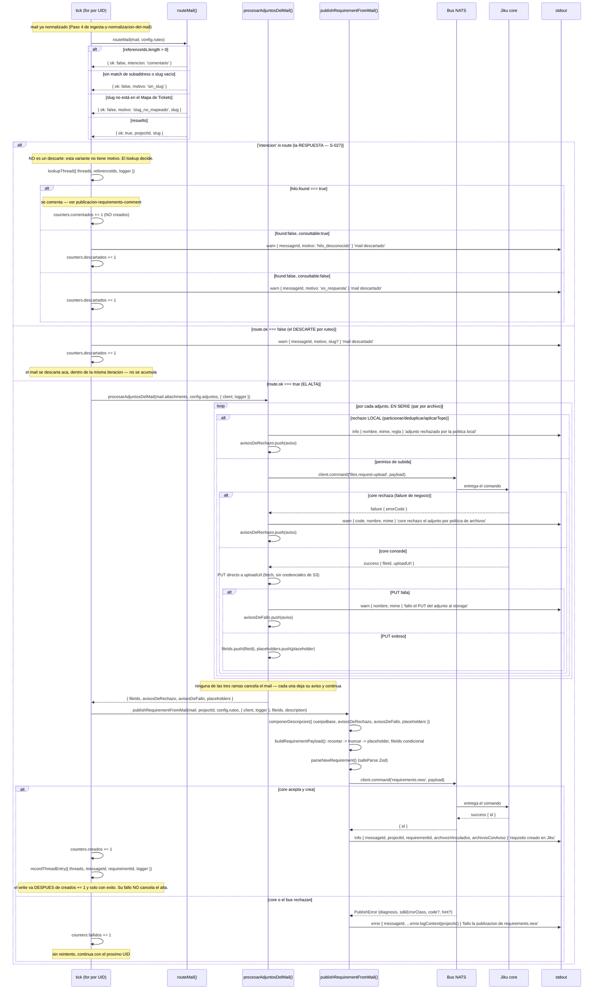

# Ruteo y Alta del Requisito

**Tipo:** Evento
**Status:** Active
**Creado:** 2026-08-31
**Última actualización:** 2026-09-08 (S-026 implementada: el Paso 6 gana el write al Mapa de Hilos
después del `success` del alta; el Paso 3 gana el lookup que resuelve el motivo final de una
respuesta, con `hilo_desconocido` como motivo nuevo y `es_respuesta` cambiando de significado.
S-027: la respuesta con match deja de descartarse y se publica como Comentario — ver
[publicacion-requirements-comment](publicacion-requirements-comment.md))
**Stories:** S-012, S-013, S-014, S-015, S-016, S-022, S-026, S-027, S-028

> **El diagrama incluye la rama del comentario desde S-028.** La nota de alcance de S-026 decía que
> el Mermaid **no se tocaba** porque la salida por comentario era de S-027 y *"escribir hoy un flujo
> que describe una salida que todavía no existe dejaría documentación que miente durante toda una
> story"*. Ese razonamiento era correcto **entonces** y quedó vencido cuando S-027 construyó la
> salida: el diagrama pasó a mentir por el otro lado, mostrando la respuesta con match cayendo en el
> descarte. S-028 lo corrigió al releer los flujos contra el código, que es alcance explícito de esa
> story. Las operaciones del Mapa de Hilos —el hash, el write, el lookup, el TTL— siguen viviendo en
> su flujo propio: [mapa-de-hilos-en-kv](mapa-de-hilos-en-kv.md), y la publicación del comentario en
> [publicacion-requirements-comment](publicacion-requirements-comment.md).

## Descripción

El punto donde `ingesta` y `publicacion` se encuentran, dentro de la misma iteración del tick, y del
que ninguno de los dos módulos es dueño natural: el de ingesta termina en el mail normalizado, el de
publicación arranca con un payload ya armado. Este flujo cubre lo que pasa entre esos dos puntos —
**si** publicar y **con qué** — inmediatamente después del Paso 4 de
[ingesta-y-normalizacion-del-mail](ingesta-y-normalizacion-del-mail.md): el árbol de decisión de
`routeMail()` que resuelve el proyecto o el motivo de descarte, el **procesamiento completo de los
adjuntos del mail** (S-022, FG-4), el armado del payload derivado del mail —ahora con `fileIds`
condicional y la `description` compuesta en cuatro bloques—, y la publicación con sus tres ramas de
resultado (alta, descarte, fallo).

## Servicios Involucrados

| Servicio | Rol | Tipo de Participación |
|----------|-----|-----------------------|
| jiku-mail-connector (`ruteo`) | Resuelve el proyecto del mail o el motivo de descarte, de forma pura y sin loguear | Procesador |
| jiku-mail-connector (`adjuntos`/`publicacion`, `procesarAdjuntosDelMail()`) | Particiona, dedupica, topea y sube cada adjunto del mail (permiso + `PUT`), sin cancelar el requisito ante ningún fallo de archivo | Procesador |
| jiku-mail-connector (`publicacion`) | Arma el payload derivado del mail (con `fileIds` condicional y la `description` compuesta), lo valida y lo publica | Procesador |
| Bus NATS | Entrega los comandos `files.request-upload` y `requirements.new` a `core` y devuelve las replies | Procesador |
| Jiku (`core`) | Autoriza, valida la forma, concede o rechaza el permiso de subida, y crea el requisito | Procesador |
| Storage S3-compatible | Recibe el `PUT` directo del byte del adjunto, fuera de banda del bus | Procesador |
| stdout | Recibe la línea de resultado de cada mail (alta, descarte o fallo) | Consumidor |

## Pasos del Flujo

### Paso 1: El trigger — un `IncomingMail` recién normalizado

**Origen:** `tick` (`src/domain/ingesta/tick.ts`)
**Destino:** `routeMail()`
**Tipo:** Interno

**Trigger:** dentro de la misma iteración del `for` del tick, inmediatamente después de
`normalize()` y `counters.parseados += 1` (Paso 4 de
[ingesta-y-normalizacion-del-mail](ingesta-y-normalizacion-del-mail.md)), antes de que el mail se
descarte.

**Ref:** S-014; ADR-001

---

### Paso 2: El árbol de decisión de `routeMail()`

**Origen:** `tick`
**Destino:** `src/domain/ruteo/route-mail.ts`
**Tipo:** Interno (función pura)

`routeMail()` **nunca lanza, nunca loguea**: todo camino negativo es un valor de retorno tipado. El
tick decide qué hacer con el resultado y es quien loguea. **Orden de evaluación exacto** — descarta lo
más barato primero:

1. **`mail.referenceIds.length > 0`** → `{ ok: false, intencion: 'comentario' }` (S-027; hasta S-026
   era `{ ok: false, motivo: 'es_respuesta' }`). **No es un descarte** —por eso esa variante no lleva
   `motivo`— sino la intención que el lookup del tick resuelve. Se evalúa **primero**,
   antes de tocar el slug: una respuesta no gasta el regex ni el lookup. Basta con que
   `referenceIds` no esté vacío, sin importar a qué apunten las referencias — incluye el **falso
   positivo conocido y aceptado del reenvío**: un mail reenviado por un cliente desde un hilo interno,
   con `References` poblado y un pedido nuevo legítimo, se descarta igual (decisión 9 del PRD, G-04
   manda degradar hacia el descarte).
2. Aislar el email de `mail.recipient` con `extractAddress()`, aplicar
   `^<subaddressPrefix>\+([^@]+)@` case-insensitive. Si no matchea o el slug capturado queda vacío →
   `{ ok: false, motivo: 'sin_slug' }`. El slug se captura **entero** entre `+` y `@`, sin validar su
   forma.
3. Normalizar el slug capturado a minúsculas, `ticketMap.get(slug)`. Si no existe →
   `{ ok: false, motivo: 'slug_no_mapeado', slug }` — **el único motivo que lleva el slug**, porque es
   el dato que hace falta para cargarlo al mapa.
4. Resuelto → `{ ok: true, projectId, slug }`. El `ticketMap` ya llegó normalizado a minúsculas desde
   la configuración; el lookup en caliente es un `Map.get()` sin transformar el mapa.

**Ref:** S-013, S-014 CA-1 a CA-4; ADR-004, ADR-006

---

### Paso 3: El descarte

**Origen:** `tick`
**Destino:** stdout
**Tipo:** Interno

Si `route.ok === false`: una única línea `warn` con
`{ messageId, motivo, ...(slug !== undefined ? { slug } : {}) }`, mensaje `'mail descartado'`. El
`slug` viaja **sólo** cuando está presente en el resultado (únicamente `slug_no_mapeado` lo lleva) —
nunca `slug: undefined` a mano. `counters.descartados += 1`.

**Desde S-026, el motivo FINAL de una respuesta no es el que devolvió `routeMail()`.** Cuando
la intención es de comentario —y **sólo** entonces; `sin_slug` y `slug_no_mapeado` no tienen
referencias que consultar y no pagan el round-trip— el tick invoca
`lookupThread({ threads, referenceIds: mail.referenceIds, logger })` **antes** de emitir la línea, y
el resultado resuelve el motivo:

| Resultado del lookup | Motivo emitido |
|---|---|
| Sin match, consultable | `hilo_desconocido` |
| No consultable (bucket inaccesible) | `es_respuesta` |
| Con match | **No se descarta.** Desde S-027 se publica como Comentario del Requisito y cuenta en `comentados` |

**`es_respuesta` cambió de significado dos veces.** Primero pasó de cubrir *"toda respuesta"* a cubrir *"no pude
averiguar a qué hilo apunta"*. La distinción contra `hilo_desconocido` —*"esta respuesta apunta a un
hilo que no conozco"*— es deliberada y el log tiene que sostenerla: uno se arregla cargando el hilo,
el otro arreglando el bucket. Y **S-027 le quitó el primero**: una respuesta con match ya no se
descarta, así que hoy `es_respuesta` significa **únicamente** *"no pude consultar el Mapa de Hilos"*.
Es el motivo más raro de los seis, y eso es correcto: sólo aparece con el bucket caído. S-027
resuelve el primero.

**Sigue habiendo UNA sola línea de log por descarte:** el motivo se resuelve en una variable antes del
`logger.warn`. `routeMail()` **no cambia** — ni su firma, ni su árbol, ni su orden de evaluación.

**El mail (y el `RouteResult`) se descartan acá**: no se acumulan en ningún array del tick — el pico de
memoria del proceso es de **un mail a la vez**, nunca del lote entero. No publica, no responde, no
persiste.

**Ref:** S-014 CA-3, CA-4; S-016 CA-9, CA-11, CA-19; S-026 CA-6, CA-8, CA-9, CA-10, CA-13; ADR-001,
ADR-006. Detalle completo del lookup en [mapa-de-hilos-en-kv](mapa-de-hilos-en-kv.md), Paso 3.

---

### Paso 4: El procesamiento de adjuntos

**Origen:** `tick`
**Destino:** `procesarAdjuntosDelMail()` (`src/domain/publicacion/procesar-adjuntos-mail.ts`)
**Tipo:** Interno

Si `route.ok === true`, ANTES de armar el payload del requisito, el tick invoca
`procesarAdjuntosDelMail(mail.attachments, config.adjuntos, { client, logger })` **dentro de la misma
iteración del mail** (S-022, FG-4). Orquesta partición → dedup → tope (S-017) con el permiso de subida
(S-018) y el `PUT` directo (S-019), **en serie, par por archivo** (permiso + `PUT` de un adjunto antes
de pedir el permiso del siguiente — nunca todos los permisos primero).

**Tres ramas de rechazo/fallo, ninguna cancela el mail — cada una deja su aviso y el procesamiento
continúa con el siguiente adjunto:**

1. **Rechazo LOCAL** (`particionar()`/`deduplicar()`/`aplicarTope()`, política de extensión/MIME/tamaño
   o tope de 10 excedido) — log `info` con `{ nombre, mime, regla }`, `'adjunto rechazado por la
   política local'`. Nunca llega a tocar el bus.
2. **`failure` de negocio de `core`** vía `requestFileUpload()` (`files.request-upload` rechazado —
   `file_type_not_allowed` o `file_too_large`) — log `warn` con `{ code, nombre, mime }`, `'permiso de
   subida rechazado'`.
3. **Fallo de `PUT`** vía `uploadFileContent()` (el storage S3-compatible no responde 2xx) — log `warn`
   con `{ nombre, mime }`, `'fallo el PUT del adjunto al storage'`. El permiso ya fue concedido, pero el
   byte nunca llegó.

Devuelve `{ fileIds, avisosDeRechazo, avisosDeFallo, placeholders }` — **nunca** un `Buffer` ni el
`content` de ningún adjunto: sólo ids, textos y placeholders.

**Ref:** S-017 a S-021; S-022 CA-1, CA-5 a CA-10; ADR-003, ADR-006

---

### Paso 5: El armado del payload

**Origen:** `publishRequirementFromMail()` (vía `buildRequirementPayload()` y `componerDescripcion()`)
**Destino:** (interno)
**Tipo:** Interno

`buildRequirementPayload()` (`src/domain/publicacion/mail-payload.ts`) arma el payload de
`requirements.new` a partir del mail, el `projectId` resuelto, y el resultado de
`procesarAdjuntosDelMail()`. **Orden exacto, y no es intercambiable:** `recortar` (`.trim()`) →
`truncar` (`.slice(0, TITLE_MAX_LENGTH)` para `title`, sin tope para `description`) → `placeholder`
(si el resultado quedó `''`). Invertirlo —placeholder antes de truncar— produciría, para un asunto de
400 espacios, un título vacío que el schema rechaza con `min(1)`, y el mail se perdería por un error
de armado del conector en vez de crear el requisito con el placeholder.

| Campo | Valor |
|---|---|
| `title` | `mail.subject.trim()` → `.slice(0, 255)` → si queda `''`, `config.ruteo.placeholderTitle` |
| `description` | `componerDescripcion({ cuerpoBase, avisosDeRechazo, avisosDeFallo, placeholders })` — cuatro bloques en orden fijo: cuerpo base → avisos de rechazo → avisos de fallo de subida → placeholders al final |
| `projectId` | El resuelto por `routeMail()` |
| `type` | `'incidencia'` — fijo |
| `priority` | `'sin_prioridad'` — fijo |
| `visibilityLevel` | `'public'` — fijo |
| `creator` | `client.userId` — informativo; `core` lo ignora y resuelve el actor del `sub` del subject (ADR-005) |
| `fileIds` | **Condicional** — presente sólo si `adjuntos.fileIds.length > 0` (nunca `fileIds: []`) |

**Las dos claves siempre excluidas:** `state` (default de Jiku), `actor` (única clave que el
`.strict()` y el SDK rechazan de plano). El `.strict()` del schema además rechaza cualquier clave
desconocida.

**Ref:** S-015 CA-1 a CA-8; S-020, S-021, S-022 CA-1; ADR-003, ADR-005

---

### Paso 6: La publicación y su línea de resultado

**Origen:** `publishRequirementFromMail()`
**Destino:** Bus NATS → Jiku (`core`)
**Tipo:** Evento (comando con reply)

El payload se valida con `parseNewRequirement()` (Zod `safeParse`) antes de publicar. Publicación con
`client.command('requirements.new', payload)` — dos argumentos, el timeout queda en el default del SDK
(15000 ms, ADR-002). Dentro de la rama `route.ok === true` del `for` de `tick.ts`, en la **misma
iteración**:

- **Éxito** → `counters.creados += 1`; `publishRequirementFromMail()` ya logueó
  `'requisito creado en Jiku'` con `{ messageId, projectId, requirementId, archivosVinculados,
  archivosConAviso }` en una sola línea (los dos conteos de archivos suman desde S-021/S-022) — el
  tick no vuelve a loguear.
- **Fallo** (`PublishError`) → `counters.fallidos += 1`; `publishRequirementFromMail()` ya logueó el
  fallo con `{ messageId, ...error.logContext(projectId) }` (diagnóstico por clase del SDK, `code` y
  `hint()` cuando existen) — el tick no vuelve a loguear, solo cuenta y continúa con el siguiente UID,
  sin reintento.

**Desde S-026, el éxito gana un efecto posterior: el write al Mapa de Hilos.** En el mismo `try`,
**después** de `counters.creados += 1`, se invoca
`recordThreadEntry({ threads, messageId: mail.messageId, requirementId, logger })` — con el
`Message-Id` **crudo**, que la función hashea. Va **sólo** en el camino de éxito: si el alta falló, el
`catch` cuenta `fallidos` y **no se escribe nada**.

**El fallo del write no cancela el alta.** `recordThreadEntry()` **no lanza** (absorbe su fallo con un
`warn`), así que no necesita un `try/catch` propio y el `catch` de `PublishError` sigue viendo sólo lo
que veía. `counters.creados` **no se revierte**, no hay compensación, y el `for` continúa. El write es
un efecto **posterior** y **fuera del camino crítico** del alta.

**La línea del tick emite seis contadores:** S-026 agregó `comentados`, que en esa story quedaba
**siempre en 0** —la salida por comentario era S-027— y que **desde S-027 se incrementa de verdad**.
Es un contador **separado** de `creados`
porque `creados` cuenta sólo altas de Requisito.

**Ref:** S-005, S-015 CA-9 a CA-14; S-016 CA-10, CA-12; S-026 CA-1, CA-3, CA-4, CA-11; ADR-001,
ADR-002, ADR-006. Detalle completo del write en [mapa-de-hilos-en-kv](mapa-de-hilos-en-kv.md),
Paso 2.

## Manejo de Errores

| Motivo/Diagnóstico | Nivel | Quién lo produce | Comportamiento |
|---|---|---|---|
| `es_respuesta` | `warn` | El lookup del tick | `counters.descartados += 1`. **Desde S-027** cubre UNA sola cosa: el lookup **no se pudo hacer** (bucket de hilos inaccesible). La respuesta con match ya no llega acá — se comenta |
| `hilo_desconocido` | `warn` | `lookupThread()`, resuelto en el tick **(S-026)** | `counters.descartados += 1`. El lookup **sí** se pudo hacer y ninguna referencia matcheó. **No se crea nada.** Cubre el reenvío de hilo interno con slug mapeado y la entrada expirada por el TTL de 90 días |
| El `put()` al Mapa de Hilos falla **(S-026)** | `warn` | `recordThreadEntry()` | **El tick continúa.** El alta **no se cancela ni se compensa** y `counters.creados` no se revierte |
| `sin_slug` | `warn` | `routeMail()` | `counters.descartados += 1` |
| `slug_no_mapeado` | `warn` | `routeMail()` | `counters.descartados += 1`, con el `slug` en la línea |
| `rechazo_del_bus_por_subject` / `bus_sin_endpoint` | `error` | Bus NATS, vía `PublishError` | `counters.fallidos += 1`, sin reintento |
| `core_rechazo_por_rol` / `core_rechazo_por_forma` / `core_rechazo_desconocido` | `error` | Jiku `core`, vía `PublishError` | `counters.fallidos += 1`, sin reintento |
| `nada_respondio` / `respuesta_ilegible` / `desconocido` | `error` | SDK / bus, vía `PublishError` | `counters.fallidos += 1`, sin reintento |

**En todos los casos de fallo: sin reintento** (ADR-001, NFR-R03). Un comando fallido no se reintenta:
sin idempotencia y sin compensación, reintentar crea dos requisitos donde tenía que haber uno.

## Resultado

**Éxito:** un requisito nuevo en Jiku, en el proyecto resuelto por el slug, con
`visibilityLevel: public` y `state: analisis` (default de Jiku) — y una línea de log con los tres
identificadores (`messageId`, `projectId`, `requirementId`).

**Descarte:** ningún efecto en Jiku ni en el bus. Una línea de log con el motivo.

**Fallo:** ningún efecto en Jiku (la escritura no ocurrió). Una línea de log con el diagnóstico de qué
sistema rechazó.

**En los tres casos:** el mail se procesa y se descarta dentro de la misma iteración del `for` del
tick — nunca se acumula un array de mails ruteados ni de resultados de ruteo entre `routeMail()` y la
publicación. **Esta es la propiedad que FG-4 tenía que preservar deliberadamente, y S-022 la afirma
con un test: ya está preservada.** `mail.attachments` —el único portador de los `Buffer` de los
adjuntos— se pasa directo a `procesarAdjuntosDelMail()` dentro de la misma iteración del mail, sin
copiarse a ningún array del tick, y deja de tener referencias vivas en cuanto esa iteración termina.
El resultado que sobrevive (`ProcesamientoAdjuntosResultado`) sólo lleva `fileIds`, textos y
placeholders — nunca un `Buffer` ni el `content` de ningún adjunto.

## Notas

**Por qué un flujo propio y no la extensión de los dos existentes:** es el punto donde
[ingesta-y-normalizacion-del-mail](ingesta-y-normalizacion-del-mail.md) y
[publicacion-requirements-new](publicacion-requirements-new.md) se encuentran, y **ninguno de los dos
es su dueño natural**. El de ingesta termina en el mail normalizado; el de publicación arranca con un
payload ya armado. La decisión de **si** publicar y **con qué** no vivía en ninguno de los dos.

**`routeMail()` es pura y pasiva a propósito:** nunca lanza, nunca loguea. Separar la decisión (ruteo)
del reporte (tick) es lo que permite testear el árbol de decisión sin infraestructura de logging ni de
bus.

**Relación con los otros tres flujos:** el trigger de este flujo es la salida del Paso 4 de
[ingesta-y-normalizacion-del-mail](ingesta-y-normalizacion-del-mail.md); su Paso 6 (la publicación) es
el segundo disparador de [publicacion-requirements-new](publicacion-requirements-new.md), que también
documenta la traducción completa de las nueve ramas de diagnóstico; la conexión al bus que este flujo
reutiliza es la de [arranque-y-conexion-al-bus](arranque-y-conexion-al-bus.md).
