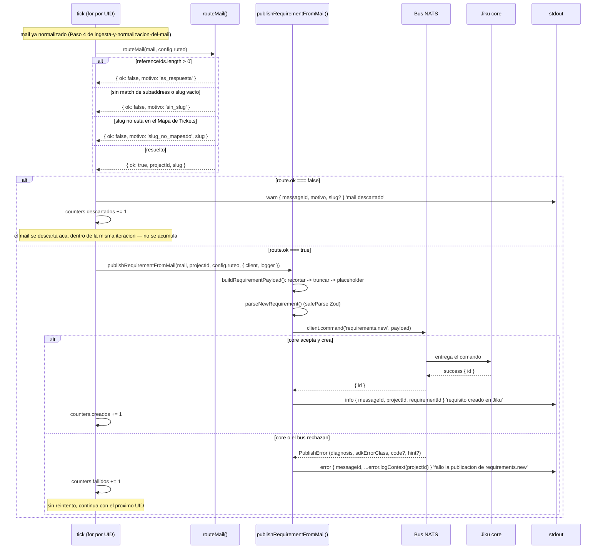

# Ruteo y Alta del Requisito

**Tipo:** Evento
**Status:** Active
**Creado:** 2026-08-31
**Última actualización:** 2026-08-31
**Stories:** S-012, S-013, S-014, S-015, S-016

## Descripción

El punto donde `ingesta` y `publicacion` se encuentran, dentro de la misma iteración del tick, y del
que ninguno de los dos módulos es dueño natural: el de ingesta termina en el mail normalizado, el de
publicación arranca con un payload ya armado. Este flujo cubre lo que pasa entre esos dos puntos —
**si** publicar y **con qué** — inmediatamente después del Paso 4 de
[ingesta-y-normalizacion-del-mail](ingesta-y-normalizacion-del-mail.md): el árbol de decisión de
`routeMail()` que resuelve el proyecto o el motivo de descarte, el armado del payload derivado del
mail, y la publicación con sus tres ramas de resultado (alta, descarte, fallo).

## Servicios Involucrados

| Servicio | Rol | Tipo de Participación |
|----------|-----|-----------------------|
| jiku-mail-connector (`ruteo`) | Resuelve el proyecto del mail o el motivo de descarte, de forma pura y sin loguear | Procesador |
| jiku-mail-connector (`publicacion`) | Arma el payload derivado del mail, lo valida y lo publica | Procesador |
| Bus NATS | Entrega el comando `requirements.new` a `core` y devuelve la reply | Procesador |
| Jiku (`core`) | Autoriza, valida la forma y crea el requisito | Procesador |
| stdout | Recibe la línea de resultado de cada mail (alta, descarte o fallo) | Consumidor |

## Pasos del Flujo

### Paso 1: El trigger — un `IncomingMail` recién normalizado

**Origen:** `tick` (`src/domain/ingesta/tick.ts`)
**Destino:** `routeMail()`
**Tipo:** Interno

**Trigger:** dentro de la misma iteración del `for` del tick, inmediatamente después de
`normalize()` y `counters.parseados += 1` (Paso 4 de
[ingesta-y-normalizacion-del-mail](ingesta-y-normalizacion-del-mail.md)), antes de que el mail se
descarte.

**Ref:** S-014; ADR-001

---

### Paso 2: El árbol de decisión de `routeMail()`

**Origen:** `tick`
**Destino:** `src/domain/ruteo/route-mail.ts`
**Tipo:** Interno (función pura)

`routeMail()` **nunca lanza, nunca loguea**: todo camino negativo es un valor de retorno tipado. El
tick decide qué hacer con el resultado y es quien loguea. **Orden de evaluación exacto** — descarta lo
más barato primero:

1. **`mail.referenceIds.length > 0`** → `{ ok: false, motivo: 'es_respuesta' }`. Se evalúa **primero**,
   antes de tocar el slug: una respuesta no gasta el regex ni el lookup. Basta con que
   `referenceIds` no esté vacío, sin importar a qué apunten las referencias — incluye el **falso
   positivo conocido y aceptado del reenvío**: un mail reenviado por un cliente desde un hilo interno,
   con `References` poblado y un pedido nuevo legítimo, se descarta igual (decisión 9 del PRD, G-04
   manda degradar hacia el descarte).
2. Aislar el email de `mail.recipient` con `extractAddress()`, aplicar
   `^<subaddressPrefix>\+([^@]+)@` case-insensitive. Si no matchea o el slug capturado queda vacío →
   `{ ok: false, motivo: 'sin_slug' }`. El slug se captura **entero** entre `+` y `@`, sin validar su
   forma.
3. Normalizar el slug capturado a minúsculas, `ticketMap.get(slug)`. Si no existe →
   `{ ok: false, motivo: 'slug_no_mapeado', slug }` — **el único motivo que lleva el slug**, porque es
   el dato que hace falta para cargarlo al mapa.
4. Resuelto → `{ ok: true, projectId, slug }`. El `ticketMap` ya llegó normalizado a minúsculas desde
   la configuración; el lookup en caliente es un `Map.get()` sin transformar el mapa.

**Ref:** S-013, S-014 CA-1 a CA-4; ADR-004, ADR-006

---

### Paso 3: El descarte

**Origen:** `tick`
**Destino:** stdout
**Tipo:** Interno

Si `route.ok === false`: una única línea `warn` con
`{ messageId, motivo, ...(slug !== undefined ? { slug } : {}) }`, mensaje `'mail descartado'`. El
`slug` viaja **sólo** cuando está presente en el resultado (únicamente `slug_no_mapeado` lo lleva) —
nunca `slug: undefined` a mano. `counters.descartados += 1`.

**El mail (y el `RouteResult`) se descartan acá**: no se acumulan en ningún array del tick — el pico de
memoria del proceso es de **un mail a la vez**, nunca del lote entero. No publica, no responde, no
persiste.

**Ref:** S-014 CA-3, CA-4; S-016 CA-9, CA-11, CA-19; ADR-001, ADR-006

---

### Paso 4: El armado del payload

**Origen:** `publishRequirementFromMail()` (vía `buildRequirementPayload()`)
**Destino:** (interno)
**Tipo:** Interno

Si `route.ok === true`, `buildRequirementPayload()` (`src/domain/publicacion/mail-payload.ts`) arma el
payload de `requirements.new` a partir del mail y el `projectId` resuelto. **Orden exacto, y no es
intercambiable:** `recortar` (`.trim()`) → `truncar` (`.slice(0, TITLE_MAX_LENGTH)` para `title`, sin
tope para `description`) → `placeholder` (si el resultado quedó `''`). Invertirlo —placeholder antes
de truncar— produciría, para un asunto de 400 espacios, un título vacío que el schema rechaza con
`min(1)`, y el mail se perdería por un error de armado del conector en vez de crear el requisito con
el placeholder.

| Campo | Valor |
|---|---|
| `title` | `mail.subject.trim()` → `.slice(0, 255)` → si queda `''`, `config.ruteo.placeholderTitle` |
| `description` | `mail.body.trim()` → si queda `''`, `config.ruteo.placeholderBody` |
| `projectId` | El resuelto por `routeMail()` |
| `type` | `'incidencia'` — fijo |
| `priority` | `'sin_prioridad'` — fijo |
| `visibilityLevel` | `'public'` — fijo |
| `creator` | `client.userId` — informativo; `core` lo ignora y resuelve el actor del `sub` del subject (ADR-005) |

**Las tres claves siempre excluidas:** `state` (default de Jiku), `actor` (única clave que el
`.strict()` y el SDK rechazan de plano), `fileIds` (FG-4). El `.strict()` del schema además rechaza
cualquier clave desconocida.

**Ref:** S-015 CA-1 a CA-8; ADR-005

---

### Paso 5: La publicación y su línea de resultado

**Origen:** `publishRequirementFromMail()`
**Destino:** Bus NATS → Jiku (`core`)
**Tipo:** Evento (comando con reply)

El payload se valida con `parseNewRequirement()` (Zod `safeParse`) antes de publicar. Publicación con
`client.command('requirements.new', payload)` — dos argumentos, el timeout queda en el default del SDK
(15000 ms, ADR-002). Dentro de la rama `route.ok === true` del `for` de `tick.ts`, en la **misma
iteración**:

- **Éxito** → `counters.creados += 1`; `publishRequirementFromMail()` ya logueó
  `'requisito creado en Jiku'` con `{ messageId, projectId, requirementId }` en una sola línea — el
  tick no vuelve a loguear.
- **Fallo** (`PublishError`) → `counters.fallidos += 1`; `publishRequirementFromMail()` ya logueó el
  fallo con `{ messageId, ...error.logContext(projectId) }` (diagnóstico por clase del SDK, `code` y
  `hint()` cuando existen) — el tick no vuelve a loguear, solo cuenta y continúa con el siguiente UID,
  sin reintento.

**Ref:** S-005, S-015 CA-9 a CA-14; S-016 CA-10, CA-12; ADR-001, ADR-002, ADR-006

## Manejo de Errores

| Motivo/Diagnóstico | Nivel | Quién lo produce | Comportamiento |
|---|---|---|---|
| `es_respuesta` | `warn` | `routeMail()` | `counters.descartados += 1`. Incluye el falso positivo aceptado del reenvío |
| `sin_slug` | `warn` | `routeMail()` | `counters.descartados += 1` |
| `slug_no_mapeado` | `warn` | `routeMail()` | `counters.descartados += 1`, con el `slug` en la línea |
| `rechazo_del_bus_por_subject` / `bus_sin_endpoint` | `error` | Bus NATS, vía `PublishError` | `counters.fallidos += 1`, sin reintento |
| `core_rechazo_por_rol` / `core_rechazo_por_forma` / `core_rechazo_desconocido` | `error` | Jiku `core`, vía `PublishError` | `counters.fallidos += 1`, sin reintento |
| `nada_respondio` / `respuesta_ilegible` / `desconocido` | `error` | SDK / bus, vía `PublishError` | `counters.fallidos += 1`, sin reintento |

**En todos los casos de fallo: sin reintento** (ADR-001, NFR-R03). Un comando fallido no se reintenta:
sin idempotencia y sin compensación, reintentar crea dos requisitos donde tenía que haber uno.

## Resultado

**Éxito:** un requisito nuevo en Jiku, en el proyecto resuelto por el slug, con
`visibilityLevel: public` y `state: analisis` (default de Jiku) — y una línea de log con los tres
identificadores (`messageId`, `projectId`, `requirementId`).

**Descarte:** ningún efecto en Jiku ni en el bus. Una línea de log con el motivo.

**Fallo:** ningún efecto en Jiku (la escritura no ocurrió). Una línea de log con el diagnóstico de qué
sistema rechazó.

**En los tres casos:** el mail se procesa y se descarta dentro de la misma iteración del `for` del
tick — nunca se acumula un array de mails ruteados ni de resultados de ruteo entre `routeMail()` y la
publicación. Es la propiedad que **FG-4 tiene que preservar deliberadamente** cuando agregue los
`Buffer` de los adjuntos.

## Notas

**Por qué un flujo propio y no la extensión de los dos existentes:** es el punto donde
[ingesta-y-normalizacion-del-mail](ingesta-y-normalizacion-del-mail.md) y
[publicacion-requirements-new](publicacion-requirements-new.md) se encuentran, y **ninguno de los dos
es su dueño natural**. El de ingesta termina en el mail normalizado; el de publicación arranca con un
payload ya armado. La decisión de **si** publicar y **con qué** no vivía en ninguno de los dos.

**`routeMail()` es pura y pasiva a propósito:** nunca lanza, nunca loguea. Separar la decisión (ruteo)
del reporte (tick) es lo que permite testear el árbol de decisión sin infraestructura de logging ni de
bus.

**Relación con los otros tres flujos:** el trigger de este flujo es la salida del Paso 4 de
[ingesta-y-normalizacion-del-mail](ingesta-y-normalizacion-del-mail.md); su Paso 5 (la publicación) es
el segundo disparador de [publicacion-requirements-new](publicacion-requirements-new.md), que también
documenta la traducción completa de las nueve ramas de diagnóstico; la conexión al bus que este flujo
reutiliza es la de [arranque-y-conexion-al-bus](arranque-y-conexion-al-bus.md).
