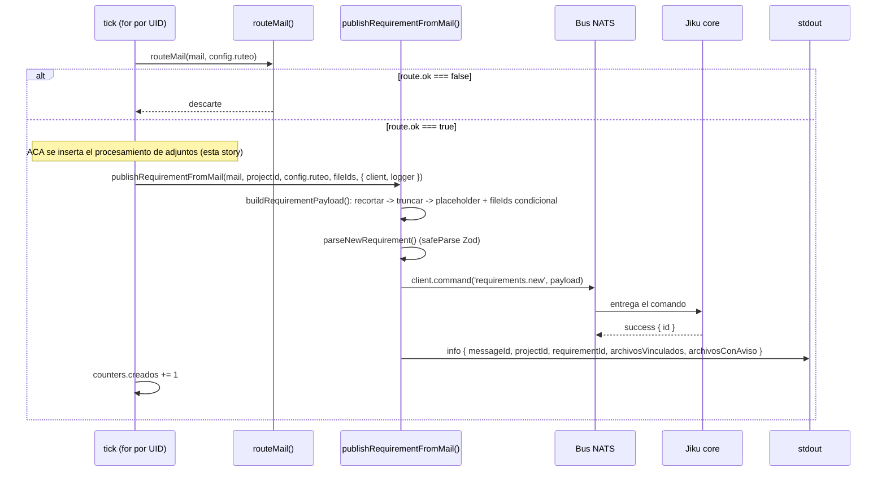

# Story Plan: S-021 (jiku-mail-connector) - Vínculo con el requisito - fileIds en el payload y cierre del ciclo

## Status

**Status:** Completed

## Story Reference

- **Story:** [S-021](../stories/S-021.vinculo-requisito-fileids-cierre-ciclo.md)
- **Service:** jiku-mail-connector
- **Summary:** Orquestar en serie, dentro del tick, el procesamiento completo de adjuntos de un mail
  (partición → dedup → tope → permiso de subida → `PUT` → composición de descripción) entre el ruteo
  y el armado del payload de `requirements.new`, agregar `fileIds` condicional al payload, y sumar el
  conteo de archivos vinculados/con aviso al log del alta exitosa. Cierra el ciclo de FG-4: ata las
  cuatro piezas puras de S-017 a S-020 al punto de publicación real.

## Architectural Context

### Tech Stack

- **Node.js** ≥ 22.12, **TypeScript** 5.x, ESM puro (`"type": "module"`).
- **Zod** para todo borde de validación (env, contratos de comando).
- **Pino** para logging estructurado, con `redact` (ver `src/shared/log-redaction.ts`).
- **`@gravadigital/jiku`** (SDK oficial) — única dependencia de acceso al bus NATS. Expone `Client`,
  `client.command()`, las clases `JikuFailure`/`JikuTimeout`/`JikuNoEndpoint`/`JikuPermissionDenied`/
  `JikuInvalidRequest`, `ErrorCode`, `isCode()`.
- **`fetch` nativo** (Node ≥ 18) + `AbortSignal.timeout()` para el `PUT` HTTPS del byte — sin
  dependencia npm nueva.
- **`node:crypto`** para el checksum sha256 (ya usado por `deduplicar()`, S-017).
- **Vitest** + **Testcontainers** (un solo NATS compartido) para tests.

### Service Architecture

**Tipo de servicio:** `worker` en Node — sin HTTP, sin base de datos propia (ver
`docs/architectures/jiku-mail-connector/manifest.yaml` y `overview.md`). Módulos: `ingesta`, `ruteo`,
`publicacion`.

**Estructura relevante para esta story:**

```
src/
  domain/
    adjuntos/
      types.ts          # AdjuntoParticionado, AdjuntoAceptado, AdjuntoRechazado, ReglaRechazo, ParticionResult
      particionar.ts    # particionar() — S-017
      dedup.ts          # deduplicar() — S-017
      tope.ts           # aplicarTope() — S-017 (MAX_ATTACHMENTS_PER_REQUIREMENT = 10)
      procesar.ts       # procesarAdjuntos() — compone las tres, S-017
    publicacion/
      files.schema.ts       # fileUploadRequestSchema / fileUploadReplySchema — S-018
      files.types.ts        # UploadResultado, parseFileUploadRequest, FileUploadValidationError — S-018
      upload-file.ts         # requestFileUpload() — publica files.request-upload, S-018
      upload-byte.ts          # uploadFileContent() — PUT directo, S-019
      description.ts          # componerDescripcion() — S-020
      mail-payload.ts          # buildRequirementPayload() — A EXTENDER en esta story
      requirement.schema.ts     # newRequirementSchema — A EXTENDER en esta story (agregar fileIds)
      requirement.types.ts       # NewRequirementPayload (z.infer) — sin cambios de código, cambia de forma
      publish-requirement.ts      # publishRequirementFromMail() — A EXTENDER (log de conteos)
      publish-errors.ts            # diagnosePublishFailure(), PublishError — SIN TOCAR (CA-6 heredado)
    ingesta/
      tick.ts            # runTick() — A EXTENDER: insertar la orquestación de adjuntos
      types.ts            # IncomingMail, MailAttachment
    ruteo/
      route-mail.ts        # routeMail() — SIN TOCAR
  config/
    index.ts          # AppConfig.adjuntos: AdjuntosConfig { allowedExtensions, allowedMimeTypes, maxSizeBytes, putTimeoutMs }
    schema.ts          # MAX_ATTACHMENTS_PER_REQUIREMENT = 10 (const, no env var)
  shared/
    log-redaction.ts    # REDACT_PATHS — NO cubre `uploadUrl` explícitamente: nunca se logueaAL CÓDIGO, no por redacción
```

**Patrón arquitectónico dominante:** funciones puras para el dominio (adjuntos, ruteo, composición),
funciones con efectos (I/O al bus, al storage) aisladas en `publicacion/` con firmas `Pick<T, ...>`
sobre los tipos de dominio, resultados tipados por unión discriminada (`tipo: 'concedido' |
'rechazado' | 'fallido'`, `tipo: 'subido' | 'fallido'`) en vez de excepciones para los caminos de
negocio — sólo se lanza para errores de programación/armado inesperados.

**Manejo de errores (patrón establecido, NO se reinventa):**

- Errores de **negocio esperados** (rechazo local, `failure` de `core`, `PUT` fallido) → **valor de
  retorno tipado**, nunca excepción. Esto es lo que permite que el `for` de la orquestación siga sin
  necesitar un `try/catch` por rama de negocio — sólo hace falta un `try/catch` alrededor de TODO el
  procesamiento de un adjunto individual, para capturar el error de **programación** inesperado que
  pide CA-6/RF-34 (ej. una excepción calculando algo, no contemplada por los tipos de retorno).
- Errores de **publicación no esperados** (fallo del SDK, timeout, permiso denegado) → `PublishError`
  clasificado por `diagnosePublishFailure()`, ya usado por `requestFileUpload()` y por
  `publishRequirementFromMail()`. Esta story NO agrega ninguna rama nueva a esa función.
- Un requisito **nunca se cancela** por un fallo de archivo: la única excepción que puede escapar de
  la orquestación de adjuntos hacia el tick es la de `publishRequirementFromMail()` (fallo de
  `requirements.new`), exactamente como hoy.

**Logging (convención `logging` + patrón heredado de S-005/S-015):**

- Primer argumento: objeto de contexto plano. Segundo: mensaje estático, sin interpolación.
- Niveles: `info` para lo esperado (rechazo local), `warn` para lo inesperado-pero-recuperable
  (rechazo de `core`, fallo de `PUT`), `error` para fallos de publicación no clasificados y errores
  de programación inesperados.
- **Nunca se loguea:** el contenido de un adjunto (`content`, ya en `REDACT_PATHS` bajo
  `attachments[*].content`), la `uploadUrl` (credencial de escritura de corta duración — **por
  disciplina de código, no está en `REDACT_PATHS`**: ningún punto de log la incluye en el objeto de
  contexto, en ningún resultado tipado de S-018/S-019), el checksum de un archivo que no se subió.

### ADR-003: Toda escritura por comandos del bus, con el byte fuera de banda

**Decisión:** Toda escritura de dominio es un comando del bus (`files.request-upload`,
`requirements.new`, ninguno más). El byte del adjunto viaja por `PUT` directo a la URL prefirmada
—nunca por el bus— porque `max_payload` de NATS es 1 MB y los adjuntos llegan a 10 MB. Se acepta una
ventana de inconsistencia sin cerrar: los archivos existen antes que el requisito, y si el alta falla
quedan huérfanos para siempre (estado válido en Jiku).

**Implementation Rules (copiadas verbatim — las que aplican a ESTA story):**

- El payload de `requirements.new` MUST incluir `title`, `description`, `projectId`, `type`,
  `priority`, `visibilityLevel`, y `fileIds` **sólo si hay al menos uno**.
- `fileIds` MUST tener a lo sumo **10** elementos (el `maxItems` del contrato). Los adjuntos
  aceptables que exceden el tope MUST anotarse como aviso en la descripción.
- El conector MUST NOT enviar `state` en `requirements.new`. MUST NOT enviar `actor` en ningún
  payload.
- El filtro local de archivos MUST tratarse como conveniencia, no como autoridad: un rechazo de
  `core` (`file_type_not_allowed`, `file_too_large`) MUST manejarse como caso esperado, con aviso en
  la descripción.
- El fallo de un adjunto (permiso o `PUT`) MUST NOT cancelar el requisito: se anota el aviso y se
  sigue.
- La descripción MUST componerse en este orden exacto: cuerpo base → avisos de rechazo → avisos de
  fallo de subida → **placeholders al final**.
- Los placeholders MUST ser `![attach:{id}]` para `image/*` y `[attach:{id}]` para el resto.
- Un requisito creado MUST NOT modificarse: no hay comando de compensación.
- Toda escritura de dominio MUST hacerse publicando un comando por el bus (ya cumplido por S-018 y la
  publicación existente de `requirements.new`; esta story no agrega ningún comando nuevo).

**Consequences relevantes:**

- **Archivos huérfanos son un estado permanente** si `requirements.new` falla después de subir
  archivos. Nadie los limpia. El conector **no lleva ninguna lista de `fileIds` abandonados**.
- **Nadie verifica el byte.** El `checksum` se declara y no se comprueba.
- El tope de 10 no es configurable: es del contrato.

### Flow Context

#### Flujo: [ruteo-y-alta-del-requisito.md](../flows/ruteo-y-alta-del-requisito.md)

**Es el flujo con más cambios de esta story.** Estado actual documentado (Pasos 1-5):

1. **Paso 1:** trigger — `IncomingMail` recién normalizado, dentro del `for` del tick.
2. **Paso 2:** `routeMail(mail, config.ruteo)` — árbol de decisión puro, nunca lanza, nunca loguea.
   Devuelve `{ ok: false, motivo, slug? }` o `{ ok: true, projectId, slug }`.
3. **Paso 3:** el descarte (`route.ok === false`) — `warn` + `counters.descartados += 1`. **Sin
   cambios en esta story.**
4. **Paso 4 (ACTUAL, a extender):** `buildRequirementPayload()` arma el payload:

   | Campo | Valor actual |
   |---|---|
   | `title` | `mail.subject.trim()` → `.slice(0, 255)` → si `''`, `placeholderTitle` |
   | `description` | `mail.body.trim()` → si `''`, `placeholderBody` |
   | `projectId` | El resuelto por `routeMail()` |
   | `type` | `'incidencia'` fijo |
   | `priority` | `'sin_prioridad'` fijo |
   | `visibilityLevel` | `'public'` fijo |
   | `creator` | `client.userId` |

   **Las tres claves siempre excluidas hoy:** `state`, `actor`, `fileIds`. **Esta story retira
   `fileIds` de esa lista de exclusión** — pasa a incluirse condicionalmente.

5. **Paso 5:** publicación con `client.command('requirements.new', payload)`, 15000 ms (default SDK,
   sin cambios), traducción de 9 ramas de diagnóstico, log de éxito
   `{ messageId, projectId, requirementId }` / log de fallo `{ messageId, ...error.logContext(projectId) }`.

**Lo que ESTA STORY inserta, entre el Paso 2 (`route.ok === true`) y el Paso 4:**

El procesamiento completo de adjuntos — partición, dedup, tope, `files.request-upload` + `PUT` por
aceptado en serie, acumulación de `fileIds` y de los tres bloques de avisos/placeholders — corre
dentro de la MISMA iteración del `for` del tick, antes de invocar `buildRequirementPayload()`.

**Paso 4 extendido (esta story):**

| Campo | Valor nuevo |
|---|---|
| `description` | Ya NO es `cuerpo.trim() → placeholder`. Pasa a ser `componerDescripcion({ cuerpoBase, avisosDeRechazo, avisosDeFallo, placeholders })` (S-020), donde `cuerpoBase` es EXACTAMENTE lo que `buildRequirementPayload()` ya calculaba (`mail.body.trim()` → placeholder si vacío) — el primer bloque no cambia de código, sólo de dónde se ensambla. |
| `fileIds` | `NUEVO`. Array de `number` (los `fileId` acumulados de cada adjunto con `tipo: 'subido'` en el `PUT`). **Se incluye la clave sólo si `fileIds.length > 0`.** Nunca `fileIds: []`. |

**Paso 5 extendido:** el log de éxito de `publishRequirementFromMail()` suma dos campos —
`archivosVinculados` (conteo de `fileIds`) y `archivosConAviso` (conteo de rechazos + fallos) — al
MISMO objeto `{ messageId, projectId, requirementId }`, sin agregar una segunda línea.

**Diagrama de secuencia actual (para orientar dónde se inserta la nueva participante):**



**Tabla de Manejo de Errores actual del flujo (referencia — SIN CAMBIOS por esta story):**

| Motivo/Diagnóstico | Nivel | Quién lo produce | Comportamiento |
|---|---|---|---|
| `es_respuesta` / `sin_slug` / `slug_no_mapeado` | `warn` | `routeMail()` | `counters.descartados += 1` |
| `rechazo_del_bus_por_subject` / `bus_sin_endpoint` | `error` | Bus NATS, vía `PublishError` | `counters.fallidos += 1`, sin reintento |
| `core_rechazo_por_rol` / `core_rechazo_por_forma` / `core_rechazo_desconocido` | `error` | `core`, vía `PublishError` | `counters.fallidos += 1`, sin reintento |
| `nada_respondio` / `respuesta_ilegible` / `desconocido` | `error` | SDK/bus, vía `PublishError` | `counters.fallidos += 1`, sin reintento |

#### Tabla de Manejo de Errores — completa para adjuntos (de REQ-004, ESTA story la implementa)

| Origen | Diagnóstico | Nivel | Comportamiento |
|---|---|---|---|
| Política local (`particionar`/`deduplicar`/`aplicarTope`) | Extensión/MIME no permitido, tamaño excedido, 0 bytes, `tope_excedido` | `info` | Aviso de rechazo, `continue` — sin publicar nada |
| `files.request-upload` → `failure` | `file_type_not_allowed` / `file_too_large` | `warn` (con `code`) | Aviso de rechazo, `continue` — síntoma de política desalineada |
| `files.request-upload` → 9 ramas de diagnóstico del SDK | Igual que `requirements.new` | `error` | Aviso de fallo de subida, `continue` — sin reintento |
| `PUT` a la URL prefirmada | Error de red, timeout 30000 ms, URL expirada | `warn` | Aviso de fallo de subida, `continue` — sin reintento, sin pedir permiso nuevo |
| Error inesperado del conector procesando un adjunto | Cualquier excepción no prevista (ej. calculando algo) | `error` | Capturado, logueado, aviso de fallo, `continue` con el próximo adjunto |
| `requirements.new` con `fileIds` | Igual que sin adjuntos (9 ramas ya documentadas) | Igual | Si falla: archivos ya subidos quedan huérfanos; el mail se cuenta `fallido` |

**En todos los casos: ningún fallo de archivo cancela el requisito, y ningún fallo de comando se
reintenta.**

#### Flujo: [publicacion-requirements-new.md](../flows/publicacion-requirements-new.md)

**Cambios acotados (referencia, no se reescribe la publicación):**

- La tabla de "Payload del tick" gana la fila `fileIds` (ya no es cierto que "no hay adjuntos en
  ninguno de los dos disparadores").
- El modo de verificación (`npm run verify`) **NO cambia**: sigue con payload fijo, sin adjuntos.
- `diagnosePublishFailure()` y `logContext()` se **reutilizan sin modificar** para
  `files.request-upload` (ya lo hace `requestFileUpload()`, S-018) y para `requirements.new` (sin
  cambios).

### Contratos exactos (de los schemas Zod existentes — NO se redeclaran tipos a mano)

**`newRequirementSchema` (`src/domain/publicacion/requirement.schema.ts`) — ANTES de esta story:**

```ts
export const newRequirementSchema = z
  .object({
    title: z.string().min(1).max(TITLE_MAX_LENGTH), // TITLE_MAX_LENGTH = 255
    description: z.string().min(1),
    projectId: z.number().int().positive(),
    type: z.enum(REQUIREMENT_TYPES),               // ['funcionalidad','mejora','incidencia','otro']
    priority: z.enum(REQUIREMENT_PRIORITIES),       // ['sin_prioridad','baja','media','alta','urgente']
    visibilityLevel: z.enum(REQUIREMENT_VISIBILITY_LEVELS), // ['public','internal']
    creator: z.string().min(1).optional(),
  })
  .strict();
```

**Esta story agrega el campo `fileIds`** (Tarea 1): `z.array(z.number().int().positive()).min(1).max(10).optional()`.
El `.min(1)` es intencional — si se incluye la clave, tiene que tener al menos un elemento; la
ausencia total de adjuntos vinculados se modela con la clave **ausente**, nunca con un array vacío
(`.strict()` del objeto ya impide claves extra, y este campo sigue siendo `.optional()`). El
`.max(10)` documenta en el propio schema el `maxItems` del contrato — mismo criterio que
`TITLE_MAX_LENGTH` para `title`.

**`fileUploadRequestSchema` / `fileUploadReplySchema` (`src/domain/publicacion/files.schema.ts`,
S-018) — SIN CAMBIOS, sólo referencia:**

```ts
// payload de files.request-upload
{ fileName: string, mimeType: string, fileSize: number, checksum: string }
// reply de éxito
{ fileId: number, uploadUrl: string }  // .loose()
```

**`UploadResultado`** (`src/domain/publicacion/files.types.ts`, S-018) — unión discriminada que
consume esta story:

```ts
type UploadResultado =
  | { tipo: 'concedido'; fileId: number; uploadUrl: string }
  | { tipo: 'rechazado'; codigo: 'file_type_not_allowed' | 'file_too_large'; nombre: string; mime: string }
  | { tipo: 'fallido'; diagnosis: PublishDiagnosis; nombre: string; mime: string };
```

**`PutResultado`** (`src/domain/publicacion/upload-byte.ts`, S-019) — unión discriminada que consume
esta story:

```ts
type PutResultado = { tipo: 'subido' } | { tipo: 'fallido' };
```

**`AdjuntoRechazado`** (`src/domain/adjuntos/types.ts`, S-017) — lo que produce `procesarAdjuntos()`:

```ts
interface AdjuntoRechazado {
  readonly nombre: string;
  readonly mime: string;
  readonly regla: 'extension' | 'mime' | 'tamano' | 'tamano_cero' | 'tope_excedido' | 'error_interno';
}
```

**`ComposicionDescripcionInput`** (`src/domain/publicacion/description.ts`, S-020) — lo que consume
`componerDescripcion()`:

```ts
interface ComposicionDescripcionInput {
  readonly cuerpoBase: string;
  readonly avisosDeRechazo: readonly string[];
  readonly avisosDeFallo: readonly string[];
  readonly placeholders: readonly string[];
}
// componerDescripcion(input) devuelve partes.filter(no-vacías).join('\n')
```

**Firmas exactas de las funciones a orquestar (ya implementadas, NO se modifican):**

```ts
// S-017
function procesarAdjuntos(
  attachments: readonly MailAttachment[],
  config: Pick<AdjuntosConfig, 'allowedExtensions' | 'allowedMimeTypes' | 'maxSizeBytes'>,
): ParticionResult<AdjuntoAceptado>; // { aceptados: AdjuntoAceptado[], rechazados: AdjuntoRechazado[] }

// S-018
function requestFileUpload(
  adjunto: Pick<AdjuntoAceptado, 'filename' | 'mimeType' | 'content' | 'checksum'>,
  deps: { client: Client; logger: Logger },
): Promise<UploadResultado>;

// S-019
function uploadFileContent(
  adjunto: Pick<AdjuntoAceptado, 'filename' | 'mimeType' | 'content'>,
  deps: { uploadUrl: string; timeoutMs: number; logger: Logger },
): Promise<PutResultado>;

// S-020
function componerDescripcion(input: ComposicionDescripcionInput): string;
```

### Integration Points

**Bus NATS (vía SDK):** ya conectado, una única conexión por proceso (`connectToBus()`, S-004). Esta
story NO abre ninguna conexión nueva, reutiliza el `client: Client` que ya llega a
`publishRequirementFromMail()`.

**Storage S3-compatible:** alcanzado únicamente vía `uploadFileContent()` (S-019), que ya resuelve el
`PUT` con `fetch` nativo. Esta story no agrega ningún cliente nuevo, sólo invoca la función existente
por cada adjunto aceptado.

**`files.request-upload` y `requirements.new`:** los dos únicos comandos permitidos (ADR-003). Esta
story no publica ningún comando nuevo — orquesta llamadas a funciones que YA publican estos dos.

### Code Conventions

- Imports absolutos con prefijo `#` nativo de Node (`#domain/...`, `#config/...`, `#shared/...`),
  extensión `.js` explícita incluso desde `.ts`. Ver convención custom `module-imports`.
- `Pick<T, 'campo1' | 'campo2'>` para firmas que no necesitan el tipo completo — patrón usado en
  TODAS las funciones de `publicacion/` y `adjuntos/` que consume esta story.
- Tipos inferidos con `z.infer`, nunca escritos a mano en paralelo al schema (convención
  `validation`).
- Resultados de negocio como unión discriminada por `tipo`, nunca excepción, para todo lo que no sea
  un error de programación o un fallo de publicación no clasificado.
- Sin barrel files (`index.ts`) en los módulos de dominio — imports directos a cada archivo, mismo
  precedente que `ruteo` y `publicacion`.
- Comentarios extensos explicando el PORQUÉ de cada decisión no evidente (estilo consistente en todo
  el repo) — no se espera prosa nueva de este volumen, pero SÍ comentarios que expliquen decisiones
  no obvias del orquestador (orden, aislamiento de fallos, invariantes).

### Reusable Code

Del catálogo (`docs/reusable-code/jiku-mail-connector/`), lo que esta story consume DIRECTAMENTE:

- **`procesarAdjuntos()`** (`src/domain/adjuntos/procesar.ts`) — compone partición → dedup → tope.
  Función pura, un solo punto de invocación para la Tarea 3.
- **`requestFileUpload()`** (`src/domain/publicacion/upload-file.ts`) — el permiso de subida, por
  adjunto. Nunca lanza para rechazo/fallo, siempre devuelve `UploadResultado`.
- **`uploadFileContent()`** (`src/domain/publicacion/upload-byte.ts`) — el `PUT`, por adjunto. Nunca
  lanza, siempre devuelve `PutResultado`.
- **`componerDescripcion()`** (`src/domain/publicacion/description.ts`) — los cuatro bloques. Pura,
  no conoce el origen de sus inputs.
- **`buildRequirementPayload()`** (`src/domain/publicacion/mail-payload.ts`) — a EXTENDER (Tarea 2),
  no a reemplazar: conserva el orden recortar → truncar → placeholder para `title`/`description`.
- **`publishRequirementFromMail()`** (`src/domain/publicacion/publish-requirement.ts`) — a EXTENDER
  (Tarea 4) con el conteo en el log, reutilizando el mismo `try/catch/log/relanza`.
- **`TITLE_MAX_LENGTH`** (`requirement.schema.ts`) — se sigue importando, nunca redeclarando.
- **`MAX_ATTACHMENTS_PER_REQUIREMENT`** (`config/schema.ts`, = 10) — referencia para entender el
  `.max(10)` del nuevo campo del schema; el tope en sí ya lo aplica `aplicarTope()` (S-017), esta
  story no lo reaplica.
- **`AppError`** (`src/shared/errors/index.ts` / `base.ts`) — base de las clases de error del
  servicio; no se usa directamente en la orquestación (que usa resultados tipados, no excepciones)
  pero es el patrón para cualquier clase de error nueva si hiciera falta (no debería hacer falta en
  esta story).
- **`REDACT_PATHS`** (`src/shared/log-redaction.ts`) — ya cubre `attachments[*].content`; la
  orquestación nueva NO debe introducir un campo de log con contenido de adjunto o `uploadUrl` que
  no pase por un objeto ya cubierto.

## Acceptance Criteria Coverage

| AC# | Descripción | Tarea(s) |
|---|---|---|
| CA-1 | Procesamiento completo insertado entre ruteo y armado del payload | Tarea 3, Tarea 4 |
| CA-2 | Adjuntos en serie, par por archivo (`request-upload` + `PUT` inmediato) | Tarea 3 |
| CA-3 | `fileIds` sólo si hay al menos uno | Tarea 1, Tarea 2 |
| CA-4 | Resto del payload de REQ-003 exactamente igual | Tarea 2 |
| CA-5 | Tope aplicado antes de subir, no se recalcula si un `PUT` falla | Tarea 3 (ya garantizado por `procesarAdjuntos()`/S-017 — la orquestación no debe reponer excedentes) |
| CA-6 | Ningún fallo de archivo cancela el requisito | Tarea 3 |
| CA-7 | Mail con todos los adjuntos fallidos es `publicado`, no `fallido`, `\Seen` no se revierte | Tarea 3, Tarea 4 (heredado del tick existente) |
| CA-8 | Archivos huérfanos son estado válido no registrado | Tarea 3 (por diseño: no se lleva ninguna lista) |
| CA-9 | Log del alta suma conteos de archivos vinculados/con aviso | Tarea 4 |
| CA-10 | Los cinco contadores del tick no cambian | Tarea 5 (verificación de propiedad) |
| CA-11 | Pico de memoria de un mail a la vez preservado | Tarea 3, Tarea 5 |
| CA-12 | Rechazo local + rechazo de `core` en mismo bloque de descripción, distintos en el log | Tarea 3 |
| CA-13 | Verificación e2e con mail real con adjuntos | Fuera de alcance de esta Tarea — documentado como verificación manual complementaria a S-022 |

## Test Scenarios

| ID | Escenario | Input | Output Esperado | AC |
|----|-----------|-------|-----------------|-----|
| TS-1 | Mail con dos adjuntos aceptables sube ambos y el payload lleva `fileIds` con los dos ids | `procesarAdjuntos()` produce 2 `aceptados` (`captura.png`, `datos.pdf`); `requestFileUpload()` y `uploadFileContent()` devuelven éxito para ambos (`fileId: 101`, `fileId: 102`) | payload de `requirements.new` incluye `fileIds: [101, 102]`; `description` termina con `![attach:101]\n[attach:102]` | CA-1, CA-3 |
| TS-2 | Mail sin adjuntos no incluye `fileIds` | `mail.attachments = []` | `Object.keys(payload)` NO contiene `'fileIds'`; `description` es exactamente `mail.body.trim()` (o el placeholder) sin bloques extra | CA-3, CA-4 |
| TS-3 | Mail con todos los adjuntos rechazados no incluye `fileIds` aunque haya avisos | `mail.attachments` con 1 adjunto `.exe` (rechazado localmente) | payload NO incluye `'fileIds'`; `description` incluye el aviso de rechazo de `virus.exe` | CA-3 |
| TS-4 | El resto del payload (`title`, `type`, `priority`, `visibilityLevel`, ausencia de `state`/`actor`) no cambia con adjuntos presentes | Mail con 1 adjunto aceptado y subido | `payload.type === 'incidencia'`, `payload.priority === 'sin_prioridad'`, `payload.visibilityLevel === 'public'`, `'state' in payload === false`, `'actor' in payload === false` | CA-4 |
| TS-5 | Adjuntos se procesan en serie: `request-upload` de A seguido inmediatamente de su `PUT`, antes del `request-upload` de B | Mail con 2 adjuntos aceptados, `client.command` y `fetch` instrumentados para registrar el orden de invocación | Orden observado: `request-upload(A)`, `PUT(A)`, `request-upload(B)`, `PUT(B)` — nunca `request-upload(A)`, `request-upload(B)`, `PUT(A)`, `PUT(B)` | CA-2 |
| TS-6 | Tope de 12 aceptables únicos con 3 `PUT` fallidos entre los primeros 10: el requisito lleva 7 `fileIds`, sin reponer los 2 excedentes | 12 adjuntos únicos aceptables; `aplicarTope()` acepta los primeros 10 y rechaza los últimos 2 (`tope_excedido`); de los 10, el `PUT` de 3 falla | `fileIds.length === 7`; `description` tiene 3 avisos de fallo de subida + 2 avisos de exceso; ningún `files.request-upload` publicado para los 2 excedentes | CA-5 |
| TS-7 | Rechazo local no cancela el requisito: el mail se cuenta `creado` | Mail con 1 adjunto `.exe` (rechazado por política local) y cuerpo `No puedo entrar` | El requisito se crea (`publishRequirementFromMail()` resuelve `{ requirementId }`); `counters.creados += 1`; `description` incluye el aviso de rechazo | CA-6, CA-7 |
| TS-8 | `failure` de `core` en `files.request-upload` (`file_type_not_allowed`) no cancela el requisito | Adjunto que pasa el filtro local; `requestFileUpload()` devuelve `{ tipo: 'rechazado', codigo: 'file_type_not_allowed', nombre, mime }` | El requisito se crea igual; `description` incluye el aviso de rechazo (mismo bloque que los locales); el log de ESE adjunto es `warn` con `code: 'file_type_not_allowed'` (ya lo emite `requestFileUpload()`) | CA-6, CA-12 |
| TS-9 | `PUT` fallido no cancela el requisito | Adjunto con permiso concedido; `uploadFileContent()` devuelve `{ tipo: 'fallido' }` | El requisito se crea igual, sin el `fileId` de ese adjunto; `description` incluye el aviso de fallo de subida (bloque distinto del de rechazo) | CA-6 |
| TS-10 | Error inesperado del conector procesando un adjunto (excepción no contemplada por los tipos de retorno) no cancela el requisito ni detiene el procesamiento de los siguientes | Un doble de `requestFileUpload()` (o de una función interna del orquestador) que lanza una excepción arbitraria para un adjunto | El error se captura dentro del `try/catch` de ESE adjunto, se loguea `error`, el adjunto queda con aviso de fallo, y el SIGUIENTE adjunto del mismo mail se procesa igual (su `fileId`, si corresponde, aparece en `fileIds`) | CA-6 |
| TS-11 | Mail cuyos adjuntos fallaron TODOS es `publicado`, no `fallido` | 2 adjuntos: uno rechazado localmente, otro con `PUT` fallido | `counters.creados += 1` (no `fallidos`); el mail permanece `\Seen` (ya lo puso la normalización, sin revertir) | CA-7 |
| TS-12 | Archivos huérfanos: `requirements.new` falla después de subir 3 archivos | 3 adjuntos suben con éxito (`fileId: 201, 202, 203`); `client.command('requirements.new', payload)` lanza (ej. `JikuTimeout`) | `publishRequirementFromMail()` relanza `PublishError`; el tick cuenta el mail como `fallidos += 1`; el conector NO publica ningún comando de compensación ni loguea una lista de `fileIds` abandonados más allá del `PublishError` ya logueado | CA-8 |
| TS-13 | Log del alta exitosa suma `archivosVinculados` y `archivosConAviso` en la MISMA línea | Mail con 3 adjuntos: 1 subido, 1 rechazado local, 1 fallo de `PUT` | Una única línea `info` `'requisito creado en Jiku'` con `{ messageId, projectId, requirementId, archivosVinculados: 1, archivosConAviso: 2 }` — no una segunda línea | CA-9 |
| TS-14 | Los cinco contadores del tick no ganan un sexto contador de archivos | Tick con 10 mails: 7 crean requisito (uno con 3 adjuntos, 1 fallido de archivo), 2 descartados, 1 fallido | La línea `'tick completado'` tiene exactamente `{ ingestados, parseados, creados: 7, descartados: 2, fallidos: 1 }` — sin ninguna clave adicional de archivos | CA-10 |
| TS-15 | Pico de memoria de un mail a la vez se preserva con los `Buffer` de adjuntos | Test de propiedad: inspeccionar que ningún array a nivel de `runTick()` acumula `Buffer`/`content` de adjuntos de mails distintos simultáneamente | Los `Buffer` de los adjuntos de un mail se liberan (quedan sin referencias vivas) al terminar esa iteración del `for`, antes de procesar el siguiente UID | CA-11 |
| TS-16 | Rechazo local (`info`) y rechazo de `core` (`warn` + `code`) en el mismo mail van al mismo bloque de descripción pero se distinguen en el log | Mail con un `.exe` (rechazo local) y un adjunto que pasa el filtro local pero `core` rechaza con `file_too_large` | `description` tiene AMBOS avisos en el bloque de rechazos (sin distinguir origen); el log tiene una línea `info` para el primero y una línea `warn` con `code: 'file_too_large'` para el segundo | CA-12 |
| TS-17 | Extensión del schema: `fileIds` con 11 elementos es rechazado por `parseNewRequirement()` | `buildRequirementPayload()` recibe (hipotéticamente, vía test directo del schema) un array de 11 números | `newRequirementSchema.safeParse({...payload, fileIds: [1..11]}).success === false` | CA-3 (integridad del contrato) |
| TS-18 | `uploadUrl` nunca aparece en ninguna línea de log de la orquestación completa | Mail con 1 adjunto subido con éxito; capturar TODAS las líneas de log emitidas durante el procesamiento | Ninguna línea serializada contiene la URL prefirmada devuelta por `requestFileUpload()` | CA-6 (heredado de ADR-003/RF-23) |

## Tasks

### Task 1: Extender el contrato de `requirements.new` con `fileIds`

**Status:** Completed

#### Description

Agregar el campo `fileIds` (opcional, array de enteros positivos, entre 1 y 10 elementos) al schema
Zod `newRequirementSchema`. Este es el primer paso porque todo lo demás (armado del payload,
orquestación) depende de que el tipo `NewRequirementPayload` (inferido con `z.infer`) ya contemple el
campo. Sin este paso, el compilador rechazaría cualquier intento de incluir `fileIds` en el objeto
armado por `buildRequirementPayload()`.

#### Acceptance Criteria

1. `newRequirementSchema` gana el campo `fileIds: z.array(z.number().int().positive()).min(1).max(10).optional()`.
2. El schema sigue siendo `.strict()` — ninguna otra clave desconocida se acepta.
3. `NewRequirementPayload` (en `requirement.types.ts`) refleja el nuevo campo automáticamente vía
   `z.infer` — no se declara un tipo paralelo a mano.
4. Un payload con `fileIds: []` (array vacío) es RECHAZADO por el schema (`.min(1)`): la ausencia de
   adjuntos vinculados se modela con la CLAVE ausente, nunca con un array vacío.
5. Un payload con `fileIds` de 11 elementos es RECHAZADO (`.max(10)`).
6. Un payload SIN la clave `fileIds` sigue siendo válido (sigue siendo `.optional()`) — no rompe
   ningún test existente de `buildVerificationPayload()`/modo de verificación.

#### Technical Details

**Architectural Context References:**
- ADR-003, Implementation Rule: "`fileIds` MUST tener a lo sumo 10 elementos".
- Sección "Contratos exactos" de este plan — el schema ANTES y el campo a agregar.
- Convención `validation`: tipos siempre inferidos con `z.infer`, nunca escritos a mano.

**Files to Create/Modify:**
- `src/domain/publicacion/requirement.schema.ts` — agregar el campo al `.object({...})`, con un
  comentario explicando por qué `.min(1)` (la clave ausente es la representación de "cero
  adjuntos", no un array vacío) y por qué `.max(10)` (documenta el `maxItems` del contrato en el
  propio schema, mismo criterio que `TITLE_MAX_LENGTH`).
- `src/domain/publicacion/requirement.types.ts` — sin cambios de código (el tipo se infiere solo),
  pero revisar que ningún comentario quede desactualizado sobre "seis campos" (pasan a ser siete).

**Implementation Notes:**
- NO agregar `.default()` al campo — mismo criterio que los enums: el schema modela el contrato de
  `core`, no la política del conector. La condicionalidad de incluir la clave es responsabilidad del
  llamador (Tarea 2), no del schema.
- Verificar que ningún otro archivo (p. ej. `verification-payload.ts`) necesite tocarse: el modo de
  verificación sigue sin adjuntos, y un payload sin `fileIds` sigue siendo válido porque el campo es
  opcional.

**Dependencies:**
- Ninguna interna nueva. Zod ya es dependencia del proyecto.

#### Testing Requirements

**Unit Tests:**
- `fileIds` con 1, 5, 10 elementos → válido.
- `fileIds` con 0 elementos (`[]`) → inválido.
- `fileIds` con 11 elementos → inválido.
- `fileIds` ausente → válido (retro-compatibilidad con el modo de verificación y con mails sin
  adjuntos).
- Un payload con una clave desconocida adicional (p. ej. `actor`) sigue siendo rechazado por
  `.strict()` (test de regresión, ya existente — confirmar que sigue pasando).

**Integration Tests:**
- Ninguno específico de esta tarea — la integración real la cubren las Tareas 3 y 4.

**Manual Testing:**
- Ninguno.

#### Task Dependencies
**Blocked by:** Ninguna
**Blocks:** Task 2, Task 3, Task 4
**Can run in parallel with:** N/A

---

### Task 2: Extender `buildRequirementPayload()` con `fileIds` condicional

**Status:** Completed

#### Description

Modificar `buildRequirementPayload()` (`mail-payload.ts`) para aceptar un array opcional de
`fileIds` ya acumulados por el llamador (la orquestación de la Tarea 3) e incluirlo en el objeto
devuelto SÓLO cuando tiene al menos un elemento. El resto de la función —`title`/`description` con
el orden recortar → truncar → placeholder, `type`/`priority`/`visibilityLevel` fijos, `creator`— NO
cambia de comportamiento observable (CA-4).

**Importante:** en esta tarea el parámetro `description` sigue siendo el `cuerpoBase` simple (el
comportamiento actual). La composición de los CUATRO bloques con `componerDescripcion()` la arma el
llamador (Tarea 4, dentro de `publishRequirementFromMail()` o en el punto de armado del payload) —
esta función NO debe importar `componerDescripcion()` ni conocer avisos/placeholders: seguiría
siendo un problema de una sola responsabilidad (armar el payload desde piezas ya resueltas), igual
que hoy.

#### Acceptance Criteria

1. `buildRequirementPayload()` recibe un nuevo parámetro (p. ej. `fileIds: readonly number[]`, con
   default `[]` o explícito según se decida en implementación) además de `mail`, `projectId`,
   `userId`, `ruteoConfig`.
2. Si `fileIds.length > 0`, el objeto devuelto incluye `fileIds: [...fileIds]` (copia, no la
   referencia mutable).
3. Si `fileIds.length === 0`, el objeto devuelto NO incluye la clave `fileIds` en absoluto (no
   `fileIds: undefined`, no `fileIds: []`) — verificable con `'fileIds' in payload === false` o
   `Object.keys(payload)`.
4. `title`, `description` (cuerpo simple), `type`, `priority`, `visibilityLevel`, `creator` se
   comportan EXACTAMENTE igual que antes de esta story — mismos tests existentes de
   `mail-payload.test.ts` siguen pasando sin modificar sus aserciones sobre esos campos.
5. El comentario del archivo que dice "`fileIds` NO va, FG-4 lo incorpora" se actualiza para
   reflejar que esta story YA lo incorpora.

#### Technical Details

**Architectural Context References:**
- ADR-003: "`fileIds` sólo si hay al menos uno" — Implementation Rule ya copiada en Architectural
  Context.
- CA-3, CA-4 de la story.
- Reusable Code: `buildRequirementPayload()` ya documentado en el índice de código reutilizable —
  esta tarea lo EXTIENDE, no lo reemplaza.

**Files to Create/Modify:**
- `src/domain/publicacion/mail-payload.ts` — agregar el parámetro y el spread condicional
  (`...(fileIds.length > 0 ? { fileIds: [...fileIds] } : {})`), siguiendo el mismo patrón de objeto
  armado por partes que ya usa la función (aunque hoy no tiene ninguna clave condicional: sería la
  primera).

**Implementation Notes:**
- Patrón recomendado para la construcción condicional (consistente con cómo `route.ts`/`tick.ts` ya
  arman objetos con claves condicionales — ver el `...(route.slug !== undefined ? { slug: route.slug } : {})`
  de `tick.ts`): usar spread condicional sobre un objeto base, nunca `delete payload.fileIds` después
  de asignarlo.
- El orden de propiedades en el objeto literal no importa para la validación de Zod ni para
  `JSON.stringify` semánticamente, pero mantener `fileIds` como último campo del objeto (después de
  `creator`) por legibilidad, ya que es el más nuevo.

**Dependencies:**
- Depende de Task 1 (el tipo `NewRequirementPayload` debe ya tener `fileIds` opcional para que el
  compilador acepte incluirlo).

#### Testing Requirements

**Unit Tests:**
- `buildRequirementPayload(mail, projectId, userId, ruteoConfig, [101, 102])` produce
  `payload.fileIds === [101, 102]`.
- `buildRequirementPayload(mail, projectId, userId, ruteoConfig, [])` produce un payload SIN la
  clave `fileIds` (`'fileIds' in payload === false`).
- Con `fileIds` no vacío, `title`/`description`/`type`/`priority`/`visibilityLevel`/`creator` no
  cambian respecto del comportamiento sin adjuntos (mismo mail, mismos valores esperados).
- El array pasado como `fileIds` no es mutado por la función, y el array devuelto en el payload no
  es la misma referencia (para evitar aliasing accidental si el llamador sigue mutando su array
  local después).

**Integration Tests:**
- Ninguno específico — se cubre en Task 4 con la orquestación real.

**Manual Testing:**
- Ninguno.

#### Task Dependencies
**Blocked by:** Task 1
**Blocks:** Task 4
**Can run in parallel with:** Task 3

---

### Task 3: Orquestador del procesamiento de adjuntos por mail

**Status:** Completed

#### Description

Crear la función que orquesta, para UN mail, el procesamiento completo de sus adjuntos: invoca
`procesarAdjuntos()` (S-017) para obtener aceptados/rechazados; para cada aceptado, EN SERIE y en el
orden del mail, invoca `requestFileUpload()` (S-018) inmediatamente seguido de `uploadFileContent()`
(S-019) si el permiso fue concedido; acumula los `fileId` de los subidos exitosamente junto con su
placeholder (`![attach:{id}]` para `image/*`, `[attach:{id}]` para el resto — el MIME a usar para
esta decisión es el MIME del propio adjunto, es decir `adjunto.mimeType`, no el declarado en la
respuesta del bus); acumula los avisos de rechazo (locales + `failure` de `core`, mismo bloque, texto
distinguible) y los avisos de fallo de subida (`PUT` fallido + fallo de publicación de
`files.request-upload`) en dos listas separadas.

Esta es la pieza NUEVA central de la story: ninguna de las cuatro dependencias (S-017 a S-020) sabe
nada de las otras ni del ciclo completo — esta función es la que las conecta, y es la que tiene la
responsabilidad exclusiva de:
- El aislamiento de fallos por adjunto (CA-6, RF-34): un `try/catch` alrededor de TODO el
  procesamiento de un adjunto individual (no sólo de las llamadas al bus) para capturar cualquier
  error de programación inesperado (ej. una excepción calculando algo) sin abortar el `for`.
- Preservar el orden "par por archivo" (CA-2): nunca pedir todos los permisos primero.
- No reponer excedentes cuando un `PUT` falla (CA-5): el tope ya lo aplicó `aplicarTope()`, esta
  función NO vuelve a tocar la lista de `topeado.rechazados` con motivo `tope_excedido` para
  intentar subir uno en lugar de un fallido.
- Traducir cada `AdjuntoRechazado` (de `particionar()`/`deduplicar()`/`aplicarTope()`) y cada
  variante `rechazado`/`fallido` de `UploadResultado`/`PutResultado` a un texto de aviso concreto,
  nombrando el archivo (RF-31: "los dos nombran el archivo").
- Distinguir en el LOG (no en la descripción) un rechazo local (`info`) de un rechazo de `core`
  (`warn` + `code`) — CA-12, RF-40. El log de la rama local (`particionar()`) NO existe todavía en
  ningún módulo previo (S-017 es puro y no loguea nada) — ESTA función es quien logea por primera
  vez cada `AdjuntoRechazado` con nivel `info`.

#### Acceptance Criteria

1. Existe una función (p. ej. `procesarAdjuntosDelMail()`) en `src/domain/publicacion/` que recibe:
   los `attachments: readonly MailAttachment[]` del mail, la config de adjuntos (`Pick<AdjuntosConfig,
   'allowedExtensions' | 'allowedMimeTypes' | 'maxSizeBytes' | 'putTimeoutMs'>`), y las dependencias
   `{ client: Client; logger: Logger }` — mismo criterio de inyección por parámetro que el resto de
   `publicacion/`.
2. Devuelve una estructura con: `fileIds: number[]` (en el orden en que se subieron con éxito),
   `avisosDeRechazo: string[]`, `avisosDeFallo: string[]`, `placeholders: string[]` — lista para
   pasar directo a `componerDescripcion()` (junto con el `cuerpoBase` que arma el llamador) y a
   `buildRequirementPayload()`.
3. Invoca `procesarAdjuntos(attachments, config)` UNA sola vez, al principio.
4. Para cada `AdjuntoRechazado` de la partición/dedup/tope: agrega un aviso de rechazo nombrando el
   archivo (con su `nombre`) a `avisosDeRechazo`, y loguea `info` con `{ nombre, mime, regla }` (o
   equivalente) — nivel `info` porque es el funcionamiento esperado del filtro local (RF-6, RF-40).
   Nota: un `AdjuntoRechazado` con `regla: 'tope_excedido'` también entra por este camino (mismo
   bloque de rechazos, RF-13).
5. Para cada `AdjuntoAceptado` dentro del tope, EN SERIE y en el orden de `topeado.aceptados`:
   a. Invoca `requestFileUpload(adjunto, { client, logger })`.
   b. Si el resultado es `tipo: 'rechazado'` (RF-17, `core` rechaza por política): agrega un aviso
      de rechazo (mismo bloque que los locales, texto distinguible por contenido si se desea, pero
      MISMO bloque de la descripción) — el log `warn` con `code` ya lo emitió `requestFileUpload()`
      internamente, esta función NO vuelve a loguearlo.
   b'. Si el resultado es `tipo: 'fallido'` (fallo de publicación del comando): agrega un aviso de
       FALLO de subida (bloque distinto del de rechazo) — el log `error` ya lo emitió
       `requestFileUpload()` internamente.
   c. Si el resultado es `tipo: 'concedido'`: invoca INMEDIATAMENTE
      `uploadFileContent(adjunto, { uploadUrl: resultado.uploadUrl, timeoutMs:
      config.putTimeoutMs, logger })`, ANTES de pasar al siguiente adjunto.
      - Si `tipo: 'subido'`: acumula `resultado.fileId` en `fileIds`, y agrega el placeholder
        correspondiente (`![attach:{id}]` si `adjunto.mimeType` empieza con `image/`, si no
        `[attach:{id}]`) a `placeholders`.
      - Si `tipo: 'fallido'`: agrega un aviso de FALLO de subida nombrando el archivo (el log `warn`
        ya lo emitió `uploadFileContent()` internamente).
6. Cualquier excepción NO prevista por los tipos de retorno de `requestFileUpload()`/
   `uploadFileContent()`, lanzada mientras se procesa UN adjunto (dentro del `try` que envuelve ese
   adjunto), se captura, se loguea `error` (sin exponer el contenido del adjunto), agrega un aviso
   de FALLO de subida nombrando el archivo, y el `for` CONTINÚA con el siguiente adjunto — nunca
   escapa de la función (CA-6, RF-34).
7. La función NUNCA lanza para un resultado de negocio (rechazo, fallo de archivo) — siempre
   devuelve. La única forma de que algo escape hacia el llamador es un bug de programación fuera del
   alcance de los `try/catch` descritos (no debería ocurrir con la implementación correcta).
8. Ningún array de esta función retiene referencias al `content: Buffer` de un adjunto más allá de
   lo necesario para el `PUT` de ESE adjunto — no se construye ninguna lista de "adjuntos
   procesados" con su `content` adjunto (CA-11).
9. La función es invocada UNA vez por mail, nunca acumula estado entre invocaciones (sin variables
   de módulo, sin caché) — respeta que no hay dedup entre mails (RF-9).

#### Technical Details

**Architectural Context References:**
- ADR-003 completo — en particular las Implementation Rules sobre `fileIds` condicional, orden
  determinístico de la descripción, y que un requisito creado no se modifica.
- Tabla de Manejo de Errores — completa para adjuntos (sección Flow Context de este plan): cada fila
  mapea 1:1 a una rama de esta función.
- Firmas exactas de `procesarAdjuntos()`, `requestFileUpload()`, `uploadFileContent()` — copiadas
  verbatim en la sección "Contratos exactos".
- REQ-004 RF-21 (par por archivo), RF-12/criterio 18 (tope no se recalcula), RF-31/RF-32 (dos
  clases de aviso, ambas nombran el archivo), RF-38/RF-39/RF-40 (qué se loguea de un adjunto y en
  qué nivel).

**Files to Create/Modify:**
- `src/domain/publicacion/procesar-adjuntos-mail.ts` (nuevo archivo — nombre sugerido; ajustar si el
  desarrollador encuentra una convención de nombres más consistente con el resto de `publicacion/`,
  p. ej. alineado con `upload-file.ts`/`upload-byte.ts`) — la función orquestadora y su tipo de
  retorno (p. ej. `ProcesamientoAdjuntosResultado`).
- `src/domain/adjuntos/types.ts` — NO modificar (los tipos de S-017 ya están completos para esta
  tarea); sólo importar `AdjuntoAceptado`, `AdjuntoRechazado`, `ReglaRechazo`.

**Implementation Notes:**
- El texto exacto de cada aviso (p. ej. `"No se pudo adjuntar {nombre}: tipo de archivo no
  permitido"` vs `"No se pudo subir {nombre}: error al subir el archivo"`) es una decisión de
  implementación libre dentro de la restricción funcional: cada aviso DEBE nombrar el archivo, y las
  dos clases (rechazo/fallo) deben ser distinguibles por el lector humano de la descripción (RF-31).
  No hay una redacción fijada por REQ-004 más allá de esa restricción — mantener consistencia con el
  tono ya usado en los comentarios del repo (español, directo).
- El placeholder usa `adjunto.mimeType` — el MISMO campo que ya decidió `particionar()`/`deduplicar()`
  (el declarado, nunca inferido del contenido) — no un campo nuevo de la respuesta del bus.
- Verificar el prefijo de MIME de imagen con `.startsWith('image/')`, no una lista cerrada de
  extensiones — cualquier `image/*` declarado cuenta (RF-30 dice explícitamente "los `image/*`").
- El orden de iteración sobre `topeado.aceptados` es el que YA produce `procesarAdjuntos()` (orden
  del mail, ya filtrado y topeado) — no reordenar, no usar `Promise.all`/`allSettled` en ningún
  punto (CA-2, ADR-001).
- Para el log de rechazo local (`info`), usar el mismo shape de campos que ya usa
  `requestFileUpload()` para su rechazo `warn` (`nombre`, `mime`, más el campo específico —
  `regla` en vez de `code`), por consistencia de lectura entre ambos niveles.

**Dependencies:**
- `procesarAdjuntos()` (`#domain/adjuntos/procesar.js`).
- `requestFileUpload()` (`#domain/publicacion/upload-file.js`).
- `uploadFileContent()` (`#domain/publicacion/upload-byte.js`).
- NO importa `componerDescripcion()` directamente — esta función devuelve las piezas
  (`avisosDeRechazo`, `avisosDeFallo`, `placeholders`, `fileIds`); quien invoca
  `componerDescripcion()` con el `cuerpoBase` es el llamador de Task 4 (para mantener a esta función
  enfocada exclusivamente en el ciclo de vida del adjunto, no en el ensamblado final del texto).

#### Testing Requirements

**Unit Tests:**
- TS-1 (dos adjuntos aceptables, ambos suben, `fileIds` con ambos ids, placeholders en orden).
- TS-5 (orden par-por-archivo: `request-upload(A)` → `PUT(A)` → `request-upload(B)` → `PUT(B)`, con
  espías/mocks sobre `client.command` y `fetch` que registran el orden de invocación).
- TS-6 (tope de 12 con 3 `PUT` fallidos: 7 `fileIds`, sin reponer los 2 excedentes, 3 avisos de
  fallo + 2 avisos de exceso).
- TS-8 (rechazo de `core` via `files.request-upload` `failure` → aviso de rechazo, mismo bloque que
  local).
- TS-9 (`PUT` fallido → aviso de fallo, requisito no afectado por esta función en sí).
- TS-10 (excepción inesperada de un doble de `requestFileUpload()` para un adjunto → capturada,
  aviso de fallo, el SIGUIENTE adjunto se procesa igual).
- TS-16 (rechazo local + rechazo de `core` en el mismo mail: mismo bloque, log distinto por nivel y
  código).
- TS-18 (ninguna línea de log de esta función incluye `uploadUrl`).
- Adjunto `image/png` produce placeholder `![attach:{id}]`; adjunto `application/pdf` produce
  `[attach:{id}]`.
- Cero adjuntos (`attachments: []`) produce `{ fileIds: [], avisosDeRechazo: [], avisosDeFallo: [],
  placeholders: [] }` — todas las listas vacías, ninguna llamada al bus ni al storage.

**Integration Tests:**
- Contra el NATS real del contenedor compartido (mismo patrón que `upload-file.ts`/`upload-byte.ts`
  ya usan en sus propios tests): un mail con 1-2 adjuntos reales, `core` doblado con `respondTo()`
  para `files.request-upload`, y un servidor HTTP de prueba (mismo criterio que ya use
  `upload-byte.test.ts` para el `PUT`) para el storage.

**Manual Testing:**
- Ninguno específico de esta tarea — se cubre en la Tarea 5/S-022 con el mail real.

#### Task Dependencies
**Blocked by:** Task 1 (indirectamente, vía el tipo de payload que consumirá el resultado)
**Blocks:** Task 4
**Can run in parallel with:** Task 2

---

### Task 4: Cablear la orquestación en el tick y extender el log del alta

**Status:** Completed

#### Description

Insertar la invocación del orquestador de la Tarea 3 dentro del flujo existente, entre
`routeMail()` resolviendo `route.ok === true` y la llamada a `publishRequirementFromMail()` (que a
su vez llama a `buildRequirementPayload()`). Extender `publishRequirementFromMail()` (o el punto
exacto donde se arma el payload final) para: (a) componer la `description` final con
`componerDescripcion()` usando el `cuerpoBase` ya calculado + las tres listas del orquestador, (b)
pasar los `fileIds` acumulados a `buildRequirementPayload()`, y (c) sumar `archivosVinculados` y
`archivosConAviso` al log de éxito existente.

Esta es la tarea de integración final: ata Task 2 (payload extendido) y Task 3 (orquestador) al
punto de publicación real, preservando el resto del comportamiento de `tick.ts` intacto (CA-1: el
procesamiento ocurre dentro de la MISMA iteración del mail, antes del armado del payload).

#### Acceptance Criteria

1. En `src/domain/ingesta/tick.ts`, dentro de la rama `route.ok === true` del `for`, ANTES de
   invocar la publicación del alta, se invoca el orquestador de adjuntos de la Tarea 3 sobre
   `mail.attachments` y `config.adjuntos`.
2. El resultado del orquestador (fileIds, avisos, placeholders) se usa para armar el `cuerpoBase`
   (igual que hoy: `mail.body.trim()` → placeholder si vacío) y componer la `description` final con
   `componerDescripcion({ cuerpoBase, avisosDeRechazo, avisosDeFallo, placeholders })` — ANTES de
   invocar `buildRequirementPayload()`/`parseNewRequirement()`.
3. `publishRequirementFromMail()` (o la función que arma el payload) recibe `fileIds` y la
   `description` ya compuesta, y los usa para construir el payload final (vía la
   `buildRequirementPayload()` extendida en Task 2 — ajustar la firma de
   `publishRequirementFromMail()` si hace falta pasar estos dos datos adicionales).
4. El log de éxito de `publishRequirementFromMail()` (`'requisito creado en Jiku'`) suma
   `archivosVinculados: fileIds.length` y `archivosConAviso: avisosDeRechazo.length +
   avisosDeFallo.length` al MISMO objeto `{ messageId, projectId, requirementId }` — sin agregar una
   segunda línea de log.
5. El log de FALLO de `publishRequirementFromMail()` (`'fallo la publicacion de requirements.new'`)
   NO cambia — no se le agrega ningún dato de adjuntos (los archivos ya subidos, si el alta falla,
   quedan huérfanos sin registro adicional, CA-8).
6. `counters.creados`/`counters.fallidos`/`counters.descartados` del tick NO ganan ningún campo
   nuevo relacionado con archivos — la línea `'tick completado'` sigue teniendo exactamente los
   cinco contadores (CA-10).
7. Si `publishRequirementFromMail()` falla DESPUÉS de que el orquestador ya subió archivos, el
   comportamiento es idéntico al actual: `counters.fallidos += 1`, sin publicar ningún comando de
   compensación, sin loguear una lista de `fileIds` huérfanos (CA-8).
8. El resto del comportamiento de `runTick()` (cap, orden, marcado `\Seen`, aislamiento de fallos
   por mail, los cinco contadores, el `finally` que siempre emite la línea de métricas) permanece
   sin cambios de comportamiento observable.

#### Technical Details

**Architectural Context References:**
- Flow Context → Flujo `ruteo-y-alta-del-requisito.md`, Paso 4 extendido (tabla de campos) y el
  diagrama de secuencia con la nota "ACA se inserta el procesamiento de adjuntos".
- ADR-003 Implementation Rules ya copiadas.
- Reusable Code: `publishRequirementFromMail()`, `runTick()` — funciones existentes a EXTENDER, no
  reimplementar; mismo criterio de inyección de dependencias por parámetro.
- CA-9 y RF-38 de la story: "es la MISMA línea, no una adicional".

**Files to Create/Modify:**
- `src/domain/ingesta/tick.ts` — insertar la invocación del orquestador dentro del `for`, antes de
  `publishRequirementFromMail(...)`. Revisar los comentarios existentes que documentan por qué el
  alta ocurre "dentro de esta misma iteración" (líneas ya presentes) para que sigan siendo exactos
  con el nuevo paso intermedio.
- `src/domain/publicacion/publish-requirement.ts` — extender `publishRequirementFromMail()` (firma y
  cuerpo) para recibir `fileIds` y la `description` ya compuesta (o recibir las piezas crudas y
  componerla adentro — decisión de implementación, manteniendo el principio de una sola
  responsabilidad clara), y sumar los dos campos al log de éxito.
- `src/domain/publicacion/mail-payload.ts` — ningún cambio adicional más allá de Task 2 (ya cubre el
  `fileIds` condicional).

**Implementation Notes:**
- Dónde vive exactamente la llamada a `componerDescripcion()` es una decisión de implementación:
  puede vivir en `tick.ts` (junto a la llamada al orquestador) o dentro de
  `publishRequirementFromMail()` (recibiendo las piezas crudas). Cualquiera de las dos es aceptable
  siempre que: (a) `buildRequirementPayload()` siga sin conocer `componerDescripcion()` (Task 2 la
  deja intacta salvo por `fileIds`), y (b) el `cuerpoBase` usado sea EXACTAMENTE
  `mail.body.trim()` → placeholder si vacío — el mismo cálculo que hoy hace
  `buildRequirementPayload()` internamente para `description` (no se debe duplicar ESA lógica de
  placeholder de cuerpo vacío en dos lugares divergentes; extraerla a una función compartida si hace
  falta reusar el cálculo en dos puntos).
- El log de éxito sigue viviendo DENTRO de `publishRequirementFromMail()` (mismo criterio que hoy:
  "el logueo va en ESTA función y no en el entry point"), nunca en `tick.ts`.
- No modificar `diagnosePublishFailure()` ni `logContext()` (CA-6 de S-018, heredado).

**Dependencies:**
- Task 2 (payload con `fileIds` condicional).
- Task 3 (el orquestador que produce `fileIds`/avisos/placeholders).
- `componerDescripcion()` (`#domain/publicacion/description.js`, S-020) — se importa por primera vez
  en el camino real (hoy sólo lo usan sus propios tests).

#### Testing Requirements

**Unit Tests:**
- TS-2, TS-3, TS-4 (payload sin `fileIds` en los casos correspondientes, resto del payload intacto).
- TS-13 (log de éxito con los dos conteos nuevos, misma línea).
- TS-7, TS-11 (fallos de archivo no cancelan el requisito, mail contado como `creado`).

**Integration Tests:**
- TS-1, TS-6, TS-12 contra el NATS real del contenedor compartido, con `respondTo()` doblando
  `core` para ambos comandos y un servidor HTTP de prueba para el `PUT` — mismo patrón que
  `test/ingesta/tick.test.ts` y `test/publicacion/publish-from-mail.test.ts` ya usan.
- Un test de extremo a extremo DENTRO de `runTick()` (no sólo de `publishRequirementFromMail()`
  aislado) que confirme que el flujo completo —descarga, ruteo, adjuntos, alta— corre en una sola
  iteración del `for`, con un mail de fixture que trae adjuntos reales.

**Manual Testing:**
- Ninguno — cubierto por Task 5 (verificación e2e complementaria a S-022).

#### Task Dependencies
**Blocked by:** Task 2, Task 3
**Blocks:** Task 5
**Can run in parallel with:** N/A

---

### Task 5: Tests de propiedad — aislamiento de fallos, memoria, contadores y no-fuga de secretos

**Status:** Completed

#### Description

Agregar los tests de propiedad que verifican las invariantes transversales de la story, del mismo
estilo que ya usan `test/*/source-properties.test.ts` en el resto del repo (escaneo de fuentes /
aserciones estructurales, no sólo comportamiento puntual): que los cinco contadores del tick no
ganaron un sexto; que el pico de memoria de un mail a la vez se preserva con los `Buffer` de
adjuntos; que ninguna línea de log, en ningún camino (éxito, rechazo, fallo), incluye la `uploadUrl`
o el contenido crudo de un adjunto; y que un mail cuyos adjuntos fallaron todos se cuenta `creado`,
nunca `fallido`.

Esta tarea cierra la story verificando las propiedades que las Tareas 3 y 4 dejan como
comportamiento pero que ameritan una aserción de propiedad explícita, dado el historial del repo de
usar tests de propiedad para invariantes de seguridad/memoria (ver `test/*/source-properties.test.ts`
existentes para `config`, `bus`, `ingesta`, `publicacion`).

#### Acceptance Criteria

1. Existe un test (o extensión de uno existente) que confirma que la línea `'tick completado'` tiene
   EXACTAMENTE las cinco claves `{ ingestados, parseados, creados, descartados, fallidos }`, sin
   ninguna clave adicional, incluso en un tick con mails con adjuntos.
2. Existe un test que confirma que ninguna línea de log capturada durante el procesamiento de un
   mail con adjuntos (camino de éxito, rechazo o fallo) contiene la substring de una `uploadUrl` de
   prueba conocida, ni el contenido (`Buffer`) de un adjunto.
3. Existe un test que confirma que un mail cuyos adjuntos fallaron TODOS resulta en
   `counters.creados += 1` (no `counters.fallidos`), y que el mail queda `\Seen`.
4. Existe un test (de propiedad o de inspección de fuente, según el patrón que ya use el repo para
   "pico de memoria") que confirma que ningún array a nivel de `runTick()`/el orquestador acumula
   `content`/`Buffer` de adjuntos de MÁS DE UN mail simultáneamente.
5. Todos los tests de propiedad existentes (`test/*/source-properties.test.ts`) que escanean el
   código fuente para invariantes generales (ej. "un solo punto de invocación de `client.command`
   para `requirements.new`") siguen pasando sin modificación, o se actualizan explícitamente si el
   escaneo necesita conocer los archivos nuevos de la Tarea 3.

#### Technical Details

**Architectural Context References:**
- CA-10, CA-11 de la story (contadores, memoria).
- ADR-006 (observabilidad por logs) — ningún log filtra contenido de cliente ni credenciales.
- Reusable Code: `test/adjuntos/source-properties.test.ts`, `test/bus/source-properties.test.ts`,
  `test/config/source-properties.test.ts`, `test/publicacion/source-properties.test.ts` — patrón ya
  establecido de tests de propiedad por módulo; esta tarea puede extender el de `publicacion` o
  crear uno propio si la propiedad es específica de la orquestación nueva.

**Files to Create/Modify:**
- `test/ingesta/tick-memory.test.ts` — ya existe (de S-016); extender con el caso de adjuntos si
  aplica, en vez de crear un archivo nuevo.
- `test/ingesta/tick-redaction.test.ts` — ya existe; extender con la aserción de no-fuga de
  `uploadUrl`/contenido de adjunto.
- `test/publicacion/source-properties.test.ts` — ya existe; revisar si necesita conocer el archivo
  nuevo del orquestador (Task 3).
- Un archivo nuevo bajo `test/publicacion/` o `test/ingesta/` para las propiedades específicas de
  adjuntos si no encajan naturalmente en los archivos existentes (nombre a decidir en
  implementación, siguiendo la convención `*-properties.test.ts` o `*-memory.test.ts` ya usada).

**Implementation Notes:**
- Para la propiedad de memoria, el repo ya tiene precedente en `test/ingesta/tick-memory.test.ts`
  (S-016) — revisar su técnica exacta (probablemente inspección de heap o de referencias vivas, o un
  test estructural sobre el código fuente) antes de inventar una nueva.
- Para la propiedad de no-fuga de `uploadUrl`, usar `createLogCapture()` (ya en el catálogo de test
  helpers) para capturar TODAS las líneas emitidas durante un procesamiento con adjuntos y hacer un
  `grep` de la URL de prueba sobre las líneas serializadas (`raw()`).

**Dependencies:**
- Task 3, Task 4 (el código cuyo comportamiento se está verificando debe existir).
- `createLogCapture()` (`test/shared/log-capture.ts`).

#### Testing Requirements

**Unit Tests:**
- TS-14 (cinco contadores, sin sexto).
- TS-15 (memoria, un mail a la vez).
- TS-18 (no fuga de `uploadUrl`).

**Integration Tests:**
- TS-11 (mail con adjuntos todos fallidos → `creado`, `\Seen`) contra el NATS real si la propiedad
  requiere el ciclo completo de publicación.

**Manual Testing:**
- Ninguno — la verificación manual e2e con mail real (CA-13) es explícitamente responsabilidad de
  S-022, no de esta story (ver Dependencias de la story: "Esta verificación manual complementa —no
  reemplaza— la que S-022 formaliza").

#### Task Dependencies
**Blocked by:** Task 4
**Blocks:** Ninguna (última tarea de esta story)
**Can run in parallel with:** N/A
